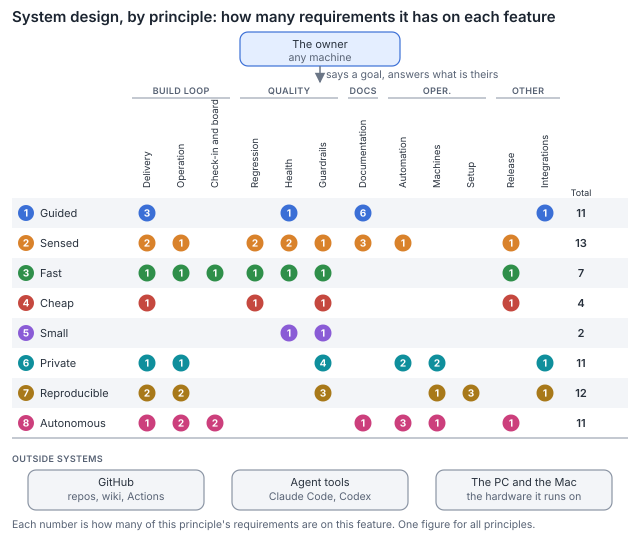
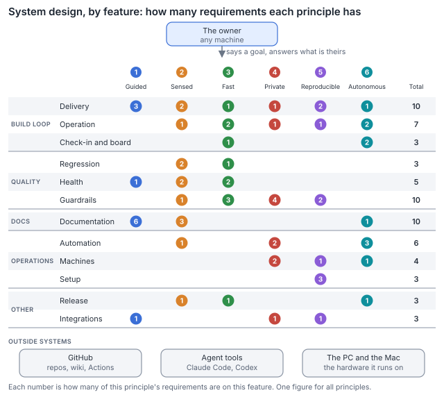

# agent-workflow-template

<!-- template:begin -->
Built with the [Charlie-org146/agent-workflow-template](https://github.com/Charlie-org146/agent-workflow-template) workflow loop.
<!-- template:end -->

[The wiki](https://github.com/Charlie-org146/agent-workflow-template/wiki/Home) has the features, how to use each one, the settings and what runs by itself. The eight sections below are the project's principles, each with the requirements that enforce it and a flow diagram for each, then every requirement with its complete text by feature; [the Principles page](https://github.com/Charlie-org146/agent-workflow-template/wiki/Principles) has each in full, with its diagram and requirements.

## What this is

Principle 1, Guided · Topic: Delivery · Release: v1.1.0 Milestone: [v1.1.0 dry run](https://github.com/Charlie-org146/agent-workflow-template/milestone/34) ### Problem Two features described the goal round: DEL-19 with the old steps, and a new step-log draft with a different list. There should be one. Nothing recorded each step, so the same problems repeated and nobody could see which step cost most. ### Requirements DEL-19.1 **A goal is one change, in one fixed file format:** title, the task it serves, done lines (each "Given … when … then …"), what it touches, and its release. It's frozen when it starts, and its done lines never change after that. **Metric.** Goals missing a part, or whose done lines changed after the freeze. Target 0. **Test.** Freezing a goal with no task named, or editing a frozen done line, is refused. DEL-19.2 **Every goal runs one list of steps:** freeze, plan, build, quick checks, tests, merge, after the merge, release. Every feature, report and the board use this list, and main changes only through a goal's merge. **Metric.** Places that name a step outside the list, and commits on main from no goal. Target 0. **Test.** A report naming a step not on the list fails the docs check; a direct push to main is refused. DEL-19.3 **Every step is logged:** start, end, minutes, tokens and result. When a step goes wrong (refused, failed, over its time limit or redone), the log says what happened and why, in plain words. **Metric.** Steps with no log entry, and wrong steps with no cause. Target 0. **Test.** After a toy goal merges, its log has one entry per step; a step refused twice shows both refusals quoted with a cause. DEL-19.4 **Each cause gets one suggested fix,** to a tool, a setting or a feature, filed once, linked to its step and grouped with the same cause seen again. Every release shows a per-step summary, worst first. A fix is applied only through the normal routes: a bug fix, or your review if it changes a feature. **Metric.** Repeat causes filed more than once; releases without the step summary. Target 0. **Test.** Two goals hitting the same refusal produce one issue with both linked; the release record lists each step's time and failures. DEL-19.5 **The goal format and the steps are drawn on one page, generated from the code,** so the picture can't drift from what runs. **Metric.** Differences between the drawn steps and the code. Target 0. **Test.** Add a step to the code without regenerating, and the docs check fails. ### Reference adopted [GitHub merge queue](https://docs.github.com/en/repositories/configuring-branches-and-merges-in-your-repository/configuring-pull-request-merges/managing-a-merge-queue). adapted [trunk-based development](https://trunkbaseddevelopment.com/). adapted [Google SRE: blameless postmortems](https://sre.google/sre-book/postmortem-culture/).

In harness-engineering terms, the loop is the **harness** around the agents: everything except the model. The principles and requirements are its **guides**, which steer the agents before they act. Tests, health, CI, the merge queue and the reviewer are its **sensors**, which check what the agents produced.

## System design

How the loop sits between its owner, its parts and the outside systems it uses; every principle below is judged against it.

## 1. Guided: documentation-driven and standard

The principles and requirements are my guardrails and the only part I write, and each one follows a named industry standard, adopted wherever one can run. The agents implement the code, tests and pages from them, so I never deal with implementation details. Nothing is built that a Reviewed requirement doesn't ask for, and tests come from the requirements.

| Requirement | Summary | Follows | Feature | Adoption | Confidence |
|---|---|---|---|---|---|
| [DOC-2 Only I write the principles and requirements; the repo copy is the PRD (absorbs DOC-22, DOC-20, INT-7, INT-2)](https://github.com/Charlie-org146/agent-workflow-template/wiki/Documentation) ([DOC-2 flow](docs/wiki/flows/DOC-2.svg)) | Each principle's sentence, its table and every requirement's text are written only by me. An agent may draft and propose; only my own words make it the text, and only my words mark it Reviewed. Goals never edit Reviewed text while building. A change is a dated, approved revision; old revisions are kept and IDs are never reused. The repo copy is the PRD: an outside document may sync into it but never overrides it, and checks read only the repo. | - [GitHub CODEOWNERS with required review](https://docs.github.com/en/repositories/managing-your-repositorys-settings-and-features/customizing-your-repository/about-code-owners): adapted - [OpenGitOps](https://opengitops.dev/): adapted | Documentation (Docs), Integrations (Other) | 0% | 100% (15 of 15) |
| [DEL-19 One change, one goal, one list of steps, every step logged](https://github.com/Charlie-org146/agent-workflow-template/wiki/Delivery) ([DEL-19 flow](docs/wiki/flows/DEL-19.svg)) | A goal is one change, in one fixed file format: title, the task it serves, done lines (each "Given … when … then …"), what it touches, and its release. It's frozen when it starts, and its done lines never change after that. Every goal runs one list of steps: freeze, plan, build, quick checks, tests, merge, after the merge, release. Every feature, report and the board use this list, and main changes only through a goal's merge. Every step is logged: start, end, minutes, tokens and result. When a step goes wrong (refused, failed, over its time limit or redone), the log says what happened and why, in plain words. Each cause gets one suggested fix, to a tool, a setting or a feature, filed once, linked to its step and grouped with the same cause seen again. Every release shows a per-step summary, worst first. A fix is applied only through the normal routes: a bug fix, or your review if it changes a feature. The goal format and the steps are drawn on one page, generated from the code, so the picture can't drift from what runs. | - [GitHub merge queue](https://docs.github.com/en/repositories/configuring-branches-and-merges-in-your-repository/configuring-pull-request-merges/managing-a-merge-queue): adopted - [trunk-based development](https://trunkbaseddevelopment.com/): adapted - [Google SRE: blameless postmortems](https://sre.google/sre-book/postmortem-culture/): adapted | Delivery (Build loop) | 33% | 100% (6 of 6) |
| [DOC-25 Every page has the same fixed sections, and README and Home match (absorbs DOC-1's page shapes)](https://github.com/Charlie-org146/agent-workflow-template/wiki/Documentation) ([DOC-25 flow](docs/wiki/flows/DOC-25.svg)) | The README and the wiki Home have exactly these sections, in order: What this is, System design, one section per principle, Requirements by feature. Every principle table has the columns shown here, including Adoption and Confidence, and each principle's heading shows both for the whole principle. Health generates the two scores; no one types them. Every wiki page has the sections of its kind. Every requirement row links to its own workflow figure. Generated sections stay current. | - [markdownlint MD043](https://github.com/DavidAnson/markdownlint/blob/v0.33.0/doc/md043.md): adapted - [Diátaxis](https://diataxis.fr/): adapted - [C4 system context diagram](https://en.wikipedia.org/wiki/C4_model): adapted | Documentation (Docs) | 0% | 100% (36 of 36) |
| [DOC-26 Each principle's requirements are dense and fully covering (new)](https://github.com/Charlie-org146/agent-workflow-template/wiki/Documentation) ([DOC-26 flow](docs/wiki/flows/DOC-26.svg)) | A new need is written into an existing requirement before a new one is added. | - [Google re:Work OKR guide, three to five objectives](https://rework.withgoogle.com/guides/set-goals-with-okrs/steps/set-objectives-and-key-results/) (checked at build): adapted | Documentation (Docs) | 0% | not measured: no data yet |
| [DEL-21 Every requirement names what it follows and adopts a standard tool by default, scored (absorbs DOC-24)](https://github.com/Charlie-org146/agent-workflow-template/wiki/Delivery) ([DEL-21 flow](docs/wiki/flows/DEL-21.svg)) | Every requirement names a specific tool, standard or production system, links its source, and gives each one a tag: adopted, adapted or own. General guidance is not a reference. A drop-in tool is used as it is; adapted names the design it copies and why. The adoption score is shown per requirement, per principle and overall. The target is 50%, and I set it. Every goal that adds or rewrites a requirement first checks whether a tool can be adopted. A change that lowers the score needs my words. | - [MADR decision records](https://adr.github.io/madr): adapted - [OpenSSF Scorecard](https://github.com/ossf/scorecard): adapted | Delivery (Build loop), Documentation (Docs), Health (Quality) | 0% | 100% (1 of 1) |
| [DEL-23 Tasks: a brief I write once and freeze, run as goals](https://github.com/Charlie-org146/agent-workflow-template/wiki/Delivery) ([DEL-23 flow](docs/wiki/flows/DEL-23.svg)) | A task starts from a short brief I write: its name, the feature it serves, what it's for in my words, and its done-when lines. My typed word freezes it, and a frozen brief can't be edited. A change means a new task that replaces it. I can add a task at any time. It goes on one task list with its name, state (queued, running, waiting, done or replaced), the goals it produced and its ETA. A task doesn't need a release to exist. Tasks are independent of each other. A task that needs another one finished names it, and doesn't start before that one is done. Two tasks that touch the same files can both build; the second merges up before its tests. A task runs as one or more goals, using the goal loop (DEL-19). It's done when every done-when line in its brief is met and all its goals have merged. The board shows each task by name, with its goals under it. | - [Shape Up: the pitch](https://basecamp.com/shapeup): adapted | Delivery (Build loop) | 0% | not measured: no data yet |
| [DOC-27 The new standard: every feature is one unit you can review](https://github.com/Charlie-org146/agent-workflow-template/wiki/Documentation) ([DOC-27 flow](docs/wiki/flows/DOC-27.svg)) | **Promise.** Every feature is small enough to understand, shows how you'd know it works, and is marked Reviewed only by your own typed words. | - [ISO/IEC/IEEE 29148, characteristics of a requirement](https://www.iso.org/standard/72089.html): adapted - [GitHub code owners and required reviews](https://docs.github.com/en/repositories/managing-your-repositorys-settings-and-features/customizing-your-repository/about-code-owners): adapted | Documentation (Docs) | 0% | not measured: no data yet |
| [DOC-28 Releases: a frozen release brief picks the tasks for a cut](https://github.com/Charlie-org146/agent-workflow-template/wiki/Documentation) ([DOC-28 flow](docs/wiki/flows/DOC-28.svg)) | Three kinds of release, each with one job. A major is a clean-up (no open issues, an empty known-red list, health green). A minor adds what its brief names. A patch fixes bugs only. Version numbers follow the kind. *As today's DOC-28.1.* Before a major or minor, I write a release brief and freeze it. It names the tasks in the cut, in order, plus what it's about and what "done" means. A frozen brief can't be edited. A release contains exactly the tasks its brief names. A task that adds a feature merges to main only once a frozen release brief names it. Until then it builds and waits, ready. A bug-fix task merges at any time and ships as a patch. The cut happens when every task in the brief is done, in the brief's order, and the gate for its kind passes. The tag records the tasks it contains. The brief stays as the release's record: what shipped, and each task's result. | - [Semantic Versioning 2.0.0](https://semver.org/): adopted - [Shape Up: the betting table](https://basecamp.com/shapeup): adapted | Documentation (Docs) | 50% | not measured: no data yet |

Adoption: 10% (the average of this principle's rows).

**How it works:** I write or approve the text and nothing else can change it. A goal must name a Reviewed requirement and its step of the loop, or the freeze refuses it. The docs check runs on every pull request and fails wrong sections, a row with no figure, or scores that differ from health's latest run.

## 2. Sensed: enforced, verified and honest

Every principle and requirement is enforced by the loop's own machinery, and everything the loop says is verified. Tests, health, CI, the merge queue, the routines and a fresh-context reviewer check each one. Every claim carries its evidence and clock time. Every ETA is a commitment, and a miss stays recorded with its cause. Whatever falls short becomes tracked work until it is fixed.

| Requirement | Summary | Follows | Feature | Adoption | Confidence |
|---|---|---|---|---|---|
| [REG-4 Every requirement has its tests, written and run one way, with honest results (absorbs REG-1, REG-9 and their folded rows)](https://github.com/Charlie-org146/agent-workflow-template/wiki/Regression) ([REG-4 flow](docs/wiki/flows/REG-4.svg)) | Every Reviewed requirement, whole flow and fixed issue has its kind of test: requirement, flow or defect. A requirement with no passing test shows "not enforced". One format, and one command runs them everywhere. **The table has one row per test script and requirement**; a row runs every case of its script for that requirement. A test counts as proven only after it was seen failing. A flaky test is marked, never silently retried. A fix leaves a defect test behind. Coverage comes from main's full run and never drops silently. **No test stays parked:** a known-red row needs an open issue and a fix goal, and a major release needs the known list empty. | - [Gherkin](https://docs.cucumber.io/gherkin/): adapted - [Nx `affected`](https://nx.dev/ci/features/affected): adapted - [Google flaky-test handling](https://testing.googleblog.com/2016/05/flaky-tests-at-google-and-how-we.html); pytest `xfail(strict=True)`: adapted | Regression (Quality), Documentation (Docs) | 0% | 100% (50 of 50) |
| [HLT-2 Health checks every rule, every principle and every page (absorbs HLT-1, DOC-13, HLT-3, HLT-6, GRD-9, HLT-13, GRD-1, DOC-1's checks)](https://github.com/Charlie-org146/agent-workflow-template/wiki/Health) ([HLT-2 flow](docs/wiki/flows/HLT-2.svg)) | Health is deterministic and read-only: twelve fixed rule groups, each rule proven able to fire, one report with a verdict per principle; what it couldn't read is never shown green. It checks each page's template, each principle's row count, every requirement's reference and tag, and every claim, ETA and correction. The scheduled health routine computes the Adoption and Confidence scores, and the docs render writes them into the tables. A fresh-context reviewer is a gate, not a report: it checks the live operation on a fixed cadence, every plan before build, and every report that claims done. **Release rules run before merge when they are fast:** every release rule that can be checked from the files alone (file count, sizes, disclosure) also runs in the pull request check, only while it keeps every merge within the 3-minute target. | - [OpenSSF Scorecard](https://github.com/ossf/scorecard): adapted - [Open Policy Agent](https://cncf.io/announcements/2021/02/04/cloud-native-computing-foundation-announces-open-policy-agent-graduation/): adapted - [IEEE 1012 independent verification](https://standards.ieee.org/ieee/1012/7324): adapted; [GitHub required status checks](https://docs.github.com/en/repositories/configuring-branches-and-merges-in-your-repository/managing-protected-branches/about-protected-branches): adopted | Health (Quality), Documentation (Docs), Guardrails (Quality), Operation (Build loop) | 33% | 100% (32 of 32) |
| [HLT-4 Every finding is one tracked issue until settled (absorbs REG-5, DEL-14, HLT-5, HLT-8, HLT-9, HLT-10, HLT-12)](https://github.com/Charlie-org146/agent-workflow-template/wiki/Health) ([HLT-4 flow](docs/wiki/flows/HLT-4.svg)) | Each finding, failing test and unfixed goal finding is one evidenced issue on its feature's Backlog milestone, triaged with my words and planned into goals. A wrong statement, a missed ETA or a skipped gate is a finding too: corrected where it was made, logged with what was said, what was true, the cause and the action. Health counts them. | - [GitHub Issues and milestones](https://docs.github.com/en/issues/using-labels-and-milestones-to-track-work/about-milestones): adopted - [Google SRE postmortem action items](https://research.google/pubs/pub45906/): adopted | Health (Quality), Regression (Quality), Delivery (Build loop) | 100% | 100% (24 of 24) |
| [DEL-1 One sentence runs unattended to a release, and a major ships only through the gate (absorbs DEL-4, REL-9 to REL-11, REL-14, REL-3 and its folded rows)](https://github.com/Charlie-org146/agent-workflow-template/wiki/Delivery) ([DEL-1 flow](docs/wiki/flows/DEL-1.svg)) | A sentence and its done lines run unattended to a recorded pull request and a release made from a tag. A merge is refused only for the goal's own findings, never left half done. A major exists only after the gate: milestone closed, full suite run, health green, everything Reviewed. Promotion and revert need the operation session and my words. | - [GitHub merge queue](https://docs.github.com/en/repositories/configuring-branches-and-merges-in-your-repository/configuring-pull-request-merges/managing-a-merge-queue), [tag release workflow](https://docs.github.com/en/repositories/releasing-projects-on-github/managing-releases-in-a-repository), [Semantic Versioning](https://semver.org/): adopted - [SonarQube quality gates](https://docs.sonarsource.com/sonarqube-server/2025.4/quality-standards-administration/managing-quality-gates/introduction-to-quality-gates): adapted - the sentence-to-PR pipeline: own | Delivery (Build loop), Release (Other) | 33% | 100% (39 of 39) |
| [AUT-1 Routines run on schedule, by runbook (absorbs AUT-2, AUT-3, DOC-16)](https://github.com/Charlie-org146/agent-workflow-template/wiki/Automation) ([AUT-1 flow](docs/wiki/flows/AUT-1.svg)) | Health and regression run on schedule wherever they can run fully. They report where they ran and what they skipped, catch up missed runs, and follow runbooks. | - [GitHub Actions `schedule`](https://docs.github.com/en/actions/reference/workflows-and-actions/events-that-trigger-workflows): adopted - [Google SRE on-call playbooks](https://sre.google/workbook/on-call/): adapted | Automation (Operations), Documentation (Docs) | 50% | 100% (12 of 12) |

Adoption: 43% (the average of this principle's rows).

**How it works:** every pull request runs its affected tests in CI. The merge queue runs a fixed smoke on the merged result before main moves; it took 11 seconds on its first run at 03:17 (the Mac's reading). Health runs on schedule and before every release, opens one issue per finding, and writes the scores. The reviewer runs every 15 minutes and on every plan and done claim.

## 3. Fast

Every change runs on one clock from my ask to main, and every step keeps a time limit set in settings.

| Requirement | Summary | Follows | Feature | Adoption | Confidence |
|---|---|---|---|---|---|
| [DEL-17 Fast end to end: every step has a time limit, and lead time is measured per step](https://github.com/Charlie-org146/agent-workflow-template/wiki/Delivery) ([DEL-17 flow](docs/wiki/flows/DEL-17.svg)) | Every step on DEL-19's list has a time limit in settings, with template defaults, and a repo may change them. The checks themselves (health, the docs check, the board) also have limits. Lead time is measured per step and per goal, from my ask to main, and shown on the board. A step over its limit shows as missed with its cause, and the next step starts at once; no step waits silently. Every ETA is a commitment: who made it, when and on what basis, and a passed one shows as missed. ETAs come from measured history, not guesses. No release while main is known broken. Merges go on; the first push after main is green again releases everything since. | - [DORA four keys](https://dora.dev/guides/dora-metrics-four-keys/): adapted - [Google SRE: service level objectives](https://sre.google/sre-book/service-level-objectives/): adapted | Delivery (Build loop) | 0% | 100% (27 of 27) |
| [DEL-22 Fast plans: a goal's plan is ready in a set time and never stalls on a tool fault](https://github.com/Charlie-org146/agent-workflow-template/wiki/Delivery) ([DEL-22 flow](docs/wiki/flows/DEL-22.svg)) | Every goal gets one plan level, by fixed rules. When a goal is frozen, the tool gives it a level from one list of levels, using rules it can check on its own, for example how many files it touches and whether it changes what a feature promises. The level and the rule that chose it are recorded, and the board shows them. Each level's needs and time limit are settings. For each level, a setting says what its plan must include and how long it may take. The template ships default values, and a repo may change them in its settings. Past its limit, the plan step says so and the board shows it as missed with its cause. A plan's reviews run side by side, and the plan is ready when the slowest finishes. A tool fault never stops a goal. When the planning tool refuses for a reason that isn't the goal's own (a record it can't read, an old file that's gone), the step takes the tool's own fallback at once. It quotes the refusal word for word in the goal's record and opens one issue. No one has to start a session or type words. The guard itself is never bypassed or changed. The fallback is the route the tool offers, and you approve it once in the release's brief. Each plan records the minutes and tokens of every review it ran. The board shows them, and a review past twice its usual is flagged. | - [DORA four keys, lead time for changes](https://dora.dev/guides/dora-metrics-four-keys/): adapted - [Circuit breaker (Martin Fowler)](https://martinfowler.com/bliki/CircuitBreaker.html): adapted | Delivery (Build loop) | 0% | not measured: no data yet |
| [DEL-25 Fast build and checks: quick checks before every push, no local test lane](https://github.com/Charlie-org146/agent-workflow-template/wiki/Delivery) ([DEL-25 flow](docs/wiki/flows/DEL-25.svg)) | Quick checks run before every push through the standard pre-commit framework: lint, the docs check and the private-name scan. The quick checks finish within their limit, default 1 minute. No full test lane runs on the machine. Tests run on GitHub (DEL-26). A machine runs a lane only when GitHub is unavailable. Generated files are made the same way every time and checked, never rewritten at PR time, so opening a PR never changes the version that was tested. | - [pre-commit](https://pre-commit.com/): adopted - [trunk-based development](https://trunkbaseddevelopment.com/): adapted | Delivery (Build loop) | 50% | not measured: no data yet |
| [DEL-26 Fast tests: on GitHub, in parallel, only what the change reaches, results reused](https://github.com/Charlie-org146/agent-workflow-template/wiki/Delivery) ([DEL-26 flow](docs/wiki/flows/DEL-26.svg)) | Tests run as parallel jobs on GitHub, split so each job finishes within its limit. A PR runs only the tests its change reaches, chosen by the standard affected-test method, and never fewer than that. Results for unchanged inputs are reused from the cache, never re-run. A test cut for time, or not run, fails the checks and names the test and its time. Green means every chosen test ran and passed. Nothing private goes to GitHub: no private-name list and no secrets; CI uses the empty list. | - [GitHub Actions matrix jobs](https://docs.github.com/en/actions/using-jobs/using-a-matrix-for-your-jobs): adopted - [actions/cache](https://github.com/actions/cache): adopted - [test impact analysis](https://martinfowler.com/articles/rise-test-impact-analysis.html): adapted | Delivery (Build loop) | 67% | 100% (4 of 4) |
| [DEL-27 Fast merge: the full tests run once, on the merged result, through the merge queue](https://github.com/Charlie-org146/agent-workflow-template/wiki/Delivery) ([DEL-27 flow](docs/wiki/flows/DEL-27.svg)) | A PR opens within its limit, default 1 minute, and any number of goals can open PRs at once. A green PR enters the merge queue at once, and the queue tests several PRs together on the merged result. The full test set never blocks a merge; the PR runs the quick set and the tests its change reaches, and only those block. The full set runs on main after merges, and a red full run opens one issue. From green to main within its limit, default 10 minutes, and a merge never makes another ready PR re-test. | - [GitHub merge queue](https://docs.github.com/en/repositories/configuring-branches-and-merges-in-your-repository/configuring-pull-request-merges/managing-a-merge-queue): adopted | Delivery (Build loop) | 100% | not measured: no data yet |

Adoption: 43% (the average of this principle's rows).

**How it works:** the merge queue enforces "ready to main" today: four merges tonight took between 50 seconds and 2 min 39 s. The 5-minute CI is being built now. Health prints each step's time and tokens for the last 20 changes and fails a step over its limit.

## 4. Cheap

Every step, task and release has a token budget from its measured usual, and I can see what each one cost.

| Requirement | Summary | Follows | Feature | Adoption | Confidence |
|---|---|---|---|---|---|
| [DEL-28 Every step has a token budget](https://github.com/Charlie-org146/agent-workflow-template/wiki/Delivery) ([DEL-28 flow](docs/wiki/flows/DEL-28.svg)) | **Tokens:** each step has a budget from its measured usual; past twice that it is flagged; waiting is done in a script. [DEL-28] | - not named yet: planned | - | 0% | not measured: no data yet |

Adoption: 0% (the average of this principle's rows).

**How it works:** the merge queue enforces "ready to main" today: four merges tonight took between 50 seconds and 2 min 39 s. The 5-minute CI is being built now. Health prints each step's time and tokens for the last 20 changes and fails a step over its limit.

## 5. Small

Nothing in our rules caps the size of a script, page or test table; the marketplace's own package rules still apply, and a change is never hidden by reformatting.

| Requirement | Summary | Follows | Feature | Adoption | Confidence |
|---|---|---|---|---|---|
| [GRD-20 Our rules set no size limits; the marketplace's package rules still apply (absorbs HLT-11)](https://github.com/Charlie-org146/agent-workflow-template/wiki/Guardrails) ([GRD-20 flow](docs/wiki/flows/GRD-20.svg)) | The marketplace's package rules stay as they are: 200 files, 5,000,000 bytes and 20 KB per packaged script. Reformatting a whole file only to hide a change is refused. | - [Agensi packaging rules](https://www.agensi.io): adopted - [ESLint `max-lines`](https://eslint.org/docs/rules/max-lines): adapted | Guardrails (Quality), Health (Quality) | 50% | 100% (2 of 2) |

Adoption: 50% (the average of this principle's rows).

**How it works:** the merge queue enforces "ready to main" today: four merges tonight took between 50 seconds and 2 min 39 s. The 5-minute CI is being built now. Health prints each step's time and tokens for the last 20 changes and fails a step over its limit.

## 6. Private and guarded

No private name, path, address or key leaves the machine, and automation gets only the access it needs.

| Requirement | Summary | Follows | Feature | Adoption | Confidence |
|---|---|---|---|---|---|
| [DEL-9 Nothing private is committed, shipped or copied (absorbs GRD-3, AUT-6, MCH-9)](https://github.com/Charlie-org146/agent-workflow-template/wiki/Delivery) ([DEL-9 flow](docs/wiki/flows/DEL-9.svg)) | Every commit, push and pull request passes the scoped private-name scan. Private files, the mail address and keys stay local and are never copied. | - [gitleaks](https://github.com/gitleaks/gitleaks): adopted - [GitHub push protection](https://docs.github.com/en/code-security/concepts/secret-security/push-protection): adopted - [GitGuardian](https://www.gitguardian.com/) on the organization: adopted | Delivery (Build loop), Guardrails (Quality), Automation (Operations), Machines (Operations) | 100% | 100% (11 of 11) |
| [GRD-4 Every session and automation gets least access (absorbs OPS-7, AUT-9, MCH-11, MCH-6)](https://github.com/Charlie-org146/agent-workflow-template/wiki/Guardrails) ([GRD-4 flow](docs/wiki/flows/GRD-4.svg)) | A worker touches only its own goal's state and cannot widen its files or budget, or resume itself. Check-ins never edit, commit or push. Each routine declares allow and deny rules and keeps its prompt locally. | - [GitHub Actions `permissions`](https://docs.github.com/en/actions/writing-workflows/choosing-what-your-workflow-does/controlling-permissions-for-github_token): adopted - [NIST SP 800-53 AC-6](https://csrc.nist.gov/CSRC/media/Projects/risk-management/800-53%20Downloads/800-53r5/SP_800-53_v5_1-derived-OSCAL.pdf), [Kubernetes RBAC](https://kubernetes.io/docs/reference/access-authn-authz/rbac/): adapted | Guardrails (Quality), Operation (Build loop), Automation (Operations), Machines (Operations) | 50% | 100% (14 of 14) |
| [GRD-5 Nothing is written outside without explicit say (absorbs INT-4)](https://github.com/Charlie-org146/agent-workflow-template/wiki/Guardrails) ([GRD-5 flow](docs/wiki/flows/GRD-5.svg)) | GitHub writes preview by default and need `--live`. Integrations read by default and write only behind a switch and an accepted delta. I attach connectors myself. | - [GitHub environments with required reviewers](https://docs.github.com/en/actions/reference/workflows-and-actions/deployments-and-environments): adapted | Guardrails (Quality), Integrations (Other) | 0% | 100% (5 of 5) |
| [GRD-6 Base branch and hooks cannot be bypassed (absorbs GRD-16)](https://github.com/Charlie-org146/agent-workflow-template/wiki/Guardrails) ([GRD-6 flow](docs/wiki/flows/GRD-6.svg)) | The base branch refuses direct and force pushes and merges only through the merge queue on required checks, with no bypass. Hook-skipping commits are refused and flagged. | - [GitHub rulesets with merge queue and required checks](https://docs.github.com/en/repositories/configuring-branches-and-merges-in-your-repository/managing-rulesets/available-rules-for-rulesets): adopted - [pre-commit](https://pre-commit.com/): adopted | Guardrails (Quality) | 100% | 100% (1 of 1) |

Adoption: 62% (the average of this principle's rows).

**How it works:** GitHub enforces these, not our code. The ruleset "Main" refuses direct pushes, and GitGuardian and push protection scan every push. The private-name scan runs in the pre-commit hook and in CI.

## 7. Reproducible, portable and adoptable

The same inputs give the same result on any machine, in any repo and on any agent. Any repo adopts the template cleanly, plugs into other systems through adapters, and survives a failure without losing work.

| Requirement | Summary | Follows | Feature | Adoption | Confidence |
|---|---|---|---|---|---|
| [SET-10 One versioned package; every agent runs one loop (absorbs DEL-16, SET-3)](https://github.com/Charlie-org146/agent-workflow-template/wiki/Setup) ([SET-10 flow](docs/wiki/flows/SET-10.svg)) | One versioned skills package works out of the box in Claude Code and Codex. Steps map to agents, with a warned fallback and recorded tokens. A private setting maps each step and goal size to an agent profile. | - [Semantic Versioning 2.0.0](https://semver.org/): adopted - [Agent Skills format](https://agentskills.io/): adopted | Setup (Operations), Delivery (Build loop) | 100% | 100% (10 of 10) |
| [MCH-1 Any machine sets up identically, and work moves between them safely (absorbs MCH-2, MCH-10, MCH-7, DEL-12, GRD-18, MCH-4, MCH-8, OPS-15, DEL-7, MCH-3)](https://github.com/Charlie-org146/agent-workflow-template/wiki/Machines) ([MCH-1 flow](docs/wiki/flows/MCH-1.svg)) | A fresh clone, the checklist, a dry run and an apply reach a working operation session on a Mac or on Windows. Each goal has one owning machine; handover and adoption move it safely. Failed steps retry three times and then stop with a reason; crashed goals resume. Backup and restore move state, never secrets. **A restart loses nothing:** committed and in-progress work survives, each machine's timers, sessions and folder trust come back on their own, and the only step left to me is reopening the app. **Cloud sessions** add capacity for read-only and test work, and never push (DEL-9). | - [Dev Containers](https://containers.dev/implementors/spec): adapted - [chezmoi](https://github.com/twpayne/chezmoi): adapted - [Kubernetes Lease](https://kubernetes.io/docs/concepts/architecture/leases/): adapted - [Temporal durable execution](https://temporal.io/in-use.md): adapted; macOS launchd; Claude Code cloud sessions: adopted | Machines (Operations), Delivery (Build loop), Guardrails (Quality), Operation (Build loop) | 25% | 100% (33 of 33) |
| [SET-1 Any repo adopts the template, stays current, and is proven by replay (absorbs SET-4, SET-6 and their folded rows)](https://github.com/Charlie-org146/agent-workflow-template/wiki/Setup) ([SET-1 flow](docs/wiki/flows/SET-1.svg)) | One safe, idempotent command adopts any repo byte for byte. Adopted repos hold only their own data, record their template version, take updates, flag lag, and send fixes upstream. Adoption is proven by a step-by-step replay against the golden result. | - [Copier](https://copier.readthedocs.io/): adapted - [GitHub template repositories](https://docs.github.com/en/repositories/creating-and-managing-repositories/creating-a-repository-from-a-template): adapted - [Renovate](https://docs.renovatebot.com): adapted - [Jest snapshots](https://jestjs.io/docs/snapshot-testing): adapted | Setup (Operations), Guardrails (Quality) | 0% | 100% (21 of 21) |
| [SET-2 Layered settings and a generated entry page (absorbs SET-5)](https://github.com/Charlie-org146/agent-workflow-template/wiki/Setup) ([SET-2 flow](docs/wiki/flows/SET-2.svg)) | Settings come in layers (template, repo, private), each with a default and an explanation. Every repo has one entry page generated from committed settings only, and two pull requests that each change a setting do not conflict in it. | - [Twelve-Factor App, factor III Config](https://12factor.net/config): adapted | Setup (Operations) | 0% | 100% (8 of 8) |
| [INT-1 Every integration is a declared, visible adapter (absorbs INT-6, INT-5)](https://github.com/Charlie-org146/agent-workflow-template/wiki/Integrations) ([INT-1 flow](docs/wiki/flows/INT-1.svg)) | Outside systems are opt-in integrations in one registry, added as adapters without changes to the loop's code, with state and deltas shown and counted. | - [Model Context Protocol](https://modelcontextprotocol.io/specification): adopted | Integrations (Other) | 100% | not measured: no data yet |
| [OPS-16 Every ready goal starts within capacity limits](https://github.com/Charlie-org146/agent-workflow-template/wiki/Operation) ([OPS-16 flow](docs/wiki/flows/OPS-16.svg)) | Every ready goal gets its own worker at once unless a capacity limit holds it. The memory floor is measured per machine. **Memory is guarded on every machine by set limits.** At most one live session per 2 GB of memory, counting the operation sessions (8 on a 16 GB machine). A new worker starts only while the system's free-memory figure is at least 25% and swap use is under 80% of its current size. Below 20% free, or at 85% swap, idle sessions are archived and nothing new starts. Below 10% free, or at 95% swap, the lowest-priority building goal is paused: its work is committed, not pushed, and it restarts when memory recovers. Each reading is the lower of two taken a minute apart, so one swing does not trigger. Every STATUS reports the free figure, swap and live sessions, and health fails a machine that crossed a limit with no action recorded. | - [Kubernetes ResourceQuota](https://kubernetes.io/docs/concepts/policy/resource-quotas/): adapted - [Kanban WIP limits](https://www.atlassian.com/agile/kanban/wip-limits): adapted | Operation (Build loop), Guardrails (Quality) | 0% | 100% (9 of 9) |

Adoption: 38% (the average of this principle's rows).

**How it works:** the package is one versioned zip that update.py installs the same way on any machine. Adoption is one command, proven by the replay tests in CI.

## 8. Autonomous and human-friendly

It runs by itself across machines and stops for me only when a decision is truly mine. At any moment I can see where everything stands, on one board and in one check-in layout, in plain words that read on a phone. When it needs me, it asks one clear question with a recommendation.

| Requirement | Summary | Follows | Feature | Adoption | Confidence |
|---|---|---|---|---|---|
| [DEL-3 It stops only for decisions that are mine, and asks them clearly (absorbs OPS-11, OPS-18, REL-12, AUT-10)](https://github.com/Charlie-org146/agent-workflow-template/wiki/Delivery) ([DEL-3 flow](docs/wiki/flows/DEL-3.svg)) | My decisions wait for me or are auto-approved where allowed. Full auto applies everything except the safety classes. Merges wait only on gates I set. Every question to me is one decision in plain words, with a recommendation, the exact words or button that answers it, and what happens if I don't answer. Questions are numbered and never asked twice. What was decided for me is listed. | - [GitHub auto-merge with required checks](https://docs.github.com/en/pull-requests/collaborating-with-pull-requests/incorporating-changes-from-a-pull-request/automatically-merging-a-pull-request): adopted - [GitHub environments required reviewers](https://docs.github.com/en/actions/reference/workflows-and-actions/deployments-and-environments): adapted | Delivery (Build loop), Operation (Build loop), Release (Other), Automation (Operations) | 50% | 100% (11 of 11) |
| [CHK-1 One live board and one check-in layout show where everything stands (absorbs CHK-2, CHK-5, CHK-6, MCH-5, CHK-3, CHK-9, AUT-4)](https://github.com/Charlie-org146/agent-workflow-template/wiki/Check-in-and-board) ([CHK-1 flow](docs/wiki/flows/CHK-1.svg)) | **The board** has these sections, in order, each collapsible: Your move (only my items); Red team (bottlenecks now, planning suggestions with taken or why not, the biggest risk, a verdict per principle); Release goals (short: one line, one bar, an ETA, at most five steps, each step with its own progress bar and ETA, and whose ETA it is); Merge queue (a card per pull request in columns: Building, PR checks, In the queue, Merged today, Held, read from GitHub); Task queue (every open task by expected time on main, with a state and whose ETA it is); Workers; Shipped. **Every item is a card;** no tables and no plain lists. **The check-in** follows the same order and opens with what slipped; a hook blocks a check-in reply in any other layout. Text is plain and reads on a phone. Every claim carries what it was read from and its clock time. One email stream, which I answer by reply. | - [GitHub Projects](https://docs.github.com/en/issues/planning-and-tracking-with-projects/customizing-views-in-your-project/changing-the-layout-of-a-view): own - [PagerDuty](https://support.pagerduty.com/docs/sms-notifications): own | Check in and board (Build loop), Machines (Operations), Automation (Operations) | 0% | 100% (43 of 43) |
| [OPS-1 One operation session governs the loop for me (absorbs OPS-2, OPS-6, OPS-8, OPS-10, OPS-23, CHK-7)](https://github.com/Charlie-org146/agent-workflow-template/wiki/Operation) ([OPS-1 flow](docs/wiki/flows/OPS-1.svg)) | **Layers:** top, one session per machine, workers; top only governs. **Relay:** my words go to the machines word for word, on fixed message forms; a machine's message is never my approval. **Full auto:** top decides process choices and numbers each decision; the safety classes wait for my typed words. **Red team:** every 15 minutes a fresh reviewer reports the bottlenecks, planning suggestions and the biggest risk; top verifies each, changes the plan or writes why not, and shows it all on the board. **Active:** top acts at once on a green pull request left unmerged, a stuck head, an idle worker or a stale STATUS. **Delays and platform limits:** every wait has a named cause and an owner. No platform limit ever leaves the loop waiting for my typing: each one, such as a session's message cap or a new session that only my typing can start, is counted before it is reached, and the loop works inside it by design (fewer and batched messages, events-only reports, archived sessions woken instead of new ones), never by routing around it through another session; if a limit would still need me, it says so early enough that it is never reached while I am away. **Setup:** one command starts it from files in the repo, the same way on any machine. **Machine log:** Every machine session writes one line to its machine log each minute and at every event: the time from the clock, free memory, swap, CPU load, live sessions and what each runs, app messages used since my last message, and the goals building with their step. The operation session schedules from this log, not from memory or guesses. It decides which machine takes a goal, how many run at once, when to wake or archive a session, and when to pause one. Each decision cites the log line it used. The board shows each machine's latest line, and health fails a machine whose log is more than 5 minutes old. | - [Kubernetes controller reconcile loop](https://kubernetes.io/docs/concepts/architecture/controller/): adapted - [Google SRE incident command](https://sre.google/sre-book/managing-incidents/): adapted | Operation (Build loop), Check in and board (Build loop) | 0% | 100% (28 of 28) |
| [AUT-5 Routines and publishing stay under my control (absorbs DOC-11)](https://github.com/Charlie-org146/agent-workflow-template/wiki/Automation) ([AUT-5 flow](docs/wiki/flows/AUT-5.svg)) | Each routine turns off or reschedules with one setting and writes nothing without secrets. Publishing never deletes or overwrites pages it didn't write, and it can be undone. | - [GitHub environments with required reviewers](https://docs.github.com/en/actions/reference/workflows-and-actions/deployments-and-environments): own | Automation (Operations), Documentation (Docs) | 0% | 100% (4 of 4) |

Adoption: 12% (the average of this principle's rows).

**How it works:** the operation session reads every machine each check-in and posts the board. Questions reach me only for the safety classes and for overrides of my own requirements. Everything else is decided, logged and listed.

## Requirements by feature

Every requirement with its complete text, grouped by topic and feature (read from each feature's page); a requirement that serves several features is listed under each.

### Build loop

#### Delivery

[How to use Delivery](https://github.com/Charlie-org146/agent-workflow-template/wiki/How-to-use-Delivery)

| Requirement | Complete text |
|---|---|
| [DEL-1 One sentence runs unattended to a release, and a major ships only through the gate](https://github.com/Charlie-org146/agent-workflow-template/wiki/Delivery) | A sentence and its done lines run unattended to a recorded pull request and a release made from a tag. [DEL-1] A merge is refused only for the goal's own findings, never left half done. [DEL-1] A major exists only after the gate: milestone closed, full suite run, health green, everything Reviewed. [DEL-1] Promotion and revert need the operation session and my words. [DEL-1] |
| [DEL-3 It stops only for decisions that are mine, and asks them clearly](https://github.com/Charlie-org146/agent-workflow-template/wiki/Delivery) | My decisions wait for me or are auto-approved where allowed. [DEL-3] Full auto applies everything except the safety classes. [DEL-3] Merges wait only on gates I set. [DEL-3] Every question to me is one decision in plain words, with a recommendation, the exact words or button that answers it, and what happens if I don't answer. [DEL-3] Questions are numbered and never asked twice. [DEL-3] What was decided for me is listed. [DEL-3] |
| [DEL-17 Fast end to end: every step has a time limit, and lead time is measured per step](https://github.com/Charlie-org146/agent-workflow-template/wiki/Delivery) | Every step on DEL-19's list has a time limit in settings, with template defaults, and a repo may change them. The checks themselves (health, the docs check, the board) also have limits. [DEL-17] Lead time is measured per step and per goal, from my ask to main, and shown on the board. [DEL-17] A step over its limit shows as missed with its cause, and the next step starts at once; no step waits silently. [DEL-17] Every ETA is a commitment: who made it, when and on what basis, and a passed one shows as missed. ETAs come from measured history, not guesses. [DEL-17] No release while main is known broken. Merges go on; the first push after main is green again releases everything since. [DEL-17] |
| [DEL-22 Fast plans: a goal's plan is ready in a set time and never stalls on a tool fault](https://github.com/Charlie-org146/agent-workflow-template/wiki/Delivery) | Every goal gets one plan level, by fixed rules. When a goal is frozen, the tool gives it a level from one list of levels, using rules it can check on its own, for example how many files it touches and whether it changes what a feature promises. The level and the rule that chose it are recorded, and the board shows them. [DEL-22] Each level's needs and time limit are settings. For each level, a setting says what its plan must include and how long it may take. The template ships default values, and a repo may change them in its settings. Past its limit, the plan step says so and the board shows it as missed with its cause. [DEL-22] A plan's reviews run side by side, and the plan is ready when the slowest finishes. [DEL-22] A tool fault never stops a goal. When the planning tool refuses for a reason that isn't the goal's own (a record it can't read, an old file that's gone), the step takes the tool's own fallback at once. It quotes the refusal word for word in the goal's record and opens one issue. No one has to start a session or type words. The guard itself is never bypassed or changed. The fallback is the route the tool offers, and you approve it once in the release's brief. [DEL-22] Each plan records the minutes and tokens of every review it ran. The board shows them, and a review past twice its usual is flagged. [DEL-22] |
| [DEL-25 Fast build and checks: quick checks before every push, no local test lane](https://github.com/Charlie-org146/agent-workflow-template/wiki/Delivery) | Quick checks run before every push through the standard pre-commit framework: lint, the docs check and the private-name scan. [DEL-25] The quick checks finish within their limit, default 1 minute. [DEL-25] No full test lane runs on the machine. Tests run on GitHub (DEL-26). A machine runs a lane only when GitHub is unavailable. [DEL-25] Generated files are made the same way every time and checked, never rewritten at PR time, so opening a PR never changes the version that was tested. [DEL-25] |
| [DEL-26 Fast tests: on GitHub, in parallel, only what the change reaches, results reused](https://github.com/Charlie-org146/agent-workflow-template/wiki/Delivery) | Tests run as parallel jobs on GitHub, split so each job finishes within its limit. [DEL-26] A PR runs only the tests its change reaches, chosen by the standard affected-test method, and never fewer than that. [DEL-26] Results for unchanged inputs are reused from the cache, never re-run. [DEL-26] A test cut for time, or not run, fails the checks and names the test and its time. Green means every chosen test ran and passed. [DEL-26] Nothing private goes to GitHub: no private-name list and no secrets; CI uses the empty list. [DEL-26] |
| [DEL-27 Fast merge: the full tests run once, on the merged result, through the merge queue](https://github.com/Charlie-org146/agent-workflow-template/wiki/Delivery) | A PR opens within its limit, default 1 minute, and any number of goals can open PRs at once. [DEL-27] A green PR enters the merge queue at once, and the queue tests several PRs together on the merged result. [DEL-27] The full test set never blocks a merge; the PR runs the quick set and the tests its change reaches, and only those block. The full set runs on main after merges, and a red full run opens one issue. [DEL-27] From green to main within its limit, default 10 minutes, and a merge never makes another ready PR re-test. [DEL-27] |
| [DEL-28 Every step has a token budget](https://github.com/Charlie-org146/agent-workflow-template/wiki/Delivery) | **Tokens:** each step has a budget from its measured usual; past twice that it is flagged; waiting is done in a script. [DEL-28] |
| [DEL-19 One change, one goal, one list of steps, every step logged](https://github.com/Charlie-org146/agent-workflow-template/wiki/Delivery) | A goal is one change, in one fixed file format: title, the task it serves, done lines (each "Given … when … then …"), what it touches, and its release. It's frozen when it starts, and its done lines never change after that. [DEL-19] Every goal runs one list of steps: freeze, plan, build, quick checks, tests, merge, after the merge, release. Every feature, report and the board use this list, and main changes only through a goal's merge. [DEL-19] Every step is logged: start, end, minutes, tokens and result. When a step goes wrong (refused, failed, over its time limit or redone), the log says what happened and why, in plain words. [DEL-19] Each cause gets one suggested fix, to a tool, a setting or a feature, filed once, linked to its step and grouped with the same cause seen again. Every release shows a per-step summary, worst first. A fix is applied only through the normal routes: a bug fix, or your review if it changes a feature. [DEL-19] The goal format and the steps are drawn on one page, generated from the code, so the picture can't drift from what runs. [DEL-19] |
| [DEL-21 Every requirement names what it follows and adopts a standard tool by default, scored](https://github.com/Charlie-org146/agent-workflow-template/wiki/Delivery) | Every requirement names a specific tool, standard or production system, links its source, and gives each one a tag: adopted, adapted or own. [DEL-21] General guidance is not a reference. [DEL-21] A drop-in tool is used as it is; adapted names the design it copies and why. [DEL-21] The adoption score is shown per requirement, per principle and overall. [DEL-21] The target is 50%, and I set it. [DEL-21] Every goal that adds or rewrites a requirement first checks whether a tool can be adopted. [DEL-21] A change that lowers the score needs my words. [DEL-21] |
| [DEL-23 Tasks: a brief I write once and freeze, run as goals](https://github.com/Charlie-org146/agent-workflow-template/wiki/Delivery) | A task starts from a short brief I write: its name, the feature it serves, what it's for in my words, and its done-when lines. My typed word freezes it, and a frozen brief can't be edited. A change means a new task that replaces it. [DEL-23] I can add a task at any time. It goes on one task list with its name, state (queued, running, waiting, done or replaced), the goals it produced and its ETA. A task doesn't need a release to exist. [DEL-23] Tasks are independent of each other. A task that needs another one finished names it, and doesn't start before that one is done. Two tasks that touch the same files can both build; the second merges up before its tests. [DEL-23] A task runs as one or more goals, using the goal loop (DEL-19). It's done when every done-when line in its brief is met and all its goals have merged. The board shows each task by name, with its goals under it. [DEL-23] |
| [DEL-9 Nothing private is committed, shipped or copied](https://github.com/Charlie-org146/agent-workflow-template/wiki/Delivery) | Every commit, push and pull request passes the scoped private-name scan. [DEL-9] Private files, the mail address and keys stay local and are never copied. [DEL-9] |

#### Operation

[How to use Operation](https://github.com/Charlie-org146/agent-workflow-template/wiki/How-to-use-Operation)

| Requirement | Complete text |
|---|---|
| [OPS-1 One operation session governs the loop for me](https://github.com/Charlie-org146/agent-workflow-template/wiki/Operation) | **Layers:** top, one session per machine, workers; top only governs. [OPS-1] **Relay:** my words go to the machines word for word, on fixed message forms; a machine's message is never my approval. [OPS-1] **Full auto:** top decides process choices and numbers each decision; the safety classes wait for my typed words. [OPS-1] **Red team:** every 15 minutes a fresh reviewer reports the bottlenecks, planning suggestions and the biggest risk; top verifies each, changes the plan or writes why not, and shows it all on the board. [OPS-1] **Active:** top acts at once on a green pull request left unmerged, a stuck head, an idle worker or a stale STATUS. [OPS-1] **Delays and platform limits:** every wait has a named cause and an owner. [OPS-1] No platform limit ever leaves the loop waiting for my typing: each one, such as a session's message cap or a new session that only my typing can start, is counted before it is reached, and the loop works inside it by design (fewer and batched messages, events-only reports, archived sessions woken instead of new ones), never by routing around it through another session; if a limit would still need me, it says so early enough that it is never reached while I am away. [OPS-1] **Setup:** one command starts it from files in the repo, the same way on any machine. [OPS-1] **Machine log:** Every machine session writes one line to its machine log each minute and at every event: the time from the clock, free memory, swap, CPU load, live sessions and what each runs, app messages used since my last message, and the goals building with their step. [OPS-1] The operation session schedules from this log, not from memory or guesses. [OPS-1] It decides which machine takes a goal, how many run at once, when to wake or archive a session, and when to pause one. [OPS-1] Each decision cites the log line it used. [OPS-1] The board shows each machine's latest line, and health fails a machine whose log is more than 5 minutes old. [OPS-1] |
| [OPS-16 Every ready goal starts within capacity limits](https://github.com/Charlie-org146/agent-workflow-template/wiki/Operation) | Every ready goal gets its own worker at once unless a capacity limit holds it. [OPS-16] The memory floor is measured per machine. [OPS-16] **Memory is guarded on every machine by set limits.** At most one live session per 2 GB of memory, counting the operation sessions (8 on a 16 GB machine). [OPS-16] A new worker starts only while the system's free-memory figure is at least 25% and swap use is under 80% of its current size. [OPS-16] Below 20% free, or at 85% swap, idle sessions are archived and nothing new starts. [OPS-16] Below 10% free, or at 95% swap, the lowest-priority building goal is paused: its work is committed, not pushed, and it restarts when memory recovers. [OPS-16] Each reading is the lower of two taken a minute apart, so one swing does not trigger. [OPS-16] Every STATUS reports the free figure, swap and live sessions, and health fails a machine that crossed a limit with no action recorded. [OPS-16] |

#### Check in and board

[How to use Check in and board](https://github.com/Charlie-org146/agent-workflow-template/wiki/How-to-use-Check-in-and-board)

| Requirement | Complete text |
|---|---|
| [CHK-1 One live board and one check-in layout show where everything stands](https://github.com/Charlie-org146/agent-workflow-template/wiki/Check-in-and-board) | **The board** has these sections, in order, each collapsible: Your move (only my items); Red team (bottlenecks now, planning suggestions with taken or why not, the biggest risk, a verdict per principle); Release goals (short: one line, one bar, an ETA, at most five steps, each step with its own progress bar and ETA, and whose ETA it is); Merge queue (a card per pull request in columns: Building, PR checks, In the queue, Merged today, Held, read from GitHub); Task queue (every open task by expected time on main, with a state and whose ETA it is); Workers; Shipped. [CHK-1] **Every item is a card;** no tables and no plain lists. [CHK-1] **The check-in** follows the same order and opens with what slipped; a hook blocks a check-in reply in any other layout. [CHK-1] Text is plain and reads on a phone. [CHK-1] Every claim carries what it was read from and its clock time. [CHK-1] One email stream, which I answer by reply. [CHK-1] |

#### Deliver first

[How to use Deliver first](https://github.com/Charlie-org146/agent-workflow-template/wiki/How-to-use-Deliver-first)

| Requirement | Complete text |
|---|---|
| [DLF-1 Deliver first: a goal waits for me once, at its start (not built)](https://github.com/Charlie-org146/agent-workflow-template/wiki/Deliver-first) | A goal goes from plan to merge without waiting for me. A red-team break, a plan past its review cap, a budget it has outgrown, a test failing outside the goal's own rows, or an open design choice does not stop it. Each one becomes a line on one tracked issue for the goal's release, with the exact words that settle it, and the goal moves on. [DLF-1] Budgets raise themselves and say so. When a goal reaches its time or token budget, the budget rises to measured spend plus the estimate of what's left, up to a cap of 2× the goal's estimate. Each raise is logged with the old and new figures. Past the cap, it asks me, as one line on the release issue, and keeps working at the cap meanwhile. [DLF-1] Only safety waits. These still stop a goal, and nothing else does: [DLF-1] the safety classes: deleting what can't be restored, money, security and sandbox settings, private data, steward merges; [DLF-1] a change to what a feature promises; [DLF-1] a test loosened or deleted; [DLF-1] the leak read before any push; [DLF-1] the full test run on GitHub before a merge. [DLF-1] Every other stop in the loop is removed or turned into DLF-1.1's issue line. [DLF-1] The release pays the debt. A release can't be cut while its deliver-first issue has an open line. At the cut I get the whole list once, grouped by goal, each line with a recommendation, plus one line that accepts them all. A line I don't accept becomes a patch goal before the cut. [DLF-1] I can turn it off. One setting, changed only by my words, turns deliver-first off for a goal, a task or a release. Then that scope waits for my word as today. [DLF-1] |

#### Checks by size

[How to use Checks by size](https://github.com/Charlie-org146/agent-workflow-template/wiki/How-to-use-Checks-by-size)

| Requirement | Complete text |
|---|---|
| [CBS-1 Checks by goal size: one table says which checks each size runs (not built)](https://github.com/Charlie-org146/agent-workflow-template/wiki/Checks-by-size) | One settings table lists, for small, medium and large goals, which checks run and in which named form. The template ships defaults, and only my words change the table. [CBS-1] Some checks are in every row and can't be lightened: the build gate, the full test run before merge, two leak readers on hand-written text before any push, and every safety class. [CBS-1] Each lighter form is defined in advance and says what it still covers, such as one review round, or one red-team pass with no reruns. A goal never improvises a lighter check. [CBS-1] Every check a goal skipped or ran light is listed on its release. The cut shows the list and can require a full run of any of them first. [CBS-1] |

#### Autonomous sizing

[How to use Autonomous sizing](https://github.com/Charlie-org146/agent-workflow-template/wiki/How-to-use-Autonomous-sizing)

| Requirement | Complete text |
|---|---|
| [ASZ-1 Autonomous sizing: the loop sizes each goal and picks its checks itself (not built)](https://github.com/Charlie-org146/agent-workflow-template/wiki/Autonomous-sizing) | The loop sizes each goal at freeze from its plan: files touched, lines, gates, and whether it touches a safety class. It records the size with its reason and picks the checks from CBS-1's table. It doesn't wait for me. The size lines: small is 3 files or fewer, 150 lines or fewer, no gate and no safety class; medium is 10 files or fewer and no safety class; large is everything else. [ASZ-1] A goal's size only goes up on its own. If the build grows past its size, it's re-sized and the added checks run. It's never sized down mid-goal. A goal touching a safety class is always large. [ASZ-1] The board shows each goal's size, reason and checks. One line from me changes a goal's size, and the change is logged with my words. [ASZ-1] |

### Quality

#### Regression

[How to use Regression](https://github.com/Charlie-org146/agent-workflow-template/wiki/How-to-use-Regression)

| Requirement | Complete text |
|---|---|
| [REG-4 Every requirement has its tests, written and run one way, with honest results](https://github.com/Charlie-org146/agent-workflow-template/wiki/Regression) | Every Reviewed requirement, whole flow and fixed issue has its kind of test: requirement, flow or defect. [REG-4] A requirement with no passing test shows "not enforced". [REG-4] One format, and one command runs them everywhere. [REG-4] **The table has one row per test script and requirement**; a row runs every case of its script for that requirement. [REG-4] A test counts as proven only after it was seen failing. [REG-4] A flaky test is marked, never silently retried. [REG-4] A fix leaves a defect test behind. [REG-4] Coverage comes from main's full run and never drops silently. [REG-4] **No test stays parked:** a known-red row needs an open issue and a fix goal, and a major release needs the known list empty. [REG-4] |

#### Health

[How to use Health](https://github.com/Charlie-org146/agent-workflow-template/wiki/How-to-use-Health)

| Requirement | Complete text |
|---|---|
| [HLT-2 Health checks every rule, every principle and every page](https://github.com/Charlie-org146/agent-workflow-template/wiki/Health) | Health is deterministic and read-only: twelve fixed rule groups, each rule proven able to fire, one report with a verdict per principle; what it couldn't read is never shown green. [HLT-2] It checks each page's template, each principle's row count, every requirement's reference and tag, and every claim, ETA and correction. [HLT-2] The scheduled health routine computes the Adoption and Confidence scores, and the docs render writes them into the tables. [HLT-2] A fresh-context reviewer is a gate, not a report: it checks the live operation on a fixed cadence, every plan before build, and every report that claims done. [HLT-2] **Release rules run before merge when they are fast:** every release rule that can be checked from the files alone (file count, sizes, disclosure) also runs in the pull request check, only while it keeps every merge within the 3-minute target. [HLT-2] |
| [HLT-4 Every finding is one tracked issue until settled](https://github.com/Charlie-org146/agent-workflow-template/wiki/Health) | Each finding, failing test and unfixed goal finding is one evidenced issue on its feature's Backlog milestone, triaged with my words and planned into goals. [HLT-4] A wrong statement, a missed ETA or a skipped gate is a finding too: corrected where it was made, logged with what was said, what was true, the cause and the action. [HLT-4] Health counts them. [HLT-4] |

#### Guardrails

[How to use Guardrails](https://github.com/Charlie-org146/agent-workflow-template/wiki/How-to-use-Guardrails)

| Requirement | Complete text |
|---|---|
| [GRD-4 Every session and automation gets least access](https://github.com/Charlie-org146/agent-workflow-template/wiki/Guardrails) | A worker touches only its own goal's state and cannot widen its files or budget, or resume itself. [GRD-4] Check-ins never edit, commit or push. [GRD-4] Each routine declares allow and deny rules and keeps its prompt locally. [GRD-4] |
| [GRD-5 Nothing is written outside without explicit say](https://github.com/Charlie-org146/agent-workflow-template/wiki/Guardrails) | GitHub writes preview by default and need `--live`. [GRD-5] Integrations read by default and write only behind a switch and an accepted delta. [GRD-5] I attach connectors myself. [GRD-5] |
| [GRD-6 Base branch and hooks cannot be bypassed](https://github.com/Charlie-org146/agent-workflow-template/wiki/Guardrails) | The base branch refuses direct and force pushes and merges only through the merge queue on required checks, with no bypass. [GRD-6] Hook-skipping commits are refused and flagged. [GRD-6] |
| [GRD-20 Our rules set no size limits; the marketplace's package rules still apply](https://github.com/Charlie-org146/agent-workflow-template/wiki/Guardrails) | The marketplace's package rules stay as they are: 200 files, 5,000,000 bytes and 20 KB per packaged script. [GRD-20] Reformatting a whole file only to hide a change is refused. [GRD-20] |

#### Fast checks

[How to use Fast checks](https://github.com/Charlie-org146/agent-workflow-template/wiki/How-to-use-Fast-checks)

| Requirement | Complete text |
|---|---|
| [SKP-1 Fast checks: skip what a later check covers, and time-limit the rest (not built)](https://github.com/Charlie-org146/agent-workflow-template/wiki/Fast-checks) | Each check names the later check that covers the same risk. When that later check is certain to run on the same change, the earlier one is skipped, and the record names the cover. One example: the local test run, when the PR's full GitHub run is the merge evidence. [SKP-1] Generated files are regenerated once, from committed data only, right before the leak read. They're never regenerated in a loop. [SKP-1] Each check has a time limit at each level: a goal step, a PR, a merge and a release. A check over its limit shows "missed: <cause>", and the next step starts at once. [SKP-1] |

#### Cheap checks

[How to use Cheap checks](https://github.com/Charlie-org146/agent-workflow-template/wiki/How-to-use-Cheap-checks)

| Requirement | Complete text |
|---|---|
| [CHP-1 Cheap checks: the cheapest form that does the job, and retire checks that find nothing (not built)](https://github.com/Charlie-org146/agent-workflow-template/wiki/Cheap-checks) | Every check records its time, tokens and findings on each run. The board shows each check's cost per finding. [CHP-1] A light form uses the cheapest means that still covers its risk. For example, a mechanical shape check for generated files instead of two readers, or a smaller model for one-pass reviews. Each form says what it gives up. [CHP-1] A check whose last 10 runs, for a kind of change, found nothing but process choices is flagged with its total cost. One line from me removes it or keeps it. [CHP-1] |

### Operations

#### Automation

[How to use Automation](https://github.com/Charlie-org146/agent-workflow-template/wiki/How-to-use-Automation)

| Requirement | Complete text |
|---|---|
| [AUT-1 Routines run on schedule, by runbook](https://github.com/Charlie-org146/agent-workflow-template/wiki/Automation) | Health and regression run on schedule wherever they can run fully. [AUT-1] They report where they ran and what they skipped, catch up missed runs, and follow runbooks. [AUT-1] |
| [AUT-5 Routines and publishing stay under my control](https://github.com/Charlie-org146/agent-workflow-template/wiki/Automation) | Each routine turns off or reschedules with one setting and writes nothing without secrets. [AUT-5] Publishing never deletes or overwrites pages it didn't write, and it can be undone. [AUT-5] |

#### Setup

[How to use Setup](https://github.com/Charlie-org146/agent-workflow-template/wiki/How-to-use-Setup)

| Requirement | Complete text |
|---|---|
| [SET-1 Any repo adopts the template, stays current, and is proven by replay](https://github.com/Charlie-org146/agent-workflow-template/wiki/Setup) | One safe, idempotent command adopts any repo byte for byte. [SET-1] Adopted repos hold only their own data, record their template version, take updates, flag lag, and send fixes upstream. [SET-1] Adoption is proven by a step-by-step replay against the golden result. [SET-1] |
| [SET-2 Layered settings and a generated entry page](https://github.com/Charlie-org146/agent-workflow-template/wiki/Setup) | Settings come in layers (template, repo, private), each with a default and an explanation. [SET-2] Every repo has one entry page generated from committed settings only, and two pull requests that each change a setting do not conflict in it. [SET-2] |
| [SET-10 One versioned package; every agent runs one loop](https://github.com/Charlie-org146/agent-workflow-template/wiki/Setup) | One versioned skills package works out of the box in Claude Code and Codex. [SET-10] Steps map to agents, with a warned fallback and recorded tokens. A private setting maps each step and goal size to an agent profile. [SET-10] |

#### Machines

[How to use Machines](https://github.com/Charlie-org146/agent-workflow-template/wiki/How-to-use-Machines)

| Requirement | Complete text |
|---|---|
| [MCH-1 Any machine sets up identically, and work moves between them safely](https://github.com/Charlie-org146/agent-workflow-template/wiki/Machines) | A fresh clone, the checklist, a dry run and an apply reach a working operation session on a Mac or on Windows. [MCH-1] Each goal has one owning machine; handover and adoption move it safely. [MCH-1] Failed steps retry three times and then stop with a reason; crashed goals resume. [MCH-1] Backup and restore move state, never secrets. [MCH-1] **A restart loses nothing:** committed and in-progress work survives, each machine's timers, sessions and folder trust come back on their own, and the only step left to me is reopening the app. **Cloud sessions** add capacity for read-only and test work, and never push (DEL-9). [MCH-1] |

#### Task first

[How to use Task first](https://github.com/Charlie-org146/agent-workflow-template/wiki/How-to-use-Task-first)

| Requirement | Complete text |
|---|---|
| [TSK-1 Task first: the operation schedules my tasks ahead of fixes to its own tools (not built)](https://github.com/Charlie-org146/agent-workflow-template/wiki/Task-first) | The schedule puts my tasks first. When the operation picks the next goal for a worker or the heavy slot, a goal from a task in my release brief comes before a fix, patch or tool goal, unless DLF-1.3's safety list says otherwise. Ties go by the brief's priority, then by the goal closest to merging. [TSK-1] A fix only goes first when it truly blocks. A fix goal may go ahead of a task goal only when that task goal can't reach its merge without it, and there's no workaround the loop already has. The operation names the blocked goal and why no workaround fits. A fix that only makes things cleaner or faster waits. [TSK-1] A workaround is the default, and the fix follows. When a tool bug hits a task goal, the operation uses a recorded workaround for that goal at once, opens one issue, and queues the real fix after the current task goals. The workaround never skips anything on DLF-1.3's list. [TSK-1] A red main doesn't stop my tasks by itself. When main's own test run is red only on rows that pass on PR runs, task goals keep merging on their own green PR runs with no new reds. A red that reaches PR runs or a safety class still stops merges. [TSK-1] I can see and change the order. The board shows the schedule in order, each goal marked task or fix, with the reason any fix is ahead of a task. One line from me reorders it. [TSK-1] |

### Docs

#### Documentation

[How to use Documentation](https://github.com/Charlie-org146/agent-workflow-template/wiki/How-to-use-Documentation)

| Requirement | Complete text |
|---|---|
| [DOC-2 Only I write the principles and requirements; the repo copy is the PRD](https://github.com/Charlie-org146/agent-workflow-template/wiki/Documentation) | Each principle's sentence, its table and every requirement's text are written only by me. [DOC-2] An agent may draft and propose; only my own words make it the text, and only my words mark it Reviewed. [DOC-2] Goals never edit Reviewed text while building. [DOC-2] A change is a dated, approved revision; old revisions are kept and IDs are never reused. [DOC-2] The repo copy is the PRD: an outside document may sync into it but never overrides it, and checks read only the repo. [DOC-2] |
| [DOC-25 Every page has the same fixed sections, and README and Home match](https://github.com/Charlie-org146/agent-workflow-template/wiki/Documentation) | The README and the wiki Home have exactly these sections, in order: What this is, System design, one section per principle, Requirements by feature. [DOC-25] Every principle table has the columns shown here, including Adoption and Confidence, and each principle's heading shows both for the whole principle. [DOC-25] Health generates the two scores; no one types them. [DOC-25] Every wiki page has the sections of its kind. [DOC-25] Every requirement row links to its own workflow figure. [DOC-25] Generated sections stay current. [DOC-25] |
| [DOC-26 Each principle's requirements are dense and fully covering](https://github.com/Charlie-org146/agent-workflow-template/wiki/Documentation) | A new need is written into an existing requirement before a new one is added. [DOC-26] |
| [DOC-27 The new standard: every feature is one unit you can review](https://github.com/Charlie-org146/agent-workflow-template/wiki/Documentation) | The new standard: every feature is one unit you can review |
| [DOC-28 Releases: a frozen release brief picks the tasks for a cut](https://github.com/Charlie-org146/agent-workflow-template/wiki/Documentation) | Three kinds of release, each with one job. A major is a clean-up (no open issues, an empty known-red list, health green). A minor adds what its brief names. A patch fixes bugs only. Version numbers follow the kind. *As today's DOC-28.1.* [DOC-28] Before a major or minor, I write a release brief and freeze it. It names the tasks in the cut, in order, plus what it's about and what "done" means. A frozen brief can't be edited. [DOC-28] A release contains exactly the tasks its brief names. A task that adds a feature merges to main only once a frozen release brief names it. Until then it builds and waits, ready. A bug-fix task merges at any time and ships as a patch. [DOC-28] The cut happens when every task in the brief is done, in the brief's order, and the gate for its kind passes. The tag records the tasks it contains. [DOC-28] The brief stays as the release's record: what shipped, and each task's result. [DOC-28] |

### Other

#### Integrations

[How to use Integrations](https://github.com/Charlie-org146/agent-workflow-template/wiki/How-to-use-Integrations)

| Requirement | Complete text |
|---|---|
| [INT-1 Every integration is a declared, visible adapter](https://github.com/Charlie-org146/agent-workflow-template/wiki/Integrations) | Outside systems are opt-in integrations in one registry, added as adapters without changes to the loop's code, with state and deltas shown and counted. [INT-1] |

#### Release

[How to use Release](https://github.com/Charlie-org146/agent-workflow-template/wiki/How-to-use-Release)

| Requirement | Complete text |
|---|---|

