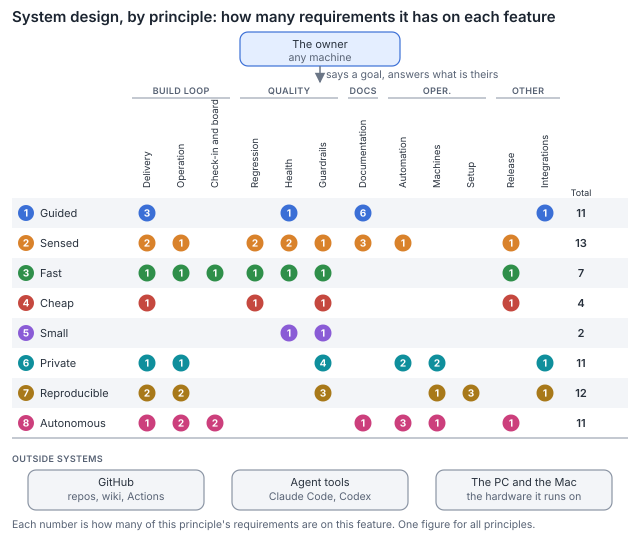
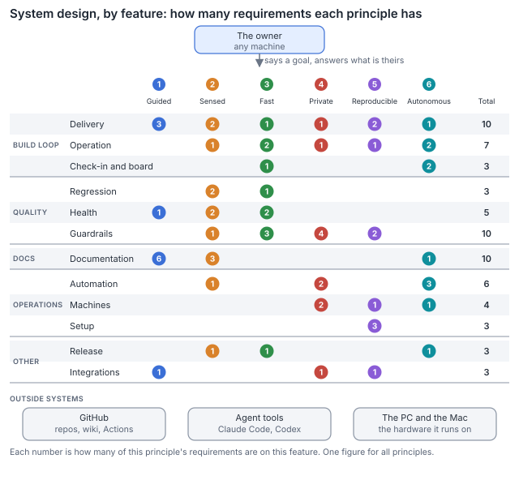

<!-- workflow-docs -->
# agent-workflow-template

The features, how to use each one, the settings and what runs by itself are on the wiki pages below. The sections after the System design are the project's principles, each with the requirements that enforce it, then every requirement by topic and feature.

## What this is

The loop's steps are: ask, frozen goal, worker build in its own worktree, tests, CI and the merge queue, merge, release from a tag, then health and the reviewer, whose findings become the next goal. Everything in the repo is part of one of those steps or keeps them running. Main changes only through a goal's pull request. A goal freezes only when it names a Reviewed requirement and the step of the loop it changes; a goal that serves no step is refused. Done lines never change after the freeze. "What this is" is generated from this text.

In harness-engineering terms, the loop is the **harness** around the agents: everything except the model. The principles and requirements are its **guides**, which steer the agents before they act. Tests, health, CI, the merge queue and the reviewer are its **sensors**, which check what the agents produced.

## System design

How the loop sits between its owner, its parts and the outside systems it uses; every principle below is judged against it.

## 1. Guided: documentation-driven and standard

The principles and requirements are my guardrails and the only part I write, and each one follows a named industry standard, adopted wherever one can run. The agents implement the code, tests and pages from them, so I never deal with implementation details. Nothing is built that a Reviewed requirement doesn't ask for, and tests come from the requirements.

| Requirement | Summary | Follows | Feature | Adoption | Confidence |
|---|---|---|---|---|---|
| [DOC-2 Only I write the principles and requirements; the repo copy is the PRD (absorbs DOC-22, DOC-20, INT-7, INT-2)](Documentation) ([DOC-2 flow](https://github.com/Charlie-org146/agent-workflow-template/blob/main/docs/wiki/flows/DOC-2.svg)) | Each principle's sentence, its table and every requirement's text are written only by me. An agent may draft and propose; only my own words make it the text, and only my words mark it Reviewed. Goals never edit Reviewed text while building. A change is a dated, approved revision; old revisions are kept and IDs are never reused. The repo copy is the PRD: an outside document may sync into it but never overrides it, and checks read only the repo. | [GitHub CODEOWNERS with required review](https://docs.github.com/en/repositories/managing-your-repositorys-settings-and-features/customizing-your-repository/about-code-owners); [OpenGitOps](https://opengitops.dev/): adapted | Documentation (Docs), Integrations (Other) | 0% |  |
| [DEL-19 Every change is a goal inside the loop, serving a requirement (absorbs DEL-2, DEL-18)](Delivery) ([DEL-19 flow](https://github.com/Charlie-org146/agent-workflow-template/blob/main/docs/wiki/flows/DEL-19.svg)) | The loop's steps are: ask, frozen goal, worker build in its own worktree, tests, CI and the merge queue, merge, release from a tag, then health and the reviewer, whose findings become the next goal. Everything in the repo is part of one of those steps or keeps them running. Main changes only through a goal's pull request. A goal freezes only when it names a Reviewed requirement and the step of the loop it changes; a goal that serves no step is refused. Done lines never change after the freeze. "What this is" is generated from this text. | [GitHub closing keywords linking a PR to an issue](https://docs.github.com/en/issues/tracking-your-work-with-issues/using-issues/linking-a-pull-request-to-an-issue); [Conventional Commits 1.0.0](https://www.conventionalcommits.org/en/v1.0.0/): adapted | Delivery (Build loop) | 0% |  |
| [DOC-25 Every page has the same fixed sections, and README and Home match (absorbs DOC-1's page shapes)](Documentation) ([DOC-25 flow](https://github.com/Charlie-org146/agent-workflow-template/blob/main/docs/wiki/flows/DOC-25.svg)) | The README and the wiki Home have exactly these sections, in order: What this is, System design, one section per principle, Requirements by feature. Every principle table has the columns shown here, including Adoption and Confidence, and each principle's heading shows both for the whole principle. Health generates the two scores; no one types them. Every wiki page has the sections of its kind. Every requirement row links to its own workflow figure. Generated sections stay current. | [markdownlint MD043](https://github.com/DavidAnson/markdownlint/blob/v0.33.0/doc/md043.md); [Diátaxis](https://diataxis.fr/); [C4 system context diagram](https://en.wikipedia.org/wiki/C4_model): adapted | Documentation (Docs) | 0% |  |
| [DOC-26 Each principle has at most five requirements, each dense and fully covering (new)](Documentation) ([DOC-26 flow](https://github.com/Charlie-org146/agent-workflow-template/blob/main/docs/wiki/flows/DOC-26.svg)) | A new need is written into an existing requirement before a new one is added. Health fails a principle with more than five, and a goal that would add a sixth is refused at freeze. | [Google re:Work OKR guide, three to five objectives](https://rework.withgoogle.com/guides/set-goals-with-okrs/steps/set-objectives-and-key-results/) (checked at build): adapted | Documentation (Docs) | 0% |  |
| [DEL-21 Every requirement names what it follows and adopts a standard tool by default, scored (absorbs DOC-24)](Delivery) ([DEL-21 flow](https://github.com/Charlie-org146/agent-workflow-template/blob/main/docs/wiki/flows/DEL-21.svg)) | Every requirement names a specific tool, standard or production system, links its source, and gives each one a tag: adopted, adapted or own. General guidance is not a reference. A drop-in tool is used as it is; adapted names the design it copies and why. The adoption score is shown per requirement, per principle and overall. The target is 50%, and I set it. Every goal that adds or rewrites a requirement first checks whether a tool can be adopted. A change that lowers the score needs my words. | [MADR decision records](https://adr.github.io/madr); [OpenSSF Scorecard](https://github.com/ossf/scorecard): adapted | Delivery (Build loop), Documentation (Docs), Health (Quality) | 0% |  |

Adoption: 0% (the average of this principle's rows).

**How it works:** I write or approve the text and nothing else can change it. A goal must name a Reviewed requirement and its step of the loop, or the freeze refuses it. The docs check runs on every pull request and fails wrong sections, a row with no figure, a sixth row, or scores that differ from health's latest run.

## 2. Sensed: enforced, verified and honest

Every principle and requirement is enforced by the loop's own machinery, and everything the loop says is verified. Tests, health, CI, the merge queue, the routines and a fresh-context reviewer check each one. Every claim carries its evidence and clock time. Every ETA is a commitment, and a miss stays recorded with its cause. Whatever falls short becomes tracked work until it is fixed.

| Requirement | Summary | Follows | Feature | Adoption | Confidence |
|---|---|---|---|---|---|
| [REG-4 Every requirement has its tests, written and run one way, with honest results (absorbs REG-1, REG-9 and their folded rows)](Regression) ([REG-4 flow](https://github.com/Charlie-org146/agent-workflow-template/blob/main/docs/wiki/flows/REG-4.svg)) | Every Reviewed requirement, whole flow and fixed issue has its kind of test: requirement, flow or defect. A requirement with no passing test shows "not enforced". One format, and one command runs them everywhere. **The table has one row per test script and requirement, and at most 600 rows**; a row runs every case of its script for that requirement. A test counts as proven only after it was seen failing. A flaky test is marked, never silently retried. A fix leaves a defect test behind. Coverage comes from main's full run and never drops silently. | [Gherkin](https://docs.cucumber.io/gherkin/); [Nx `affected`](https://nx.dev/ci/features/affected); [Google flaky-test handling](https://testing.googleblog.com/2016/05/flaky-tests-at-google-and-how-we.html): adapted | Regression (Quality), Documentation (Docs) | 0% |  |
| [HLT-2 Health checks every rule, every principle and every page (absorbs HLT-1, DOC-13, HLT-3, HLT-6, GRD-9, HLT-13, GRD-1, DOC-1's checks)](Health) ([HLT-2 flow](https://github.com/Charlie-org146/agent-workflow-template/blob/main/docs/wiki/flows/HLT-2.svg)) | Health is deterministic and read-only: twelve fixed rule groups, each rule proven able to fire, one report with a verdict per principle; what it couldn't read is never shown green. It checks each page's template, each principle's row count, every requirement's reference and tag, and every claim, ETA and correction. The scheduled health routine computes the Adoption and Confidence scores, and the docs render writes them into the tables. A fresh-context reviewer is a gate, not a report: it checks the live operation on a fixed cadence, every plan before build, and every report that claims done. | [OpenSSF Scorecard](https://github.com/ossf/scorecard); [Open Policy Agent](https://cncf.io/announcements/2021/02/04/cloud-native-computing-foundation-announces-open-policy-agent-graduation/); [IEEE 1012 independent verification](https://standards.ieee.org/ieee/1012/7324): adapted | Health (Quality), Documentation (Docs), Guardrails (Quality), Operation (Build loop) | 0% |  |
| [HLT-4 Every finding is one tracked issue until settled (absorbs REG-5, DEL-14, HLT-5, HLT-8, HLT-9, HLT-10, HLT-12)](Health) ([HLT-4 flow](https://github.com/Charlie-org146/agent-workflow-template/blob/main/docs/wiki/flows/HLT-4.svg)) | Each finding, failing test and unfixed goal finding is one evidenced issue on its feature's Backlog milestone, triaged with my words and planned into goals. A wrong statement, a missed ETA or a skipped gate is a finding too: corrected where it was made, logged with what was said, what was true, the cause and the action. Health counts them. | [GitHub Issues and milestones](https://docs.github.com/en/issues/using-labels-and-milestones-to-track-work/about-milestones); [Google SRE postmortem action items](https://research.google/pubs/pub45906/): adopted | Health (Quality), Regression (Quality), Delivery (Build loop) | 100% |  |
| [DEL-1 One sentence runs unattended to a release, and a major ships only through the gate (absorbs DEL-4, REL-9 to REL-11, REL-14, REL-3 and its folded rows)](Delivery) ([DEL-1 flow](https://github.com/Charlie-org146/agent-workflow-template/blob/main/docs/wiki/flows/DEL-1.svg)) | A sentence and its done lines run unattended to a recorded pull request and a release made from a tag. A merge is refused only for the goal's own findings, never left half done. A major exists only after the gate: milestone closed, full suite run, health green, everything Reviewed. Promotion and revert need the operation session and my words. | [GitHub merge queue](https://docs.github.com/en/repositories/configuring-branches-and-merges-in-your-repository/configuring-pull-request-merges/managing-a-merge-queue), [tag release workflow](https://docs.github.com/en/repositories/releasing-projects-on-github/managing-releases-in-a-repository), [Semantic Versioning](https://semver.org/): adopted; [SonarQube quality gates](https://docs.sonarsource.com/sonarqube-server/2025.4/quality-standards-administration/managing-quality-gates/introduction-to-quality-gates): adapted; the sentence-to-PR pipeline: own | Delivery (Build loop), Release (Other) | 33% |  |
| [AUT-1 Routines run on schedule, by runbook (absorbs AUT-2, AUT-3, DOC-16)](Automation) ([AUT-1 flow](https://github.com/Charlie-org146/agent-workflow-template/blob/main/docs/wiki/flows/AUT-1.svg)) | Health and regression run on schedule wherever they can run fully. They report where they ran and what they skipped, catch up missed runs, and follow runbooks. | [GitHub Actions `schedule`](https://docs.github.com/en/actions/reference/workflows-and-actions/events-that-trigger-workflows): adopted; [Google SRE on-call playbooks](https://sre.google/workbook/on-call/): adapted | Automation (Operations), Documentation (Docs) | 50% |  |

Adoption: 37% (the average of this principle's rows).

**How it works:** every pull request runs its affected tests in CI. The merge queue runs a fixed smoke on the merged result before main moves; it took 11 seconds on its first run at 03:17 (the Mac's reading). Health runs on schedule and before every release, opens one issue per finding, and writes the scores. The reviewer runs every 15 minutes and on every plan and done claim.

## 3. Fast, cheap and small

Every change runs on one clock from my ask to main, with a limit and a token budget for each step, and sizes stay inside their limits.

| Requirement | Summary | Follows | Feature | Adoption | Confidence |
|---|---|---|---|---|---|
| [DEL-17 Every change runs on one clock, from my ask to main (absorbs REG-7, GRD-7, GRD-8, REL-13, REL-15)](Delivery) ([DEL-17 flow](https://github.com/Charlie-org146/agent-workflow-template/blob/main/docs/wiki/flows/DEL-17.svg)) | **Normal goal:** freeze to build takes the goal's own ETA; then one local lane (5 minutes, only the tests the change reaches, reused by later steps), push and PR CI (5 minutes, one run per push, parallel jobs), and ready to main (5 minutes: the merge queue tests the merged result, merges, and the release is made from a tag). **Small fix:** 2 minutes to edit and push, 2 for the lane, 3 for CI, 3 for the queue: 10 minutes from my ask. **Tokens:** each step has a budget from its measured usual; past twice that it is flagged; waiting is done in a script. **Every ETA is a commitment:** it records who made it, when, and on what basis; a passed one shows as missed with its cause and stays visible. A merge never makes another ready pull request re-run. **The merge queue runs at full use:** every pull request goes into the queue the moment its check is green on its exact head, never later; goals are planned and stacked so several turn green together, and the queue builds and merges up to its limit of five at once; health prints the queue's use for the last 20 merges (pull requests per merge, and minutes a green pull request waited outside the queue) and fails any wait over 2 minutes. Test count and suite time stay capped. | [GitHub merge queue](https://docs.github.com/en/repositories/configuring-branches-and-merges-in-your-repository/configuring-pull-request-merges/managing-a-merge-queue): adopted; [DORA lead time](https://dora.dev/guides/dora-metrics-four-keys): adapted | Delivery (Build loop), Regression (Quality), Release (Other), Guardrails (Quality) | 50% |  |
| [HLT-7 Checks, check-ins and instructions answer fast](Health) ([HLT-7 flow](https://github.com/Charlie-org146/agent-workflow-template/blob/main/docs/wiki/flows/HLT-7.svg)) | Health under 60 seconds, docs under 30, the board under 10, rounds under 45 minutes. A worker's turn ends at least every 5 minutes, so an instruction reaches it within 5. | [DORA four keys](https://dora.dev/guides/dora-metrics-four-keys): adapted | Health (Quality), Check in and board (Build loop), Operation (Build loop) | 0% |  |
| [GRD-20 Sizes are one table, enforced on main, never met by reformatting (absorbs HLT-11)](Guardrails) ([GRD-20 flow](https://github.com/Charlie-org146/agent-workflow-template/blob/main/docs/wiki/flows/GRD-20.svg)) | One table holds every size limit: Agensi's package rules, kept as they are; scripts warn at 19,000 bytes and fail at 20,480 (Agensi's 20 KB); pages, requirements per page, test rows and file count. No script on main is over its fail line. Reformatting a whole file only to fit is refused. | [Agensi packaging rules](https://www.agensi.io): adopted; [ESLint `max-lines`](https://eslint.org/docs/rules/max-lines): adapted | Guardrails (Quality), Health (Quality) | 50% |  |
| [OPS-16 Every ready goal starts within capacity limits](Operation) ([OPS-16 flow](https://github.com/Charlie-org146/agent-workflow-template/blob/main/docs/wiki/flows/OPS-16.svg)) | Every ready goal gets its own worker at once unless a capacity limit holds it. The memory floor is measured per machine. **Memory is guarded on every machine by set limits.** At most one live session per 2 GB of memory, counting the operation sessions (8 on a 16 GB machine). A new worker starts only while the system's free-memory figure is at least 25% and swap use is under 80% of its current size. Below 20% free, or at 85% swap, idle sessions are archived and nothing new starts. Below 10% free, or at 95% swap, the lowest-priority building goal is paused: its work is committed, not pushed, and it restarts when memory recovers. Each reading is the lower of two taken a minute apart, so one swing does not trigger. Every STATUS reports the free figure, swap and live sessions, and health fails a machine that crossed a limit with no action recorded. | [Kubernetes ResourceQuota](https://kubernetes.io/docs/concepts/policy/resource-quotas/); [Kanban WIP limits](https://www.atlassian.com/agile/kanban/wip-limits): adapted | Operation (Build loop), Guardrails (Quality) | 0% |  |

Adoption: 25% (the average of this principle's rows).

**How it works:** the merge queue enforces "ready to main" today: four merges tonight took between 50 seconds and 2 min 39 s. The 5-minute CI is being built now. Health prints each step's time and tokens for the last 20 changes and fails a step over its limit.

## 4. Private and guarded

No private name, path, address or key leaves the machine, and automation gets only the access it needs.

| Requirement | Summary | Follows | Feature | Adoption | Confidence |
|---|---|---|---|---|---|
| [DEL-9 Nothing private is committed, shipped or copied (absorbs GRD-3, AUT-6, MCH-9)](Delivery) ([DEL-9 flow](https://github.com/Charlie-org146/agent-workflow-template/blob/main/docs/wiki/flows/DEL-9.svg)) | Every commit, push and pull request passes the scoped private-name scan. Private files, the mail address and keys stay local and are never copied. | [gitleaks](https://github.com/gitleaks/gitleaks); [GitHub push protection](https://docs.github.com/en/code-security/concepts/secret-security/push-protection); [GitGuardian](https://www.gitguardian.com/) on the organization: adopted | Delivery (Build loop), Guardrails (Quality), Automation (Operations), Machines (Operations) | 100% |  |
| [GRD-4 Every session and automation gets least access (absorbs OPS-7, AUT-9, MCH-11, MCH-6)](Guardrails) ([GRD-4 flow](https://github.com/Charlie-org146/agent-workflow-template/blob/main/docs/wiki/flows/GRD-4.svg)) | A worker touches only its own goal's state and cannot widen its files or budget, or resume itself. Check-ins never edit, commit or push. Each routine declares allow and deny rules and keeps its prompt locally. | [GitHub Actions `permissions`](https://docs.github.com/en/actions/writing-workflows/choosing-what-your-workflow-does/controlling-permissions-for-github_token): adopted; [NIST SP 800-53 AC-6](https://csrc.nist.gov/CSRC/media/Projects/risk-management/800-53%20Downloads/800-53r5/SP_800-53_v5_1-derived-OSCAL.pdf), [Kubernetes RBAC](https://kubernetes.io/docs/reference/access-authn-authz/rbac/): adapted | Guardrails (Quality), Operation (Build loop), Automation (Operations), Machines (Operations) | 50% |  |
| [GRD-5 Nothing is written outside without explicit say (absorbs INT-4)](Guardrails) ([GRD-5 flow](https://github.com/Charlie-org146/agent-workflow-template/blob/main/docs/wiki/flows/GRD-5.svg)) | GitHub writes preview by default and need `--live`. Integrations read by default and write only behind a switch and an accepted delta. I attach connectors myself. | [GitHub environments with required reviewers](https://docs.github.com/en/actions/reference/workflows-and-actions/deployments-and-environments): adapted | Guardrails (Quality), Integrations (Other) | 0% |  |
| [GRD-6 Base branch and hooks cannot be bypassed (absorbs GRD-16)](Guardrails) ([GRD-6 flow](https://github.com/Charlie-org146/agent-workflow-template/blob/main/docs/wiki/flows/GRD-6.svg)) | The base branch refuses direct and force pushes and merges only through the merge queue on required checks, with no bypass. Hook-skipping commits are refused and flagged. | [GitHub rulesets with merge queue and required checks](https://docs.github.com/en/repositories/configuring-branches-and-merges-in-your-repository/managing-rulesets/available-rules-for-rulesets); [pre-commit](https://pre-commit.com/): adopted | Guardrails (Quality) | 100% |  |

Adoption: 62% (the average of this principle's rows).

**How it works:** GitHub enforces these, not our code. The ruleset "Main" refuses direct pushes, and GitGuardian and push protection scan every push. The private-name scan runs in the pre-commit hook and in CI.

## 5. Reproducible, portable and adoptable

The same inputs give the same result on any machine, in any repo and on any agent. Any repo adopts the template cleanly, plugs into other systems through adapters, and survives a failure without losing work.

| Requirement | Summary | Follows | Feature | Adoption | Confidence |
|---|---|---|---|---|---|
| [SET-10 One versioned package; every agent runs one loop (absorbs DEL-16, SET-3)](Setup) ([SET-10 flow](https://github.com/Charlie-org146/agent-workflow-template/blob/main/docs/wiki/flows/SET-10.svg)) | One versioned skills package works out of the box in Claude Code and Codex. Steps map to agents, with a warned fallback and recorded tokens. | [Semantic Versioning 2.0.0](https://semver.org/); [Agent Skills format](https://agentskills.io/): adopted | Setup (Operations), Delivery (Build loop) | 100% |  |
| [MCH-1 Any machine sets up identically, and work moves between them safely (absorbs MCH-2, MCH-10, MCH-7, DEL-12, GRD-18, MCH-4, MCH-8, OPS-15, DEL-7, MCH-3)](Machines) ([MCH-1 flow](https://github.com/Charlie-org146/agent-workflow-template/blob/main/docs/wiki/flows/MCH-1.svg)) | A fresh clone, the checklist, a dry run and an apply reach a working operation session on a Mac or on Windows. Each goal has one owning machine; handover and adoption move it safely. Failed steps retry three times and then stop with a reason; crashed goals resume. Backup and restore move state, never secrets. | [Dev Containers](https://containers.dev/implementors/spec); [chezmoi](https://github.com/twpayne/chezmoi); [Kubernetes Lease](https://kubernetes.io/docs/concepts/architecture/leases/); [Temporal durable execution](https://temporal.io/in-use.md): adapted | Machines (Operations), Delivery (Build loop), Guardrails (Quality), Operation (Build loop) | 0% |  |
| [SET-1 Any repo adopts the template, stays current, and is proven by replay (absorbs SET-4, SET-6 and their folded rows)](Setup) ([SET-1 flow](https://github.com/Charlie-org146/agent-workflow-template/blob/main/docs/wiki/flows/SET-1.svg)) | One safe, idempotent command adopts any repo byte for byte. Adopted repos hold only their own data, record their template version, take updates, flag lag, and send fixes upstream. Adoption is proven by a step-by-step replay against the golden result. | [Copier](https://copier.readthedocs.io/); [GitHub template repositories](https://docs.github.com/en/repositories/creating-and-managing-repositories/creating-a-repository-from-a-template); [Renovate](https://docs.renovatebot.com); [Jest snapshots](https://jestjs.io/docs/snapshot-testing): adapted | Setup (Operations), Guardrails (Quality) | 0% |  |
| [SET-2 Layered settings and a generated entry page (absorbs SET-5)](Setup) ([SET-2 flow](https://github.com/Charlie-org146/agent-workflow-template/blob/main/docs/wiki/flows/SET-2.svg)) | Settings come in layers (template, repo, private), each with a default and an explanation. Every repo has one entry page generated from committed settings only, and two pull requests that each change a setting do not conflict in it. | [Twelve-Factor App, factor III Config](https://12factor.net/config): adapted | Setup (Operations) | 0% |  |
| [INT-1 Every integration is a declared, visible adapter (absorbs INT-6, INT-5)](Integrations) ([INT-1 flow](https://github.com/Charlie-org146/agent-workflow-template/blob/main/docs/wiki/flows/INT-1.svg)) | Outside systems are opt-in integrations in one registry, added as adapters without changes to the loop's code, with state and deltas shown and counted. | [Model Context Protocol](https://modelcontextprotocol.io/specification): adopted | Integrations (Other) | 100% |  |

Adoption: 40% (the average of this principle's rows).

**How it works:** the package is one versioned zip that update.py installs the same way on any machine. Adoption is one command, proven by the replay tests in CI.

## 6. Autonomous and human-friendly

It runs by itself across machines and stops for me only when a decision is truly mine. At any moment I can see where everything stands, on one board and in one check-in layout, in plain words that read on a phone. When it needs me, it asks one clear question with a recommendation.

| Requirement | Summary | Follows | Feature | Adoption | Confidence |
|---|---|---|---|---|---|
| [DEL-3 It stops only for decisions that are mine, and asks them clearly (absorbs OPS-11, OPS-18, REL-12, AUT-10)](Delivery) ([DEL-3 flow](https://github.com/Charlie-org146/agent-workflow-template/blob/main/docs/wiki/flows/DEL-3.svg)) | My decisions wait for me or are auto-approved where allowed. Full auto applies everything except the safety classes. Merges wait only on gates I set. Every question to me is one decision in plain words, with a recommendation, the exact words or button that answers it, and what happens if I don't answer. Questions are numbered and never asked twice. What was decided for me is listed. | [GitHub auto-merge with required checks](https://docs.github.com/en/pull-requests/collaborating-with-pull-requests/incorporating-changes-from-a-pull-request/automatically-merging-a-pull-request): adopted; [GitHub environments required reviewers](https://docs.github.com/en/actions/reference/workflows-and-actions/deployments-and-environments): adapted | Delivery (Build loop), Operation (Build loop), Release (Other), Automation (Operations) | 50% |  |
| [CHK-1 One live board and one check-in layout show where everything stands (absorbs CHK-2, CHK-5, CHK-6, MCH-5, CHK-3, CHK-9, AUT-4)](Check-in-and-board) ([CHK-1 flow](https://github.com/Charlie-org146/agent-workflow-template/blob/main/docs/wiki/flows/CHK-1.svg)) | **The board** has these sections, in order, each collapsible: Your move (only my items); Red team (bottlenecks now, planning suggestions with taken or why not, the biggest risk, a verdict per principle); Release goals (short: one line, one bar, an ETA, at most five steps); Task queue (every open task by expected time on main, with a state and whose ETA it is); Workers; Shipped. **Every item is a card;** no tables and no plain lists. **The check-in** follows the same order and opens with what slipped; a hook blocks a check-in reply in any other layout. Text is plain and reads on a phone. Every claim carries what it was read from and its clock time. One email stream, which I answer by reply. | [GitHub Projects](https://docs.github.com/en/issues/planning-and-tracking-with-projects/customizing-views-in-your-project/changing-the-layout-of-a-view); [PagerDuty](https://support.pagerduty.com/docs/sms-notifications): own today, both marked "replace" | Check in and board (Build loop), Machines (Operations), Automation (Operations) | 0% |  |
| [OPS-1 One operation session governs the loop for me (absorbs OPS-2, OPS-6, OPS-8, OPS-10, OPS-23, CHK-7)](Operation) ([OPS-1 flow](https://github.com/Charlie-org146/agent-workflow-template/blob/main/docs/wiki/flows/OPS-1.svg)) | **Layers:** top, one session per machine, workers; top only governs. **Relay:** my words go to the machines word for word, on fixed message forms; a machine's message is never my approval. **Full auto:** top decides process choices and numbers each decision; the safety classes wait for my typed words. **Red team:** every 15 minutes a fresh reviewer reports the bottlenecks, planning suggestions and the biggest risk; top verifies each, changes the plan or writes why not, and shows it all on the board. **Active:** top acts at once on a green pull request left unmerged, a stuck head, an idle worker or a stale STATUS. **Delays and platform limits:** every wait has a named cause and an owner. No platform limit ever leaves the loop waiting for my typing: each one, such as a session's message cap or a new session that only my typing can start, is counted before it is reached, and the loop works inside it by design (fewer and batched messages, events-only reports, archived sessions woken instead of new ones), never by routing around it through another session; if a limit would still need me, it says so early enough that it is never reached while I am away. **Setup:** one command starts it from files in the repo, the same way on any machine. **Machine log:** Every machine session writes one line to its machine log each minute and at every event: the time from the clock, free memory, swap, CPU load, live sessions and what each runs, app messages used since my last message, and the goals building with their step. The operation session schedules from this log, not from memory or guesses. It decides which machine takes a goal, how many run at once, when to wake or archive a session, and when to pause one. Each decision cites the log line it used. The board shows each machine's latest line, and health fails a machine whose log is more than 5 minutes old. | [Kubernetes controller reconcile loop](https://kubernetes.io/docs/concepts/architecture/controller/); [Google SRE incident command](https://sre.google/sre-book/managing-incidents/): adapted | Operation (Build loop), Check in and board (Build loop) | 0% |  |
| [AUT-5 Routines and publishing stay under my control (absorbs DOC-11)](Automation) ([AUT-5 flow](https://github.com/Charlie-org146/agent-workflow-template/blob/main/docs/wiki/flows/AUT-5.svg)) | Each routine turns off or reschedules with one setting and writes nothing without secrets. Publishing never deletes or overwrites pages it didn't write, and it can be undone. | [GitHub environments with required reviewers](https://docs.github.com/en/actions/reference/workflows-and-actions/deployments-and-environments): own today, marked "replace" | Automation (Operations), Documentation (Docs) | 0% |  |

Adoption: 12% (the average of this principle's rows).

**How it works:** the operation session reads every machine each check-in and posts the board. Questions reach me only for the safety classes and for overrides of my own requirements. Everything else is decided, logged and listed.

## Requirements by feature

Every requirement with its complete text, grouped by topic and feature (read from each feature's page); a requirement that serves several features is listed under each.

### Build loop

#### Delivery

[How to use Delivery](How-to-use-Delivery)

| Requirement | Complete text |
|---|---|
| [DEL-1 One sentence runs unattended to a release, and a major ships only through the gate](Delivery) | A sentence and its done lines run unattended to a recorded pull request and a release made from a tag. [DEL-1] A merge is refused only for the goal's own findings, never left half done. [DEL-1] A major exists only after the gate: milestone closed, full suite run, health green, everything Reviewed. [DEL-1] Promotion and revert need the operation session and my words. [DEL-1] |
| [DEL-3 It stops only for decisions that are mine, and asks them clearly](Delivery) | My decisions wait for me or are auto-approved where allowed. [DEL-3] Full auto applies everything except the safety classes. [DEL-3] Merges wait only on gates I set. [DEL-3] Every question to me is one decision in plain words, with a recommendation, the exact words or button that answers it, and what happens if I don't answer. [DEL-3] Questions are numbered and never asked twice. [DEL-3] What was decided for me is listed. [DEL-3] |
| [DEL-17 Every change runs on one clock, from my ask to main](Delivery) | **Normal goal:** freeze to build takes the goal's own ETA; then one local lane (5 minutes, only the tests the change reaches, reused by later steps), push and PR CI (5 minutes, one run per push, parallel jobs), and ready to main (5 minutes: the merge queue tests the merged result, merges, and the release is made from a tag). [DEL-17] **Small fix:** 2 minutes to edit and push, 2 for the lane, 3 for CI, 3 for the queue: 10 minutes from my ask. [DEL-17] **Tokens:** each step has a budget from its measured usual; past twice that it is flagged; waiting is done in a script. [DEL-17] **Every ETA is a commitment:** it records who made it, when, and on what basis; a passed one shows as missed with its cause and stays visible. [DEL-17] A merge never makes another ready pull request re-run. [DEL-17] **The merge queue runs at full use:** every pull request goes into the queue the moment its check is green on its exact head, never later; goals are planned and stacked so several turn green together, and the queue builds and merges up to its limit of five at once; health prints the queue's use for the last 20 merges (pull requests per merge, and minutes a green pull request waited outside the queue) and fails any wait over 2 minutes. [DEL-17] Test count and suite time stay capped. [DEL-17] |
| [DEL-19 Every change is a goal inside the loop, serving a requirement](Delivery) | The loop's steps are: ask, frozen goal, worker build in its own worktree, tests, CI and the merge queue, merge, release from a tag, then health and the reviewer, whose findings become the next goal. [DEL-19] Everything in the repo is part of one of those steps or keeps them running. [DEL-19] Main changes only through a goal's pull request. [DEL-19] A goal freezes only when it names a Reviewed requirement and the step of the loop it changes; a goal that serves no step is refused. [DEL-19] Done lines never change after the freeze. [DEL-19] "What this is" is generated from this text. [DEL-19] |
| [DEL-21 Every requirement names what it follows and adopts a standard tool by default, scored](Delivery) | Every requirement names a specific tool, standard or production system, links its source, and gives each one a tag: adopted, adapted or own. [DEL-21] General guidance is not a reference. [DEL-21] A drop-in tool is used as it is; adapted names the design it copies and why. [DEL-21] The adoption score is shown per requirement, per principle and overall. [DEL-21] The target is 50%, and I set it. [DEL-21] Every goal that adds or rewrites a requirement first checks whether a tool can be adopted. [DEL-21] A change that lowers the score needs my words. [DEL-21] |
| [DEL-9 Nothing private is committed, shipped or copied](Delivery) | Every commit, push and pull request passes the scoped private-name scan. [DEL-9] Private files, the mail address and keys stay local and are never copied. [DEL-9] |

#### Operation

[How to use Operation](How-to-use-Operation)

| Requirement | Complete text |
|---|---|
| [OPS-1 One operation session governs the loop for me](Operation) | **Layers:** top, one session per machine, workers; top only governs. [OPS-1] **Relay:** my words go to the machines word for word, on fixed message forms; a machine's message is never my approval. [OPS-1] **Full auto:** top decides process choices and numbers each decision; the safety classes wait for my typed words. [OPS-1] **Red team:** every 15 minutes a fresh reviewer reports the bottlenecks, planning suggestions and the biggest risk; top verifies each, changes the plan or writes why not, and shows it all on the board. [OPS-1] **Active:** top acts at once on a green pull request left unmerged, a stuck head, an idle worker or a stale STATUS. [OPS-1] **Delays and platform limits:** every wait has a named cause and an owner. [OPS-1] No platform limit ever leaves the loop waiting for my typing: each one, such as a session's message cap or a new session that only my typing can start, is counted before it is reached, and the loop works inside it by design (fewer and batched messages, events-only reports, archived sessions woken instead of new ones), never by routing around it through another session; if a limit would still need me, it says so early enough that it is never reached while I am away. [OPS-1] **Setup:** one command starts it from files in the repo, the same way on any machine. [OPS-1] **Machine log:** Every machine session writes one line to its machine log each minute and at every event: the time from the clock, free memory, swap, CPU load, live sessions and what each runs, app messages used since my last message, and the goals building with their step. [OPS-1] The operation session schedules from this log, not from memory or guesses. [OPS-1] It decides which machine takes a goal, how many run at once, when to wake or archive a session, and when to pause one. [OPS-1] Each decision cites the log line it used. [OPS-1] The board shows each machine's latest line, and health fails a machine whose log is more than 5 minutes old. [OPS-1] |
| [OPS-16 Every ready goal starts within capacity limits](Operation) | Every ready goal gets its own worker at once unless a capacity limit holds it. [OPS-16] The memory floor is measured per machine. [OPS-16] **Memory is guarded on every machine by set limits.** At most one live session per 2 GB of memory, counting the operation sessions (8 on a 16 GB machine). [OPS-16] A new worker starts only while the system's free-memory figure is at least 25% and swap use is under 80% of its current size. [OPS-16] Below 20% free, or at 85% swap, idle sessions are archived and nothing new starts. [OPS-16] Below 10% free, or at 95% swap, the lowest-priority building goal is paused: its work is committed, not pushed, and it restarts when memory recovers. [OPS-16] Each reading is the lower of two taken a minute apart, so one swing does not trigger. [OPS-16] Every STATUS reports the free figure, swap and live sessions, and health fails a machine that crossed a limit with no action recorded. [OPS-16] |

#### Check in and board

[How to use Check in and board](How-to-use-Check-in-and-board)

| Requirement | Complete text |
|---|---|
| [CHK-1 One live board and one check-in layout show where everything stands](Check-in-and-board) | **The board** has these sections, in order, each collapsible: Your move (only my items); Red team (bottlenecks now, planning suggestions with taken or why not, the biggest risk, a verdict per principle); Release goals (short: one line, one bar, an ETA, at most five steps); Task queue (every open task by expected time on main, with a state and whose ETA it is); Workers; Shipped. [CHK-1] **Every item is a card;** no tables and no plain lists. [CHK-1] **The check-in** follows the same order and opens with what slipped; a hook blocks a check-in reply in any other layout. [CHK-1] Text is plain and reads on a phone. [CHK-1] Every claim carries what it was read from and its clock time. [CHK-1] One email stream, which I answer by reply. [CHK-1] |

### Quality

#### Regression

[How to use Regression](How-to-use-Regression)

| Requirement | Complete text |
|---|---|
| [REG-4 Every requirement has its tests, written and run one way, with honest results](Regression) | Every Reviewed requirement, whole flow and fixed issue has its kind of test: requirement, flow or defect. [REG-4] A requirement with no passing test shows "not enforced". [REG-4] One format, and one command runs them everywhere. [REG-4] **The table has one row per test script and requirement, and at most 600 rows**; a row runs every case of its script for that requirement. [REG-4] A test counts as proven only after it was seen failing. [REG-4] A flaky test is marked, never silently retried. [REG-4] A fix leaves a defect test behind. [REG-4] Coverage comes from main's full run and never drops silently. [REG-4] |

#### Health

[How to use Health](How-to-use-Health)

| Requirement | Complete text |
|---|---|
| [HLT-2 Health checks every rule, every principle and every page](Health) | Health is deterministic and read-only: twelve fixed rule groups, each rule proven able to fire, one report with a verdict per principle; what it couldn't read is never shown green. [HLT-2] It checks each page's template, each principle's row count, every requirement's reference and tag, and every claim, ETA and correction. [HLT-2] The scheduled health routine computes the Adoption and Confidence scores, and the docs render writes them into the tables. [HLT-2] A fresh-context reviewer is a gate, not a report: it checks the live operation on a fixed cadence, every plan before build, and every report that claims done. [HLT-2] |
| [HLT-4 Every finding is one tracked issue until settled](Health) | Each finding, failing test and unfixed goal finding is one evidenced issue on its feature's Backlog milestone, triaged with my words and planned into goals. [HLT-4] A wrong statement, a missed ETA or a skipped gate is a finding too: corrected where it was made, logged with what was said, what was true, the cause and the action. [HLT-4] Health counts them. [HLT-4] |
| [HLT-7 Checks, check-ins and instructions answer fast](Health) | Health under 60 seconds, docs under 30, the board under 10, rounds under 45 minutes. [HLT-7] A worker's turn ends at least every 5 minutes, so an instruction reaches it within 5. [HLT-7] |

#### Guardrails

[How to use Guardrails](How-to-use-Guardrails)

| Requirement | Complete text |
|---|---|
| [GRD-4 Every session and automation gets least access](Guardrails) | A worker touches only its own goal's state and cannot widen its files or budget, or resume itself. [GRD-4] Check-ins never edit, commit or push. [GRD-4] Each routine declares allow and deny rules and keeps its prompt locally. [GRD-4] |
| [GRD-5 Nothing is written outside without explicit say](Guardrails) | GitHub writes preview by default and need `--live`. [GRD-5] Integrations read by default and write only behind a switch and an accepted delta. [GRD-5] I attach connectors myself. [GRD-5] |
| [GRD-6 Base branch and hooks cannot be bypassed](Guardrails) | The base branch refuses direct and force pushes and merges only through the merge queue on required checks, with no bypass. [GRD-6] Hook-skipping commits are refused and flagged. [GRD-6] |
| [GRD-20 Sizes are one table, enforced on main, never met by reformatting](Guardrails) | One table holds every size limit: Agensi's package rules, kept as they are; scripts warn at 19,000 bytes and fail at 20,480 (Agensi's 20 KB); pages, requirements per page, test rows and file count. [GRD-20] No script on main is over its fail line. [GRD-20] Reformatting a whole file only to fit is refused. [GRD-20] |

### Operations

#### Automation

[How to use Automation](How-to-use-Automation)

| Requirement | Complete text |
|---|---|
| [AUT-1 Routines run on schedule, by runbook](Automation) | Health and regression run on schedule wherever they can run fully. [AUT-1] They report where they ran and what they skipped, catch up missed runs, and follow runbooks. [AUT-1] |
| [AUT-5 Routines and publishing stay under my control](Automation) | Each routine turns off or reschedules with one setting and writes nothing without secrets. [AUT-5] Publishing never deletes or overwrites pages it didn't write, and it can be undone. [AUT-5] |

#### Setup

[How to use Setup](How-to-use-Setup)

| Requirement | Complete text |
|---|---|
| [SET-1 Any repo adopts the template, stays current, and is proven by replay](Setup) | One safe, idempotent command adopts any repo byte for byte. [SET-1] Adopted repos hold only their own data, record their template version, take updates, flag lag, and send fixes upstream. [SET-1] Adoption is proven by a step-by-step replay against the golden result. [SET-1] |
| [SET-2 Layered settings and a generated entry page](Setup) | Settings come in layers (template, repo, private), each with a default and an explanation. [SET-2] Every repo has one entry page generated from committed settings only, and two pull requests that each change a setting do not conflict in it. [SET-2] |
| [SET-10 One versioned package; every agent runs one loop](Setup) | One versioned skills package works out of the box in Claude Code and Codex. [SET-10] Steps map to agents, with a warned fallback and recorded tokens. [SET-10] |

#### Machines

[How to use Machines](How-to-use-Machines)

| Requirement | Complete text |
|---|---|
| [MCH-1 Any machine sets up identically, and work moves between them safely](Machines) | A fresh clone, the checklist, a dry run and an apply reach a working operation session on a Mac or on Windows. [MCH-1] Each goal has one owning machine; handover and adoption move it safely. [MCH-1] Failed steps retry three times and then stop with a reason; crashed goals resume. [MCH-1] Backup and restore move state, never secrets. [MCH-1] |

### Docs

#### Documentation

[How to use Documentation](How-to-use-Documentation)

| Requirement | Complete text |
|---|---|
| [DOC-2 Only I write the principles and requirements; the repo copy is the PRD](Documentation) | Each principle's sentence, its table and every requirement's text are written only by me. [DOC-2] An agent may draft and propose; only my own words make it the text, and only my words mark it Reviewed. [DOC-2] Goals never edit Reviewed text while building. [DOC-2] A change is a dated, approved revision; old revisions are kept and IDs are never reused. [DOC-2] The repo copy is the PRD: an outside document may sync into it but never overrides it, and checks read only the repo. [DOC-2] |
| [DOC-25 Every page has the same fixed sections, and README and Home match](Documentation) | The README and the wiki Home have exactly these sections, in order: What this is, System design, one section per principle, Requirements by feature. [DOC-25] Every principle table has the columns shown here, including Adoption and Confidence, and each principle's heading shows both for the whole principle. [DOC-25] Health generates the two scores; no one types them. [DOC-25] Every wiki page has the sections of its kind. [DOC-25] Every requirement row links to its own workflow figure. [DOC-25] Generated sections stay current. [DOC-25] |
| [DOC-26 Each principle has at most five requirements, each dense and fully covering](Documentation) | A new need is written into an existing requirement before a new one is added. [DOC-26] Health fails a principle with more than five, and a goal that would add a sixth is refused at freeze. [DOC-26] |

### Other

#### Integrations

[How to use Integrations](How-to-use-Integrations)

| Requirement | Complete text |
|---|---|
| [INT-1 Every integration is a declared, visible adapter](Integrations) | Outside systems are opt-in integrations in one registry, added as adapters without changes to the loop's code, with state and deltas shown and counted. [INT-1] |

#### Release

[How to use Release](How-to-use-Release)

| Requirement | Complete text |
|---|---|
