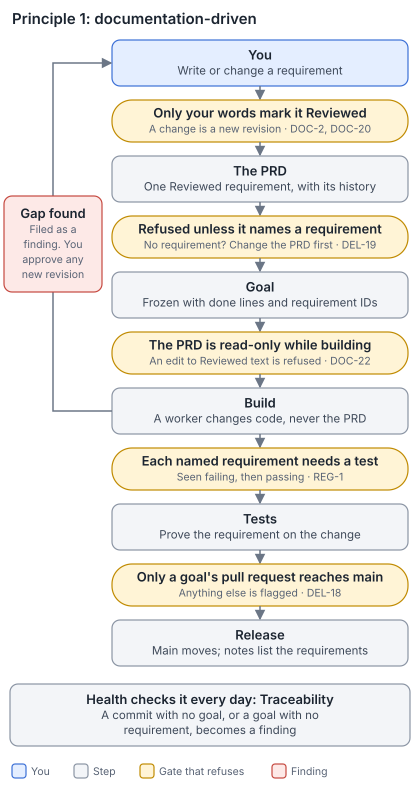
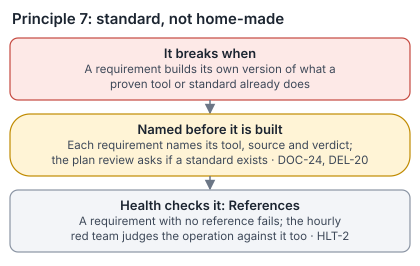

<!-- workflow-docs -->
<!-- workflow-docs guide -->
# Principles

Seven principles sit above the features. Health gives one verdict for each, red when any of its groups fails, and each is made true by the requirements it names. Each table has one row per consolidated requirement: a summary that names the requirements it absorbs, what it follows (a specific tool, standard or production system, its source and a verdict), its feature, the version that introduced it and a link to its own flow diagram. A row marked v2.0 (planned) or v2.0 (in progress) is work with no requirement ID yet. The README and Home show the same seven, then every requirement with its complete text by topic and feature (45 requirements).

## 1. Documentation-driven

Principles, features, requirements and tests are written first, in that order: nothing is built that a Reviewed requirement doesn't ask for, tests come from the requirements, and the PRD changes only by your words.

| Requirement | Summary | Follows | Feature | Version | Flow |
|---|---|---|---|---|---|
| [DOC-2 Only my words review or revise the PRD](Documentation) | Only I mark text Reviewed; goals never edit it while building; changes are dated, approved revisions, old ones kept, IDs never reused (absorbs DOC-22, DOC-20) | GitHub CODEOWNERS with required code-owner review ([About code owners](https://docs.github.com/en/repositories/managing-your-repositorys-settings-and-features/customizing-your-repository/about-code-owners)): adapted | Documentation (Docs) | 🟧 v2.0 (since v0.1.2) | [DOC-2 flow](https://github.com/jcl2018/agent-workflow-template/blob/main/docs/wiki/flows/DOC-2.svg) |
| [DEL-19 Every change is a goal serving a requirement](Delivery) | Main changes only through a goal's PR and release commit; a goal freezes only naming a Reviewed requirement; its done lines never change (absorbs DEL-2, DEL-18) | GitHub closing keywords linking PR to issue; Conventional Commits 1.0.0 ([Linking a PR to an issue](https://docs.github.com/en/issues/tracking-your-work-with-issues/using-issues/linking-a-pull-request-to-an-issue), [Conventional Commits 1.0.0](https://www.conventionalcommits.org/en/v1.0.0/)): adapted | Delivery (Build loop) | 🟧 v2.0 (since v0.1.2) | [DEL-19 flow](https://github.com/jcl2018/agent-workflow-template/blob/main/docs/wiki/flows/DEL-19.svg) |
| [INT-7 PRDs may sync with an outside document](Integrations) | A PRD lives in the repo by default; a page may opt in to sync with an outside document, but the repo copy stays authoritative | one named sync tool for Notion-sourced pages, or cut ([Write the Docs: Docs as Code](https://www.writethedocs.org/guide/docs-as-code/) is general guidance, so it does not count): replace or cut, v2.0 planned | Integrations (Other) | 🟩 v1.0.74 | [INT-7 flow](https://github.com/jcl2018/agent-workflow-template/blob/main/docs/wiki/flows/INT-7.svg) |
| [REG-1 Three kinds of tests](Regression) | Every Reviewed requirement, whole flow and fixed issue has its kind of test; a requirement with no passing test shows not enforced | Gherkin Given/When/Then (Cucumber); Google test pyramid ([Gherkin reference](https://docs.cucumber.io/gherkin/), [Google: fixing the test hourglass](https://testing.googleblog.com/2020/11/fixing-test-hourglass.html)): adapted | Regression (Quality) | 🟧 v2.0 (since v0.1.2) | [REG-1 flow](https://github.com/jcl2018/agent-workflow-template/blob/main/docs/wiki/flows/REG-1.svg) |

## 2. Enforced and kept true

Every requirement is proven and kept true: tests and health check it, the pages agree with each other and the code, and whatever falls short, conflicts or goes stale becomes work until it is fixed.

| Requirement | Summary | Follows | Feature | Version | Flow |
|---|---|---|---|---|---|
| [HLT-2 Health checks every rule and every principle](Health) | Deterministic read-only health checks twelve fixed groups, each rule proven fireable, prints one formal report and a verdict for each of the seven principles; UNREAD is never green (absorbs HLT-1, DOC-13, HLT-3, HLT-6, GRD-9, HLT-13, GRD-1) | OpenSSF Scorecard; Open Policy Agent ([OpenSSF Scorecard](https://github.com/ossf/scorecard), [OPA graduation](https://cncf.io/announcements/2021/02/04/cloud-native-computing-foundation-announces-open-policy-agent-graduation/)): adapted | Health (Quality), Documentation (Docs), Guardrails (Quality) | 🟧 v2.0 (since v0.1.2) | [HLT-2 flow](https://github.com/jcl2018/agent-workflow-template/blob/main/docs/wiki/flows/HLT-2.svg) |
| [HLT-4 Every finding is one tracked issue until settled](Health) | Each finding, failing test and unfixed goal finding is one evidenced issue on its feature's Backlog milestone, triaged with my words and planned into goals (absorbs REG-5, DEL-14, HLT-5, HLT-8, HLT-9, HLT-10, HLT-12) &bull; 🟪 ops-findings (planned): The operation layer files process findings as issues on the owning feature's Backlog, deduped against open issues. [flow](https://github.com/jcl2018/agent-workflow-template/blob/main/docs/wiki/flows/v2.0-planned-ops-findings.svg) | GitHub Issues and milestones; Google SRE postmortem action items ([GitHub milestones](https://docs.github.com/en/issues/using-labels-and-milestones-to-track-work/about-milestones), [SRE Workbook, postmortem culture](https://sre.google/workbook/postmortem-culture/)): adopted | Health (Quality), Regression (Quality), Delivery (Build loop) | 🟧 v2.0 (since v0.1.2) | [HLT-4 flow](https://github.com/jcl2018/agent-workflow-template/blob/main/docs/wiki/flows/HLT-4.svg) |
| [AUT-1 Routines run on schedule, by runbook](Automation) | Health and regression run on schedule where they can run fully, report where they ran and what they skipped, catch up missed runs, follow runbooks (absorbs AUT-2, AUT-3, DOC-16) | GitHub Actions `schedule` trigger; Google SRE on-call playbooks ([Events that trigger workflows](https://docs.github.com/en/actions/reference/workflows-and-actions/events-that-trigger-workflows), [SRE Workbook, on-call](https://sre.google/workbook/on-call/)): adopted | Automation (Operations), Documentation (Docs) | 🟧 v2.0 (since v0.20.0) | [AUT-1 flow](https://github.com/jcl2018/agent-workflow-template/blob/main/docs/wiki/flows/AUT-1.svg) |
| [DEL-1 One sentence runs unattended to a released PR](Delivery) | A sentence and done lines run unattended to a recorded PR and noted release; merges refuse only the goal's own doc findings, never half done (absorbs DEL-4, REL-10, REL-14, REL-9, REL-11) &bull; 🟪 plan-red-team (planned): Hourly and before any release ETA, a fresh-context reviewer lists unverified assumptions, idle-capacity work and the biggest risk. [flow](https://github.com/jcl2018/agent-workflow-template/blob/main/docs/wiki/flows/v2.0-planned-plan-red-team.svg) | a coding-agent pipeline with a record (to research), or split so the release step follows semantic-release ([semantic-release](https://npmjs.com/semantic-release)): replace, v2.0 planned | Delivery (Build loop), Release (Other) | 🟧 v2.0 (since v0.1.2) | [DEL-1 flow](https://github.com/jcl2018/agent-workflow-template/blob/main/docs/wiki/flows/DEL-1.svg) |
| [REL-3 A major ships only through the gate](Release) | A major exists only after the gate: closed milestone, full suite, green health, all Reviewed; promotion and revert need the operation session and my words (absorbs REL-1, REL-2, REL-4, REL-5, REL-6, REL-8, REL-7) &bull; 🟪 release-readiness (planned): Nightly full CI regression on main, every shard reported, UNRUN 0; a daily red-row count and trend in health and the check-in. [flow](https://github.com/jcl2018/agent-workflow-template/blob/main/docs/wiki/flows/v2.0-planned-release-readiness.svg) | Semantic Versioning 2.0.0; SonarQube quality gates ([semver.org](https://semver.org/), [SonarQube quality gates](https://docs.sonarsource.com/sonarqube-server/2025.4/quality-standards-administration/managing-quality-gates/introduction-to-quality-gates)): adopted | Release (Other) | 🟧 v2.0 (since v0.1.2) | [REL-3 flow](https://github.com/jcl2018/agent-workflow-template/blob/main/docs/wiki/flows/REL-3.svg) |
| [REG-4 Tests are written, listed and run one way](Regression) | The loop writes and lists every test in one format; one command runs them everywhere; goals run affected tests, the schedule runs all (absorbs DOC-3, REG-2, DOC-10, REG-3, REG-8, REG-12, REG-13) &bull; 🟧 ci-shards-unrun0 (in progress): Every test runs in CI: the full nightly regression finishes every row inside its job budget (UNRUN 0), so a release gate can accept a main CI run. [flow](https://github.com/jcl2018/agent-workflow-template/blob/main/docs/wiki/flows/v2.0-ci-shards-unrun0.svg) &bull; 🟧 lanes-table-data (in progress): A goal that edits a few lines of the known or regression table runs only the rows those lines change. [flow](https://github.com/jcl2018/agent-workflow-template/blob/main/docs/wiki/flows/v2.0-lanes-table-data.svg) | Gherkin; Nx `affected` ([Gherkin reference](https://docs.cucumber.io/gherkin/), [Nx affected](https://nx.dev/ci/features/affected)): adapted | Regression (Quality), Documentation (Docs) | 🟧 v2.0 (since v0.1.2) | [REG-4 flow](https://github.com/jcl2018/agent-workflow-template/blob/main/docs/wiki/flows/REG-4.svg) |
| [REG-9 Test results and coverage are honest](Regression) | Every test was seen failing or shows unproven; flaky is marked; fixes leave defect tests; coverage comes from main's full run and never drops silently (absorbs REG-6, REG-10, REG-15, REG-16) | Google flaky-test handling (re-run, track flakiness) ([Flaky tests at Google](https://testing.googleblog.com/2016/05/flaky-tests-at-google-and-how-we.html)): adapted | Regression (Quality) | 🟧 v2.0 (since v0.1.2) | [REG-9 flow](https://github.com/jcl2018/agent-workflow-template/blob/main/docs/wiki/flows/REG-9.svg) |
| [DOC-1 Every page follows its template and stays checked](Documentation) | Feature, How-to-use, Home and README pages have fixed shapes the docs check enforces; generated sections stay current; code-only changes never un-review pages (absorbs DOC-4, DOC-6, DOC-14, DOC-15, DOC-18, DOC-19, DOC-21, DOC-23) | Diátaxis; Vale prose linter ([Diátaxis](https://diataxis.fr/), [Canonical on Diátaxis](https://ubuntu.com/blog/diataxis-a-new-foundation-for-canonical-documentation), [GitLab Vale tests](https://docs.gitlab.com/development/documentation/testing/vale)): adapted | Documentation (Docs) | 🟧 v2.0 (since v0.1.2) | [DOC-1 flow](https://github.com/jcl2018/agent-workflow-template/blob/main/docs/wiki/flows/DOC-1.svg) |
| [OPS-1 The operation session governs, re-plans and cleans up](Operation) | One command starts a three-layer, govern-only operation session that self-checks, re-plans each check-in, surfaces silent workers and blockers, and cleans up merged goals (absorbs OPS-6, OPS-8, OPS-10, OPS-23, CHK-7) | Kubernetes controller reconcile loop ([Kubernetes controllers](https://kubernetes.io/docs/concepts/architecture/controller/)): adapted | Operation (Build loop), Check in and board (Build loop) | 🟧 v2.0 (since v0.1.2) | [OPS-1 flow](https://github.com/jcl2018/agent-workflow-template/blob/main/docs/wiki/flows/OPS-1.svg) |
| [INT-2 Integrations never override the repo copy](Integrations) | Checks read only the repo; unreachable integrations say so harmlessly; two-sided differences become open deltas; milestones may opt in to outside sync (absorbs INT-3, INT-8) | OpenGitOps principles; Argo CD ([OpenGitOps](https://opengitops.dev/), [CNCF survey on Argo CD](https://cncf.io/announcements/2025/07/24/cncf-end-user-survey-finds-argo-cd-as-majority-adopted-gitops-solution-for-kubernetes)): adapted | Integrations (Other) | 🟩 v0.28.53 | [INT-2 flow](https://github.com/jcl2018/agent-workflow-template/blob/main/docs/wiki/flows/INT-2.svg) |

## 3. Fast, cheap and small

Goals, tests and health stay inside their time and token limits, and scripts, pages and the package stay inside their size limits, including Agensi's.

| Requirement | Summary | Follows | Feature | Version | Flow |
|---|---|---|---|---|---|
| [REL-13 A ready pull request is on main within 5 minutes](Release) | From the moment a pull request is ready (its own checks green on its head) to its commit on main takes 5 minutes or less. A merge never makes another ready pull request re-run: the merge queue tests the merged result. The queue's own check finishes within 3 minutes. The release adds no second pass through the checks. Health prints the median and slowest of the last 20 merges and fails one over 5 minutes. (absorbs REL-15) | GitHub merge queue ([Managing a merge queue](https://docs.github.com/en/repositories/configuring-branches-and-merges-in-your-repository/configuring-pull-request-merges/managing-a-merge-queue)): adopted | Release (Other) | 🟩 v0.28.47 | [REL-13 flow](https://github.com/jcl2018/agent-workflow-template/blob/main/docs/wiki/flows/REL-13.svg) |
| [DEL-17 A small fix is on main within 10 minutes; every goal's time is a hard stop](Delivery) | A small fix (one script, a few lines, no requirement change) goes from my ask to main in 10 minutes or less: the worker gets the whole instruction before it starts, skips idea, plan and review, changes only what the instruction names, runs only the tests the change reaches, and goes straight to the queue. Every other goal freezes its ETA; at the ETA it finishes its step, starts no new one, and I choose ship, extend once or defer; a missed ETA stays on the board as missed with its cause (principle 8). | DORA "lead time for changes" ([DORA four keys](https://dora.dev/guides/dora-metrics-four-keys)): adapted | Delivery (Build loop), Operation (Build loop) | 🟪 v2.0 planned (since v1.0.28) | [DEL-17 flow](https://github.com/jcl2018/agent-workflow-template/blob/main/docs/wiki/flows/DEL-17.svg) |
| [REG-7 Every test run inside the loop takes 5 minutes or less and runs only what the change reaches](Regression) | A lane, a PR check and the queue check each finish within 5 minutes and run only the rows the change reaches; the rest go to the scheduled full suite, which names how many. A change to a goal's own record files selects fewer than 20 rows. Test count and suite time stay capped by settings (REG-14 kept). | Test impact analysis, running only the tests a change affects (reference to be named and checked at build, DEL-21); Playwright sharding ([Playwright sharding](https://playwright.dev/docs/test-sharding)): adapted | Regression (Quality) | 🟧 v2.0 (since v0.1.2) | [REG-7 flow](https://github.com/jcl2018/agent-workflow-template/blob/main/docs/wiki/flows/REG-7.svg) |
| [HLT-7 Checks, check-ins and instructions answer fast](Health) | Health under 60 seconds, docs under 30, board under 10, rounds under 45 minutes, an unchanged check-in one line (kept). New: a worker's turn ends at least every 5 minutes, so an instruction sent to it is acted on within 5 minutes, never only when a long turn ends. | DORA four keys (as today): adapted | Health (Quality), Check in and board (Build loop), Operation (Build loop) | 🟧 v2.0 (since v0.1.2) | [HLT-7 flow](https://github.com/jcl2018/agent-workflow-template/blob/main/docs/wiki/flows/HLT-7.svg) |
| [GRD-7 Tokens and CI minutes are metered and never doubled](Guardrails) | One CI run per pushed head, never two; a newer run cancels the one it replaces; a code-free change skips heavy jobs. Step tokens come from session records, an unread count shows "unread", never 0, and a step far past its usual is flagged while it runs. Daily run or minute limits raise one alarm. (absorbs GRD-8) | GitHub Actions `concurrency` and `paths` ([Workflow syntax](https://docs.github.com/en/actions/reference/workflows-and-actions/workflow-syntax)): adopted; FinOps ([FinOps principles](https://www.finops.org/framework/principles/)): adapted | Guardrails (Quality) | 🟧 v2.0 (since v0.27.1) | [GRD-7 flow](https://github.com/jcl2018/agent-workflow-template/blob/main/docs/wiki/flows/GRD-7.svg) |
| [GRD-20 Sizes are one table, enforced on main, and never met by reformatting](Guardrails) | One table states every size limit: Agensi's package rules (kept as they are), scripts warn at 19,000 bytes and fail at 20,000, pages, requirements per page and file count. No script on main is over its fail line. A goal that would cross a limit trims real content or splits the file; reformatting a whole file only to fit (tonight's re-indent) is refused. Health still names slow tests and prints cleanup commands for stale worktrees. (absorbs HLT-11) | Agensi packaging rules ([Agensi](https://www.agensi.io/docs/packaging)): adopted; ESLint `max-lines` ([max-lines](https://eslint.org/docs/rules/max-lines)): adapted | Guardrails (Quality), Health (Quality) | 🟩 v1.0.75 | [GRD-20 flow](https://github.com/jcl2018/agent-workflow-template/blob/main/docs/wiki/flows/GRD-20.svg) |
| [OPS-16 Every ready goal starts within capacity limits](Operation) | Kept, with one change: the memory floor is measured per machine, not one fixed 3 GB, so a lane does not wait on memory held by the system and the owner's own apps (issue #5397). | Kubernetes ResourceQuota; Kanban WIP limits (as today): adapted | Operation (Build loop), Guardrails (Quality) | 🟧 v2.0 (since v0.1.3) | [OPS-16 flow](https://github.com/jcl2018/agent-workflow-template/blob/main/docs/wiki/flows/OPS-16.svg) |
| [REL-15 A ready pull request is on main within 5 minutes](Release) | Absorbed by REL-13; this requirement's text and tests stay on its page until the pages follow. | GitHub merge queue ([GitHub merge queue](https://docs.github.com/en/repositories/configuring-branches-and-merges-in-your-repository/configuring-pull-request-merges/managing-a-merge-queue)): adopted, v2.0 planned (today: merge.py with the merge_queue setting). Delegation record: approved by operation-top under owner delegation (DOC-2, o486), goal rel-15-queue. | Release (Other) | 🟪 v2.0 planned | - |
| [GRD-8 Token and time use is real and watched](Guardrails) | Absorbed by GRD-7; this requirement's text and tests stay on its page until the pages follow. | FinOps Foundation Framework ([FinOps principles](https://www.finops.org/framework/principles/)): adapted | Guardrails (Quality) | 🟧 v2.0 (since v0.27.1) | [GRD-8 flow](https://github.com/jcl2018/agent-workflow-template/blob/main/docs/wiki/flows/GRD-8.svg) |
| [HLT-11 Health keeps scripts, pages and branches lean](Health) | Absorbed by GRD-20; this requirement's text and tests stay on its page until the pages follow. | ESLint `max-lines`; `actions/stale` ([ESLint max-lines](https://eslint.org/docs/rules/max-lines), [actions/stale](https://github.com/actions/stale)): adapted | Health (Quality), Guardrails (Quality) | 🟩 v1.0.75 | [HLT-11 flow](https://github.com/jcl2018/agent-workflow-template/blob/main/docs/wiki/flows/HLT-11.svg) |

## 4. Private and guarded

No private name, path, address or key leaves the machine, and automation gets only the access it needs.

| Requirement | Summary | Follows | Feature | Version | Flow |
|---|---|---|---|---|---|
| [DEL-9 Nothing private is committed, shipped or copied](Delivery) | Every commit, push and PR passes the scoped private-name scan; private files, mail address and key stay local and are never copied (absorbs GRD-3, AUT-6, MCH-9) | gitleaks; GitHub secret scanning push protection ([gitleaks](https://github.com/gitleaks/gitleaks/blob/e55d3975ec6989fae76f28f5034ca88a7891fd94/README.md), [Push protection](https://docs.github.com/en/code-security/concepts/secret-security/push-protection)): adopted | Delivery (Build loop), Guardrails (Quality), Automation (Operations), Machines (Operations) | 🟧 v2.0 (since v0.1.3) | [DEL-9 flow](https://github.com/jcl2018/agent-workflow-template/blob/main/docs/wiki/flows/DEL-9.svg) |
| [GRD-4 Each session writes only what its role allows](Guardrails) | A worker touches only its own goal's state and cannot widen files, budget or resume itself; check-ins never edit, commit or push (absorbs OPS-7) | NIST SP 800-53 AC-6 Least Privilege; Kubernetes RBAC ([SP 800-53 r5 (NIST)](https://csrc.nist.gov/CSRC/media/Projects/risk-management/800-53%20Downloads/800-53r5/SP_800-53_v5_1-derived-OSCAL.pdf), [Kubernetes RBAC](https://kubernetes.io/docs/reference/access-authn-authz/rbac/)): adapted | Guardrails (Quality), Operation (Build loop) | 🟧 v2.0 (since v0.1.2) | [GRD-4 flow](https://github.com/jcl2018/agent-workflow-template/blob/main/docs/wiki/flows/GRD-4.svg) |
| [GRD-5 Nothing is written outside without explicit say](Guardrails) | GitHub writes preview by default and need --live; integrations read by default, write behind a switch and accepted delta; I attach connectors (absorbs INT-4) | GitHub environments required reviewers ([Deployments and environments](https://docs.github.com/en/actions/reference/workflows-and-actions/deployments-and-environments)): adapted | Guardrails (Quality), Integrations (Other) | 🟧 v2.0 (since v0.27.1) | [GRD-5 flow](https://github.com/jcl2018/agent-workflow-template/blob/main/docs/wiki/flows/GRD-5.svg) |
| [GRD-6 Base branch and hooks cannot be bypassed](Guardrails) | The base branch refuses direct and force pushes and merges only on required checks; hook-skipping commits are refused and flagged (absorbs GRD-16) | GitHub rulesets with required status checks; pre-commit ([Available rules for rulesets](https://docs.github.com/en/repositories/configuring-branches-and-merges-in-your-repository/managing-rulesets/available-rules-for-rulesets), [pre-commit](https://pre-commit.com/)): adopted | Guardrails (Quality) | 🟧 v2.0 (since v0.27.1) | [GRD-6 flow](https://github.com/jcl2018/agent-workflow-template/blob/main/docs/wiki/flows/GRD-6.svg) |
| [AUT-9 Automation runs with declared, least access](Automation) | Each routine declares allow and deny rules and keeps its prompt locally so it never stops to ask; workers start without the desktop app (absorbs MCH-11, MCH-6) | GitHub Actions `permissions`; OpenSSF Scorecard Token-Permissions ([Controlling GITHUB_TOKEN permissions](https://docs.github.com/en/actions/writing-workflows/choosing-what-your-workflow-does/controlling-permissions-for-github_token), [Scorecard checks](https://github.com/ossf/scorecard)): adopted | Automation (Operations), Machines (Operations) | 🟧 v2.0 (since v0.28.59) | [AUT-9 flow](https://github.com/jcl2018/agent-workflow-template/blob/main/docs/wiki/flows/AUT-9.svg) |

## 5. Reproducible, portable and adoptable

The same inputs give the same result on any machine, in any repo and on any agent; any repo adopts the template cleanly, byte for byte, and its README shows the template's principles and design logic as written; it plugs into other systems through adapters, and survives a failure without losing work.

| Requirement | Summary | Follows | Feature | Version | Flow |
|---|---|---|---|---|---|
| [DEL-7 Work survives failure and moves by backup](Delivery) | Failed steps retry thrice then stop with a reason; crashed goals resume; budgets stop new steps; backup and restore move state, never secrets (absorbs MCH-3) | Temporal durable execution ([Temporal in use](https://temporal.io/in-use.md)): adapted | Delivery (Build loop), Machines (Operations) | 🟧 v2.0 (since v0.1.2) | [DEL-7 flow](https://github.com/jcl2018/agent-workflow-template/blob/main/docs/wiki/flows/DEL-7.svg) |
| [SET-10 One versioned package; every agent runs one loop](Setup) | One versioned skills package works out of the box in Claude Code and Codex; steps map to agents with warned fallback and recorded tokens (absorbs DEL-16, SET-3) | Semantic Versioning 2.0.0; Agent Skills format ([semver.org](https://semver.org/), [Agent Skills](https://agentskills.io/)): adopted | Setup (Operations), Delivery (Build loop) | 🟧 v2.0 (since v0.1.3) | [SET-10 flow](https://github.com/jcl2018/agent-workflow-template/blob/main/docs/wiki/flows/SET-10.svg) |
| [MCH-1 Any Mac or Windows machine sets up identically](Machines) | A fresh clone plus prerequisites checklist, dry run and apply reaches a working operation session; drift is listed; POSIX-only code cannot merge (absorbs MCH-2, MCH-10, MCH-7, DEL-12, GRD-18) | Dev Containers spec; chezmoi ([Dev Container spec](https://containers.dev/implementors/spec), [chezmoi](https://github.com/twpayne/chezmoi)): adapted | Machines (Operations), Delivery (Build loop), Guardrails (Quality) | 🟧 v2.0 (since v0.27.55) | [MCH-1 flow](https://github.com/jcl2018/agent-workflow-template/blob/main/docs/wiki/flows/MCH-1.svg) |
| [MCH-4 One owner and one merge order per goal](Machines) | Each goal has one owning machine; handover, take and adoption move it safely; machine_sync gives one merge order; peer records never approve (absorbs MCH-8, OPS-15) | Kubernetes Lease leader election ([Kubernetes Leases](https://kubernetes.io/docs/concepts/architecture/leases/)): adapted | Machines (Operations), Operation (Build loop) | 🟩 v1.0.65 | [MCH-4 flow](https://github.com/jcl2018/agent-workflow-template/blob/main/docs/wiki/flows/MCH-4.svg) |
| [INT-1 Every integration is a declared, visible adapter](Integrations) | Outside systems are opt-in integrations in one registry, added as adapters without loop code changes, with state and deltas shown and counted (absorbs INT-6, INT-5) | Model Context Protocol ([MCP specification](https://modelcontextprotocol.io/specification)): adopted | Integrations (Other) | 🟩 v1.0.74 | [INT-1 flow](https://github.com/jcl2018/agent-workflow-template/blob/main/docs/wiki/flows/INT-1.svg) |
| [SET-1 Any repo adopts the template; its own files are adapted](Setup) | One safe, idempotent command adopts any repo byte for byte; its README shows the template's principles as written plus its own; health judges it (absorbs SET-7, SET-9, SET-18, GRD-10, SET-14, SET-12) | Copier; GitHub template repositories ([Copier](https://copier.readthedocs.io/), [Template repositories](https://docs.github.com/en/repositories/creating-and-managing-repositories/creating-a-repository-from-a-template)): adapted | Setup (Operations), Guardrails (Quality) | 🟧 v2.0 (since v0.1.3) | [SET-1 flow](https://github.com/jcl2018/agent-workflow-template/blob/main/docs/wiki/flows/SET-1.svg) |
| [SET-4 Repos build on the template and stay current](Setup) | Adopted repos hold only their data, record their template version, see and take updates, flag lag, judge migration, and send fixes upstream (absorbs SET-20, SET-21, SET-19, SET-16) &bull; 🟪 develop-staging (planned): develop and staging branches for the template; the branch-flow design goes to the owner before any protection or default-branch change. [flow](https://github.com/jcl2018/agent-workflow-template/blob/main/docs/wiki/flows/v2.0-planned-develop-staging.svg) | `copier update`; Renovate; Dependabot ([Copier](https://copier.readthedocs.io/), [Renovate](https://docs.renovatebot.com), [Dependabot version updates](https://docs.github.com/en/code-security/concepts/supply-chain-security/dependabot-version-updates)): adapted | Setup (Operations) | 🟧 v2.0 (since v0.1.3) | [SET-4 flow](https://github.com/jcl2018/agent-workflow-template/blob/main/docs/wiki/flows/SET-4.svg) |
| [SET-6 Adoption is proven by strict replay](Setup) | Adoption is proven on realistic test repos and a step-by-step replay against the golden result that stops at the first mismatch (absorbs SET-11) &bull; 🟧 ci-trace-matrix (in progress): Every land command is replayed under the read-trace in about 16 parallel CI jobs, so lanes-trace finishes inside the 900 s row limit. [flow](https://github.com/jcl2018/agent-workflow-template/blob/main/docs/wiki/flows/v2.0-ci-trace-matrix.svg) | Jest snapshot testing; reproducible-builds.org definition ([Jest snapshots](https://jestjs.io/docs/snapshot-testing), [Reproducible builds](https://reproducible-builds.org/docs/definition/)): adapted | Setup (Operations) | 🟧 v2.0 (since v0.22.0) | [SET-6 flow](https://github.com/jcl2018/agent-workflow-template/blob/main/docs/wiki/flows/SET-6.svg) |
| [SET-2 Layered settings and a generated entry page](Setup) | Settings layer template, repo and private, each defaulted, explained and visible; every repo has one generated entry page from committed settings only (absorbs SET-5) | The Twelve-Factor App, factor III Config ([12factor: Config](https://12factor.net/config)): adapted | Setup (Operations) | 🟧 v2.0 (since v0.1.3) | [SET-2 flow](https://github.com/jcl2018/agent-workflow-template/blob/main/docs/wiki/flows/SET-2.svg) |

## 6. Autonomous, and you decide only what's yours

It runs by itself across machines and shows where everything stands, and it stops for you only when a decision is truly yours.

| Requirement | Summary | Follows | Feature | Version | Flow |
|---|---|---|---|---|---|
| [DEL-3 It stops only for decisions that are mine](Delivery) | My decisions wait or are auto-approved where allowed; full auto applies all but safety classes; one standing merge instruction covers listed IDs (absorbs OPS-11, OPS-18) | GitHub environments required reviewers ([Deployments and environments](https://docs.github.com/en/actions/reference/workflows-and-actions/deployments-and-environments)): adapted | Delivery (Build loop), Operation (Build loop) | 🟧 v2.0 (since v0.1.2) | [DEL-3 flow](https://github.com/jcl2018/agent-workflow-template/blob/main/docs/wiki/flows/DEL-3.svg) |
| [MCH-5 One email stream, answered by reply or phone](Machines) | Each new event mails once within a shared daily budget; rounds send one digest; I answer by reply or phone; safety needs typed words (absorbs CHK-3, CHK-9, AUT-4) | PagerDuty notify and acknowledge by SMS, phone or app: cut reply-by-email ([PagerDuty SMS notifications](https://support.pagerduty.com/docs/sms-notifications)): replace, v2.0 planned | Machines (Operations), Check in and board (Build loop), Automation (Operations) | 🟧 v2.0 (since v0.20.0) | [MCH-5 flow](https://github.com/jcl2018/agent-workflow-template/blob/main/docs/wiki/flows/MCH-5.svg) |
| [CHK-1 One live board and fixed check-in layout](Check-in-and-board) | Top publishes one fixed board every 5 minutes with a measured finish forecast; check-ins come every 30 minutes or on events, hook-enforced, showing all machines (absorbs CHK-2, CHK-5, CHK-6) (release target and freeze, ETA reporting, measured forecast (v2.0 planned, release-eta)) | GitHub Projects board: the board becomes a GitHub Projects board; the fixed chat layout is cut or kept as a view of it ([GitHub Projects layouts](https://docs.github.com/en/issues/planning-and-tracking-with-projects/customizing-views-in-your-project/changing-the-layout-of-a-view)): replace, v2.0 planned | Check in and board (Build loop) | 🟪 v2.0, v2.0 planned (since v0.1.2) | [CHK-1 flow](https://github.com/jcl2018/agent-workflow-template/blob/main/docs/wiki/flows/CHK-1.svg) |
| [OPS-2 Live communication on a fixed protocol](Operation) | Workers report every step change live; fixed STATUS, ASK and MERGE messages link worker, machine and top; workers never talk to top | Kubernetes node heartbeats via Lease ([Kubernetes Leases](https://kubernetes.io/docs/concepts/architecture/leases/), [Node status](https://kubernetes.io/docs/reference/node/node-status/)): adapted | Operation (Build loop) | 🟧 v2.0 (since v0.1.2) | [OPS-2 flow](https://github.com/jcl2018/agent-workflow-template/blob/main/docs/wiki/flows/OPS-2.svg) |
| [REL-12 Merges wait only on gates I set](Release) | With a review hold, auto merge waits for the recorded diff read; a private repo needs no Actions check, statuses fill required checks (absorbs AUT-10) | GitHub auto-merge with required checks ([Automatically merging a PR](https://docs.github.com/en/pull-requests/collaborating-with-pull-requests/incorporating-changes-from-a-pull-request/automatically-merging-a-pull-request)): adopted | Release (Other), Automation (Operations) | 🟩 v1.0.70 | [REL-12 flow](https://github.com/jcl2018/agent-workflow-template/blob/main/docs/wiki/flows/REL-12.svg) |
| [AUT-5 Routines and publishing stay under my control](Automation) | Each routine turns off or reschedules in one setting and writes nothing without secrets; publishing never deletes or overwrites foreign pages, and is undoable (absorbs DOC-11) | GitHub environments with required reviewers for every publish ([Deployments and environments](https://docs.github.com/en/actions/reference/workflows-and-actions/deployments-and-environments)): replace, v2.0 planned | Automation (Operations), Documentation (Docs) | 🟧 v2.0 (since v0.20.0) | [AUT-5 flow](https://github.com/jcl2018/agent-workflow-template/blob/main/docs/wiki/flows/AUT-5.svg) |

## 7. Standard, not home-made

Every requirement follows a specific, named industry tool, standard or production system with a proven record, and uses that tool itself wherever one can run here; where it can't, it copies the proven design and says why.

| Requirement | Summary | Follows | Feature | Version | Flow |
|---|---|---|---|---|---|
| [DOC-24 Every requirement names what it follows](Documentation) | Every requirement names what it follows: a specific tool, published standard or production system with a proven record, a link to its source and a verdict, adopted or adapted; general guidance is not a reference | MADR (Markdown decision records) ([MADR](https://adr.github.io/madr)): adapted, v2.0 planned | Documentation (Docs) | 🟪 v2.0 (planned) | none yet |
| [DEL-21 Adopt a standard tool by default](Delivery) | A requirement with a drop-in standard tool uses it; adapted is an exception that names the proven design it copies and a one-line reason, and health lists every exception; a requirement with no reference is replaced by its industry-standard counterpart or cut | MADR: each goal's plan records the alternatives considered ([MADR](https://adr.github.io/madr)): adapted, v2.0 planned | Delivery (Build loop) | 🟪 v2.0 (planned) | none yet |
| [HLT-2 Health checks every rule and every principle](Health) | Health fails a requirement with no reference; before a goal's build the plan review answers whether a standard tool exists for it; and the hourly red team judges the operation against this principle too | OpenSSF Scorecard; Thoughtworks architectural fitness function ([OpenSSF Scorecard](https://github.com/ossf/scorecard), [Fitness function](https://www.thoughtworks.com/en-gb/radar/techniques/architectural-fitness-function)): adapted, v2.0 planned | Health (Quality) | 🟪 v2.0 (planned) | none yet |
