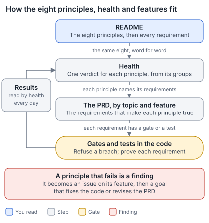
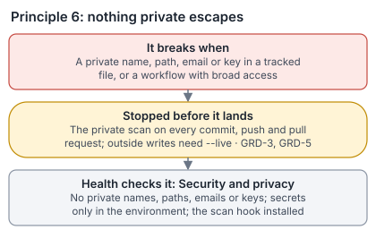

<!-- workflow-docs -->
<!-- workflow-docs guide -->
# Principles

Eight principles sit above the features. Health gives one verdict for each, red when any of its groups fails, and each is made true by the requirements it names. Each table lists every requirement that belongs to its principle, once: the requirement, its feature, the release that introduced it, its title and a link to the feature's flow diagram. A row marked v2.1 (planned) is a feature on the v2.1 roadmap that has no requirement ID yet; the last table lists requirements that fit no principle yet. The README shows the same eight in short; this page has each in full, with its diagram and requirements.

## 1. Documentation-driven

Nothing is built that a Reviewed requirement doesn't ask for, and the PRD changes only by your words.

| Requirement | Feature | Release | Summary | Flow |
|---|---|---|---|---|
| [DOC-2 The PRD is mine](Documentation) | Documentation | v0.1.2 | The PRD is mine | [Documentation flow](How-to-use-Documentation#system-diagram) |
| [DOC-20 Reviewed text is revised, never rewritten](Documentation) | Documentation | v1.0.67 | Reviewed text is revised, never rewritten | [Documentation flow](How-to-use-Documentation#system-diagram) |
| [DOC-22 The PRD is read-only while a goal builds](Documentation) | Documentation | v1.0.67 | The PRD is read-only while a goal builds | [Documentation flow](How-to-use-Documentation#system-diagram) |
| [DEL-2 Done lines are frozen](Delivery) | Delivery | v0.1.2 | Done lines are frozen | [Delivery flow](How-to-use-Delivery#system-diagram) |
| [DEL-18 Everything goes through a goal](Delivery) | Delivery | v1.0.70 | Everything goes through a goal | [Delivery flow](How-to-use-Delivery#system-diagram) |
| [DEL-19 Every goal serves a requirement](Delivery) | Delivery | v1.0.70 | Every goal serves a requirement | [Delivery flow](How-to-use-Delivery#system-diagram) |
| [REG-1 Three kinds of tests](Regression) | Regression | v0.1.2 | Three kinds of tests | [Regression flow](How-to-use-Regression#system-diagram) |
| [INT-7 PRDs kept in an outside document](Integrations) | Integrations | v1.0.74 | PRDs kept in an outside document | [Integrations flow](How-to-use-Integrations#system-diagram) |
| plan-red-team (planned) | Delivery | v2.1 (planned) | plan-red-team | [Delivery flow](How-to-use-Delivery#system-diagram) |

## 2. The loop and coverage

Every requirement is enforced and proven, and whatever falls short, conflicts or has no owner becomes work until it is fixed or the PRD is revised.

| Requirement | Feature | Release | Summary | Flow |
|---|---|---|---|---|
| [REG-1 Three kinds of tests](Regression) | Regression | v0.1.2 | Three kinds of tests | [Regression flow](How-to-use-Regression#system-diagram) |
| [REG-6 Every fixed issue leaves a test](Regression) | Regression | v0.1.2 | Every fixed issue leaves a test | [Regression flow](How-to-use-Regression#system-diagram) |
| [REG-9 Honest results](Regression) | Regression | v0.1.3 | Honest results | [Regression flow](How-to-use-Regression#system-diagram) |
| [REG-10 Tests a machine can't run](Regression) | Regression | v0.27.46 | Tests a machine can't run | [Regression flow](How-to-use-Regression#system-diagram) |
| [REG-15 Coverage is measured in one place](Regression) | Regression | v1.0.74 | Coverage is measured in one place | [Regression flow](How-to-use-Regression#system-diagram) |
| [REG-16 Coverage never drops silently](Regression) | Regression | v1.0.74 | Coverage never drops silently | [Regression flow](How-to-use-Regression#system-diagram) |
| [DOC-3 Tests follow on their own](Documentation) | Documentation | v0.1.2 | Tests follow on their own | [Documentation flow](How-to-use-Documentation#system-diagram) |
| [HLT-4 Findings become issues](Health) | Health | v0.1.2 | Findings become issues | [Health flow](How-to-use-Health#system-diagram) |
| [HLT-6 Every rule can fire](Health) | Health | v0.1.2 | Every rule can fire | [Health flow](How-to-use-Health#system-diagram) |
| [HLT-12 A filed finding becomes work](Health) | Health | v1.0.75 | A filed finding becomes work | [Health flow](How-to-use-Health#system-diagram) |
| [GRD-9 Health proves every guardrail](Guardrails) | Guardrails | v0.27.1 | Health proves every guardrail | [Guardrails flow](How-to-use-Guardrails#system-diagram) |
| [DEL-14 Every goal feeds back what it found](Delivery) | Delivery | v0.28.14 | Every goal feeds back what it found | [Delivery flow](How-to-use-Delivery#system-diagram) |
| [DEL-1 The loop](Delivery) | Delivery | v0.1.2 | The loop | [Delivery flow](How-to-use-Delivery#system-diagram) |
| [DEL-4 The pull request is the record](Delivery) | Delivery | v0.1.2 | The pull request is the record | [Delivery flow](How-to-use-Delivery#system-diagram) |
| [GRD-1 One visible set of guardrails](Guardrails) | Guardrails | v0.27.1 | One visible set of guardrails | [Guardrails flow](How-to-use-Guardrails#system-diagram) |
| [HLT-1 Deterministic and read-only](Health) | Health | v0.1.2 | Deterministic and read-only | [Health flow](How-to-use-Health#system-diagram) |
| [HLT-2 The rules](Health) | Health | v0.1.2 | The rules | [Health flow](How-to-use-Health#system-diagram) |
| [HLT-3 Formal report with one findings table](Health) | Health | v0.1.2 | Formal report with one findings table | [Health flow](How-to-use-Health#system-diagram) |
| [HLT-9 Evidence or nothing](Health) | Health | v0.22.0 | Evidence or nothing | [Health flow](How-to-use-Health#system-diagram) |
| [HLT-10 Every feature has a Backlog milestone](Health) | Health | v0.28.14 | Every feature has a Backlog milestone | [Health flow](How-to-use-Health#system-diagram) |
| [OPS-1 One command starts the operation session](Operation) | Operation | v0.1.2 | One command starts the operation session | [Operation flow](How-to-use-Operation#system-diagram) |
| [OPS-10 Re-plan at every check-in](Operation) | Operation | v0.1.2 | Re-plan at every check-in | [Operation flow](How-to-use-Operation#system-diagram) |
| [REG-2 Test format](Regression) | Regression | v0.1.2 | Test format | [Regression flow](How-to-use-Regression#system-diagram) |
| [REG-3 One command, three places](Regression) | Regression | v0.1.2 | One command, three places | [Regression flow](How-to-use-Regression#system-diagram) |
| [REG-5 Failures go to GitHub](Regression) | Regression | v0.1.2 | Failures go to GitHub | [Regression flow](How-to-use-Regression#system-diagram) |
| [REG-8 Controllable](Regression) | Regression | v0.1.2 | Controllable | [Regression flow](How-to-use-Regression#system-diagram) |
| [REG-12 Lanes don't disturb each other](Regression) | Regression | v1.0.74 | Lanes don't disturb each other | [Regression flow](How-to-use-Regression#system-diagram) |
| [REG-13 One machine's failure is not the goal's failure](Regression) | Regression | v1.0.74 | One machine's failure is not the goal's failure | [Regression flow](How-to-use-Regression#system-diagram) |
| [REL-3 The full suite passes on the candidate](Release) | Release | v0.1.2 | The full suite passes on the candidate | [Release flow](How-to-use-Release#system-diagram) |
| [REL-4 Health, review and pages pass on the candidate](Release) | Release | v0.1.2 | Health, review and pages pass on the candidate | [Release flow](How-to-use-Release#system-diagram) |
| ops-findings (planned) | Operation | v2.1 (planned) | ops-findings | [Operation flow](How-to-use-Operation#system-diagram) |

## 3. The docs are true

The pages agree with each other and with the code: one ID, one name for each command, and no two requirements that contradict.

| Requirement | Feature | Release | Summary | Flow |
|---|---|---|---|---|
| [DOC-1 PRD template](Documentation) | Documentation | v0.1.2 | PRD template | [Documentation flow](How-to-use-Documentation#system-diagram) |
| [DOC-6 Each skill's commands are documented](Documentation) | Documentation | v0.1.2 | Each skill's commands are documented | [Documentation flow](How-to-use-Documentation#system-diagram) |
| [DOC-12 Fast check](Documentation) | Documentation | v0.22.0 | Fast check | [Documentation flow](How-to-use-Documentation#system-diagram) |
| [DOC-13 Same answer every time](Documentation) | Documentation | v0.22.0 | Same answer every time | [Documentation flow](How-to-use-Documentation#system-diagram) |
| [DOC-20 Reviewed text is revised, never rewritten](Documentation) | Documentation | v1.0.67 | Reviewed text is revised, never rewritten | [Documentation flow](How-to-use-Documentation#system-diagram) |
| [DOC-21 A code change alone never un-reviews a page](Documentation) | Documentation | v1.0.74 | A code change alone never un-reviews a page | [Documentation flow](How-to-use-Documentation#system-diagram) |
| [HLT-5 Repo review](Health) | Health | v0.1.2 | Repo review | [Health flow](How-to-use-Health#system-diagram) |
| [HLT-13 Conflicts and orphans are findings](Health) | Health | v1.0.75 | Conflicts and orphans are findings | [Health flow](How-to-use-Health#system-diagram) |
| [REL-10 Every goal ends with a release](Release) | Release | v0.1.2 | Every goal ends with a release | [Release flow](How-to-use-Release#system-diagram) |
| [INT-2 The repo stays the source of truth](Integrations) | Integrations | v1.0.74 | The repo stays the source of truth | [Integrations flow](How-to-use-Integrations#system-diagram) |
| [INT-3 A difference is a delta, never a silent overwrite](Integrations) | Integrations | v0.28.53 | A difference is a delta, never a silent overwrite | [Integrations flow](How-to-use-Integrations#system-diagram) |
| [DOC-4 Home is one table](Documentation) | Documentation | v0.1.2 | Home is one table | [Documentation flow](How-to-use-Documentation#system-diagram) |
| [DOC-10 One Tests page](Documentation) | Documentation | v0.22.0 | One Tests page | [Documentation flow](How-to-use-Documentation#system-diagram) |
| [DOC-14 A feature page lists what it ships](Documentation) | Documentation | v0.25.1 | A feature page lists what it ships | [Documentation flow](How-to-use-Documentation#system-diagram) |
| [DOC-15 Home shows the setup and what runs by itself](Documentation) | Documentation | v0.27.17 | Home shows the setup and what runs by itself | [Documentation flow](How-to-use-Documentation#system-diagram) |
| [DOC-16 A runbook for each routine](Documentation) | Documentation | v0.27.22 | A runbook for each routine | [Documentation flow](How-to-use-Documentation#system-diagram) |
| [DOC-18 Every feature has a How-to-use page](Documentation) | Documentation | v1.0.23 | Every feature has a How-to-use page | [Documentation flow](How-to-use-Documentation#system-diagram) |
| [DOC-19 One How-to item per functional requirement](Documentation) | Documentation | v1.0.28 | One How-to item per functional requirement | [Documentation flow](How-to-use-Documentation#system-diagram) |
| [DOC-23 The README is the principles](Documentation) | Documentation | v1.0.69 | The README is the principles | [Documentation flow](How-to-use-Documentation#system-diagram) |
| [INT-8 Milestones kept in step with an outside page](Integrations) | Integrations | v1.0.74 | Milestones kept in step with an outside page | [Integrations flow](How-to-use-Integrations#system-diagram) |

## 4. Nothing stale or left over

The tests ran today, merged work is released, and no stale branch, idle session, old finding or question to you is left behind.

| Requirement | Feature | Release | Summary | Flow |
|---|---|---|---|---|
| [AUT-2 Regression on a schedule](Automation) | Automation | v0.20.0 | Regression on a schedule | [Automation flow](How-to-use-Automation#system-diagram) |
| [AUT-3 Health on a schedule](Automation) | Automation | v0.20.0 | Health on a schedule | [Automation flow](How-to-use-Automation#system-diagram) |
| [REG-4 When tests run](Regression) | Regression | v0.1.2 | When tests run | [Regression flow](How-to-use-Regression#system-diagram) |
| [REL-9 The merge's wiki check refuses only for what the goal changed](Release) | Release | v0.1.2 | The merge's wiki check refuses only for what the goal changed | [Release flow](How-to-use-Release#system-diagram) |
| [REL-1 A version number says what changed](Release) | Release | v0.1.2 | A version number says what changed | [Release flow](How-to-use-Release#system-diagram) |
| [REL-5 A candidate admits only gate fixes](Release) | Release | v0.1.2 | A candidate admits only gate fixes | [Release flow](How-to-use-Release#system-diagram) |
| [REL-6 Promotion tags, snapshots and reports](Release) | Release | v0.1.2 | Promotion tags, snapshots and reports | [Release flow](How-to-use-Release#system-diagram) |
| [REL-7 A major can be reverted](Release) | Release | v0.1.2 | A major can be reverted | [Release flow](How-to-use-Release#system-diagram) |
| [OPS-6 Clean up after every goal](Operation) | Operation | v0.1.2 | Clean up after every goal | [Operation flow](How-to-use-Operation#system-diagram) |
| [OPS-8 No silent worker](Operation) | Operation | v0.1.2 | No silent worker | [Operation flow](How-to-use-Operation#system-diagram) |
| [HLT-8 Triage](Health) | Health | v0.22.0 | Triage | [Health flow](How-to-use-Health#system-diagram) |
| [HLT-12 A filed finding becomes work](Health) | Health | v1.0.75 | A filed finding becomes work | [Health flow](How-to-use-Health#system-diagram) |
| [CHK-7 Blockers first](Check-in-and-board) | Check in and board | v0.1.3 | Blockers first | [Check in and board flow](How-to-use-Check-in-and-board#system-diagram) |
| [AUT-1 Routines run where they can run fully](Automation) | Automation | v0.20.0 | Routines run where they can run fully | [Automation flow](How-to-use-Automation#system-diagram) |
| [OPS-23 The operation session keeps itself running](Operation) | Operation | v1.0.75 | The operation session keeps itself running | [Operation flow](How-to-use-Operation#system-diagram) |
| [REL-2 A major's milestone is closed out](Release) | Release | v0.1.2 | A major's milestone is closed out | [Release flow](How-to-use-Release#system-diagram) |
| [REL-14 Every release is noted](Release) | Release | v1.0.70 | Every release is noted | [Release flow](How-to-use-Release#system-diagram) |
| [SET-20 A repo behind the template says so](Setup) | Setup | v1.0.70 | A repo behind the template says so | [Setup flow](How-to-use-Setup#system-diagram) |
| release-readiness (planned) | Release | v2.1 (planned) | release-readiness | [Release flow](How-to-use-Release#system-diagram) |

## 5. Fast, cheap and small

Goals, tests and health stay inside their time and token limits, and scripts, pages and the package stay inside their size limits, including Agensi's.

| Requirement | Feature | Release | Summary | Flow |
|---|---|---|---|---|
| [GRD-2 Budgets and caps stop a runaway](Guardrails) | Guardrails | v0.27.1 | Budgets and caps stop a runaway | [Guardrails flow](How-to-use-Guardrails#system-diagram) |
| [GRD-7 CI spends minutes only on runs that matter](Guardrails) | Guardrails | v0.27.1 | CI spends minutes only on runs that matter | [Guardrails flow](How-to-use-Guardrails#system-diagram) |
| [GRD-8 A step far past its usual is flagged while it runs](Guardrails) | Guardrails | v0.27.1 | A step far past its usual is flagged while it runs | [Guardrails flow](How-to-use-Guardrails#system-diagram) |
| [GRD-19 A page stays small enough to review](Guardrails) | Guardrails | v1.0.75 | A page stays small enough to review | [Guardrails flow](How-to-use-Guardrails#system-diagram) |
| [GRD-20 The package always passes Agensi's rules](Guardrails) | Guardrails | v1.0.75 | The package always passes Agensi's rules | [Guardrails flow](How-to-use-Guardrails#system-diagram) |
| [GRD-21 Our package limits are never looser than Agensi's](Guardrails) | Guardrails | v1.0.75 | Our package limits are never looser than Agensi's | [Guardrails flow](How-to-use-Guardrails#system-diagram) |
| [GRD-22 A goal learns at qa that it doesn't fit](Guardrails) | Guardrails | v1.0.75 | A goal learns at qa that it doesn't fit | [Guardrails flow](How-to-use-Guardrails#system-diagram) |
| [DEL-17 A goal's ETA is a hard limit](Delivery) | Delivery | v1.0.28 | A goal's ETA is a hard limit | [Delivery flow](How-to-use-Delivery#system-diagram) |
| [REG-7 Fast in the loop](Regression) | Regression | v0.1.2 | Fast in the loop | [Regression flow](How-to-use-Regression#system-diagram) |
| [REG-11 Preparation is budgeted too](Regression) | Regression | v1.0.74 | Preparation is budgeted too | [Regression flow](How-to-use-Regression#system-diagram) |
| [REG-14 Caps on tests and suite time](Regression) | Regression | v1.0.11 | Caps on tests and suite time | [Regression flow](How-to-use-Regression#system-diagram) |
| [AUT-7 Bounded cost](Automation) | Automation | v0.22.0 | Bounded cost | [Automation flow](How-to-use-Automation#system-diagram) |
| [HLT-11 Health keeps the repo lean](Health) | Health | v1.0.75 | Health keeps the repo lean | [Health flow](How-to-use-Health#system-diagram) |
| [SET-3 Shipped as a versioned package](Setup) | Setup | v0.1.3 | Shipped as a versioned package | [Setup flow](How-to-use-Setup#system-diagram) |
| [CHK-4 A check-in with nothing new costs nothing](Check-in-and-board) | Check in and board | v1.0.75 | A check-in with nothing new costs nothing | [Check in and board flow](How-to-use-Check-in-and-board#system-diagram) |
| [CHK-8 Fast board](Check-in-and-board) | Check in and board | v0.1.2 | Fast board | [Check in and board flow](How-to-use-Check-in-and-board#system-diagram) |
| [GRD-12 Nothing starts under the memory floor](Guardrails) | Guardrails | v0.28.49 | Nothing starts under the memory floor | [Guardrails flow](How-to-use-Guardrails#system-diagram) |
| [GRD-15 Token counts are real or say unread](Guardrails) | Guardrails | v1.0.75 | Token counts are real or say unread | [Guardrails flow](How-to-use-Guardrails#system-diagram) |
| [GRD-17 Too many CI runs raise an alarm](Guardrails) | Guardrails | v1.0.75 | Too many CI runs raise an alarm | [Guardrails flow](How-to-use-Guardrails#system-diagram) |
| [HLT-7 Fast check](Health) | Health | v0.1.2 | Fast check | [Health flow](How-to-use-Health#system-diagram) |
| [OPS-12 Session pool](Operation) | Operation | v0.27.33 | Session pool | [Operation flow](How-to-use-Operation#system-diagram) |
| [OPS-16 Fill every free slot at once](Operation) | Operation | v0.1.3 | Fill every free slot at once | [Operation flow](How-to-use-Operation#system-diagram) |
| [OPS-20 Every ready goal gets its own worker](Operation) | Operation | v1.0.75 | Every ready goal gets its own worker | [Operation flow](How-to-use-Operation#system-diagram) |
| [REL-13 Fast merge queue](Release) | Release | v0.28.47 | Fast merge queue | [Release flow](How-to-use-Release#system-diagram) |
| release-eta (planned) | Release | v2.1 (planned) | release-eta | [Release flow](How-to-use-Release#system-diagram) |
| merge-queue (planned) | Release | v2.1 (planned) | merge-queue | [Release flow](How-to-use-Release#system-diagram) |

## 6. Nothing private escapes

No private name, path, address or key leaves the machine, and automation gets only the access it needs.

| Requirement | Feature | Release | Summary | Flow |
|---|---|---|---|---|
| [GRD-3 Nothing private is committed](Guardrails) | Guardrails | v0.27.1 | Nothing private is committed | [Guardrails flow](How-to-use-Guardrails#system-diagram) |
| [GRD-4 A worker writes only its own goal's work](Guardrails) | Guardrails | v0.27.1 | A worker writes only its own goal's work | [Guardrails flow](How-to-use-Guardrails#system-diagram) |
| [GRD-5 Nothing is written to GitHub without --live](Guardrails) | Guardrails | v0.27.1 | Nothing is written to GitHub without --live | [Guardrails flow](How-to-use-Guardrails#system-diagram) |
| [GRD-16 No commit skips the hooks](Guardrails) | Guardrails | v1.0.75 | No commit skips the hooks | [Guardrails flow](How-to-use-Guardrails#system-diagram) |
| [AUT-6 Private address](Automation) | Automation | v0.22.0 | Private address | [Automation flow](How-to-use-Automation#system-diagram) |
| [AUT-9 Every routine declares what it may do](Automation) | Automation | v0.28.59 | Every routine declares what it may do | [Automation flow](How-to-use-Automation#system-diagram) |
| [INT-4 Nothing leaves without my say](Integrations) | Integrations | v1.0.74 | Nothing leaves without my say | [Integrations flow](How-to-use-Integrations#system-diagram) |
| [MCH-6 Phone-first: starting a worker never needs the desktop app](Machines) | Machines | v1.0.65 | Phone-first: starting a worker never needs the desktop app | [Machines flow](How-to-use-Machines#system-diagram) |
| [DEL-9 Nothing private ships](Delivery) | Delivery | v0.1.3 | Nothing private ships | [Delivery flow](How-to-use-Delivery#system-diagram) |
| [GRD-6 The base branch is protected](Guardrails) | Guardrails | v0.27.1 | The base branch is protected | [Guardrails flow](How-to-use-Guardrails#system-diagram) |
| [MCH-9 A machine keeps its private data to itself](Machines) | Machines | v1.0.70 | A machine keeps its private data to itself | [Machines flow](How-to-use-Machines#system-diagram) |
| [OPS-7 Govern only](Operation) | Operation | v0.1.2 | Govern only | [Operation flow](How-to-use-Operation#system-diagram) |

## 7. It works installed fresh

A repo that adopts the template gets the same loop, checks and guardrails, with nothing rebuilt there.

| Requirement | Feature | Release | Summary | Flow |
|---|---|---|---|---|
| [SET-1 One command adopts a repo](Setup) | Setup | v0.1.3 | One command adopts a repo | [Setup flow](How-to-use-Setup#system-diagram) |
| [SET-6 Adoption is proven](Setup) | Setup | v0.22.0 | Adoption is proven | [Setup flow](How-to-use-Setup#system-diagram) |
| [SET-16 One command judges a repo fully migrated](Setup) | Setup | v1.0.28 | One command judges a repo fully migrated | [Setup flow](How-to-use-Setup#system-diagram) |
| [SET-21 Adopted repos build on the template, not copies of it](Setup) | Setup | v1.0.70 | Adopted repos build on the template, not copies of it | [Setup flow](How-to-use-Setup#system-diagram) |
| [GRD-10 Setup installs the whole set](Guardrails) | Guardrails | v0.27.1 | Setup installs the whole set | [Guardrails flow](How-to-use-Guardrails#system-diagram) |
| [MCH-1 One command sets a machine up](Machines) | Machines | v1.0.26 | One command sets a machine up | [Machines flow](How-to-use-Machines#system-diagram) |
| [MCH-7 Prerequisites first](Machines) | Machines | v1.0.70 | Prerequisites first | [Machines flow](How-to-use-Machines#system-diagram) |
| [DEL-12 Windows-safe on merge](Delivery) | Delivery | v0.27.55 | Windows-safe on merge | [Delivery flow](How-to-use-Delivery#system-diagram) |
| [GRD-18 Windows-safe](Guardrails) | Guardrails | v1.0.75 | Windows-safe | [Guardrails flow](How-to-use-Guardrails#system-diagram) |
| [MCH-2 A new machine or account reaches a working operation session and its peer link from one command](Machines) | Machines | v1.0.57 | A new machine or account reaches a working operation session and its peer link from one command | [Machines flow](How-to-use-Machines#system-diagram) |
| [MCH-3 Backup and restore are commands](Machines) | Machines | v1.0.57 | Backup and restore are commands | [Machines flow](How-to-use-Machines#system-diagram) |
| [MCH-4 Goals move between machines, with one owner and one merge order](Machines) | Machines | v1.0.65 | Goals move between machines, with one owner and one merge order | [Machines flow](How-to-use-Machines#system-diagram) |
| [MCH-10 A drifted machine says so](Machines) | Machines | v1.0.70 | A drifted machine says so | [Machines flow](How-to-use-Machines#system-diagram) |
| [SET-2 Layered settings](Setup) | Setup | v0.1.3 | Layered settings | [Setup flow](How-to-use-Setup#system-diagram) |
| [SET-4 Updates reach every repo](Setup) | Setup | v0.1.3 | Updates reach every repo | [Setup flow](How-to-use-Setup#system-diagram) |
| [SET-5 A self-describing workspace](Setup) | Setup | v0.1.3 | A self-describing workspace | [Setup flow](How-to-use-Setup#system-diagram) |
| [SET-7 Safe and repeatable](Setup) | Setup | v0.22.0 | Safe and repeatable | [Setup flow](How-to-use-Setup#system-diagram) |
| [SET-9 Learn from a repo already set up](Setup) | Setup | v0.22.0 | Learn from a repo already set up | [Setup flow](How-to-use-Setup#system-diagram) |
| [SET-10 The right format for every agent](Setup) | Setup | v0.22.0 | The right format for every agent | [Setup flow](How-to-use-Setup#system-diagram) |
| [SET-11 A strict replay of the first adoption](Setup) | Setup | v0.27.33 | A strict replay of the first adoption | [Setup flow](How-to-use-Setup#system-diagram) |
| [SET-12 Adopt all my repos in one pass](Setup) | Setup | v0.27.33 | Adopt all my repos in one pass | [Setup flow](How-to-use-Setup#system-diagram) |
| [SET-14 The connectors each repo needs are checked](Setup) | Setup | v0.27.33 | The connectors each repo needs are checked | [Setup flow](How-to-use-Setup#system-diagram) |
| [SET-18 Adoption never blocks, and health judges it](Setup) | Setup | v1.0.26 | Adoption never blocks, and health judges it | [Setup flow](How-to-use-Setup#system-diagram) |
| [SET-19 Fixes flow back to the template](Setup) | Setup | v1.0.70 | Fixes flow back to the template | [Setup flow](How-to-use-Setup#system-diagram) |
| develop-staging (planned) | Release | v2.1 (planned) | develop-staging | [Release flow](How-to-use-Release#system-diagram) |

## 8. It stops for you only when it must

It asks you only for what is yours to decide: anything destructive, costly or private, and any change to the PRD. Everything else it decides, tells you, and lets you reverse.

| Requirement | Feature | Release | Summary | Flow |
|---|---|---|---|---|
| [DEL-3 It only stops for me when it must](Delivery) | Delivery | v0.1.2 | It only stops for me when it must | [Delivery flow](How-to-use-Delivery#system-diagram) |
| [DEL-17 A goal's ETA is a hard limit](Delivery) | Delivery | v1.0.28 | A goal's ETA is a hard limit | [Delivery flow](How-to-use-Delivery#system-diagram) |
| [OPS-11 Full auto mode](Operation) | Operation | v0.1.2 | Full auto mode | [Operation flow](How-to-use-Operation#system-diagram) |
| [OPS-18 I say it once](Operation) | Operation | v0.1.3 | I say it once | [Operation flow](How-to-use-Operation#system-diagram) |
| [MCH-8 A goal started on another machine can be adopted](Machines) | Machines | v0.1.3 | A goal started on another machine can be adopted | [Machines flow](How-to-use-Machines#system-diagram) |
| [REL-11 A merge is never refused late or left half done](Release) | Release | v1.0.70 | A merge is never refused late or left half done | [Release flow](How-to-use-Release#system-diagram) |
| [REL-8 Promotion and waivers are my words](Release) | Release | v0.1.2 | Promotion and waivers are my words | [Release flow](How-to-use-Release#system-diagram) |
| [DOC-2 The PRD is mine](Documentation) | Documentation | v0.1.2 | The PRD is mine | [Documentation flow](How-to-use-Documentation#system-diagram) |
| [CHK-7 Blockers first](Check-in-and-board) | Check in and board | v0.1.3 | Blockers first | [Check in and board flow](How-to-use-Check-in-and-board#system-diagram) |
| [CHK-9 I can answer and steer from my phone or mail](Check-in-and-board) | Check in and board | v1.0.75 | I can answer and steer from my phone or mail | [Check in and board flow](How-to-use-Check-in-and-board#system-diagram) |
| [AUT-4 A digest by email](Automation) | Automation | v0.20.0 | A digest by email | [Automation flow](How-to-use-Automation#system-diagram) |
| [AUT-5 Under my control](Automation) | Automation | v0.20.0 | Under my control | [Automation flow](How-to-use-Automation#system-diagram) |
| [AUT-10 A private repo needs no Actions check to merge](Automation) | Automation | v1.0.74 | A private repo needs no Actions check to merge | [Automation flow](How-to-use-Automation#system-diagram) |
| [CHK-1 Live board](Check-in-and-board) | Check in and board | v0.1.2 | Live board | [Check in and board flow](How-to-use-Check-in-and-board#system-diagram) |
| [CHK-2 A check-in on a cadence, in one layout](Check-in-and-board) | Check in and board | v0.1.2 | A check-in on a cadence, in one layout | [Check in and board flow](How-to-use-Check-in-and-board#system-diagram) |
| [CHK-3 Notify me by mail](Check-in-and-board) | Check in and board | v1.0.75 | Notify me by mail | [Check in and board flow](How-to-use-Check-in-and-board#system-diagram) |
| [CHK-6 What a check-in shows of other machines](Check-in-and-board) | Check in and board | v0.1.3 | What a check-in shows of other machines | [Check in and board flow](How-to-use-Check-in-and-board#system-diagram) |
| [DOC-11 Safe publish](Documentation) | Documentation | v0.22.0 | Safe publish | [Documentation flow](How-to-use-Documentation#system-diagram) |
| [MCH-5 One email stream: every update and question by mail, answered by reply](Machines) | Machines | v1.0.65 | One email stream: every update and question by mail, answered by reply | [Machines flow](How-to-use-Machines#system-diagram) |
| [MCH-11 No routine stops to ask](Machines) | Machines | v1.0.70 | No routine stops to ask | [Machines flow](How-to-use-Machines#system-diagram) |
| [OPS-2 Live communication](Operation) | Operation | v0.1.2 | Live communication | [Operation flow](How-to-use-Operation#system-diagram) |
| [REL-12 A review hold before auto merge](Release) | Release | v1.0.70 | A review hold before auto merge | [Release flow](How-to-use-Release#system-diagram) |

## Not yet covered

Requirements that fit none of the eight principles; the owner places them.

| Requirement | Feature | Release | Why no principle fits |
|---|---|---|---|
| [CHK-5 Dependency map](Check-in-and-board) | Check in and board | v1.0.75 | The dependency map shows what waits on what; it is a view, and no principle names a view. |
| [DEL-7 It survives failure](Delivery) | Delivery | v0.1.2 | It survives failure: retries, resume and a stop after three tries. No principle's sentence is about a goal's own robustness. |
| [DEL-16 Each step runs on the agent I pick](Delivery) | Delivery | v1.0.49 | Each step runs on the agent the owner picks: a choice of tool, not a limit, a doc rule or a stop for the owner. |
| [INT-1 One contract for every integration](Integrations) | Integrations | v1.0.74 | One contract for every integration: how outside systems plug in, which no principle's sentence covers. |
| [INT-5 Every integration is visible](Integrations) | Integrations | v1.0.74 | Every integration is visible: a listing of outside systems; no principle's sentence covers it. |
| [INT-6 A new system is an adapter, not a rewrite](Integrations) | Integrations | v1.0.74 | A new system is an adapter, not a rewrite: an extension rule, no principle's sentence covers it. |
| [OPS-13 Two layers per pod](Operation) | Operation | v1.0.75 | Two layers per pod: the shape of the operation's own structure; no principle's sentence covers it. |
| [OPS-15 Pods coordinate through shared state](Operation) | Operation | v1.0.75 | Pods coordinate through shared state: how pods stay consistent; no principle's sentence covers it. |
