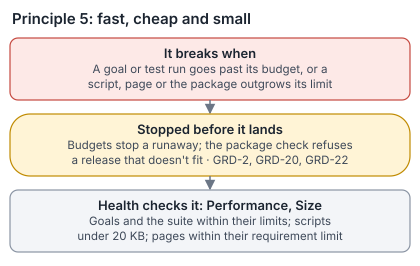

<!-- workflow-docs -->
<!-- workflow-docs guide -->
# Principles

Six principles sit above the features. Health gives one verdict for each, red when any of its groups fails, and each is made true by the requirements it names. Each table has one row per consolidated requirement: its feature or features, the release that introduced it, its substance score, a one-line summary that names the requirements it absorbs, and a link to its own flow diagram. A row marked v2.1 (planned) or v2.0 (in progress) is work with no requirement ID yet. The README shows the same six in short; this page has each in full, with its diagram and requirements.

## 1. Documentation-driven (enforce score 2/5)

Principles, features, requirements and tests are written first, in that order: nothing is built that a Reviewed requirement doesn't ask for, tests come from the requirements, and the PRD changes only by your words.

| Requirement | Features | Release | Score | Summary | Flow |
|---|---|---|---|---|---|
| [DOC-2 Only my words review or revise the PRD](Documentation) | Documentation | 🟧 v2.0 (since v0.1.2) | 5/5 | Only I mark text Reviewed; goals never edit it while building; changes are dated, approved revisions, old ones kept, IDs never reused (absorbs DOC-22, DOC-20) | [DOC-2 flow](https://github.com/jcl2018/agent-workflow-template/blob/main/docs/wiki/flows/DOC-2.svg) |
| [DEL-19 Every change is a goal serving a requirement](Delivery) | Delivery | 🟧 v2.0 (since v0.1.2) | 4/5 | Main changes only through a goal's PR and release commit; a goal freezes only naming a Reviewed requirement; its done lines never change (absorbs DEL-2, DEL-18) | [DEL-19 flow](https://github.com/jcl2018/agent-workflow-template/blob/main/docs/wiki/flows/DEL-19.svg) |
| [INT-7 PRDs may sync with an outside document](Integrations) | Integrations | 🟩 v1.0.74 | 3/5 | A PRD lives in the repo by default; a page may opt in to sync with an outside document, but the repo copy stays authoritative | [INT-7 flow](https://github.com/jcl2018/agent-workflow-template/blob/main/docs/wiki/flows/INT-7.svg) |
| [REG-1 Three kinds of tests](Regression) | Regression | 🟧 v2.0 (since v0.1.2) | 5/5 | Every Reviewed requirement, whole flow and fixed issue has its kind of test; a requirement with no passing test shows not enforced | [REG-1 flow](https://github.com/jcl2018/agent-workflow-template/blob/main/docs/wiki/flows/REG-1.svg) |

## 2. Enforced and kept true (enforce score 2/5)

Every requirement is proven and kept true: tests and health check it, the pages agree with each other and the code, and whatever falls short, conflicts or goes stale becomes work until it is fixed.

| Requirement | Features | Release | Score | Summary | Flow |
|---|---|---|---|---|---|
| [HLT-2 Health checks every rule deterministically and provably](Health) | Health, Documentation, Guardrails | 🟧 v2.0 (since v0.1.2) | 3/5 | Deterministic read-only health checks twelve fixed groups, each rule proven fireable, prints one formal report and per-principle verdicts; UNREAD is never green (absorbs HLT-1, DOC-13, HLT-3, HLT-6, GRD-9, HLT-13, GRD-1) | [HLT-2 flow](https://github.com/jcl2018/agent-workflow-template/blob/main/docs/wiki/flows/HLT-2.svg) |
| [HLT-4 Every finding is one tracked issue until settled](Health) | Health, Regression, Delivery | 🟧 v2.0 (since v0.1.2) | 4/5 | Each finding, failing test and unfixed goal finding is one evidenced issue on its feature's Backlog milestone, triaged with my words and planned into goals (absorbs REG-5, DEL-14, HLT-5, HLT-8, HLT-9, HLT-10, HLT-12) &bull; 🟪 ops-findings (planned): The operation layer files process findings as issues on the owning feature's Backlog, deduped against open issues. [flow](https://github.com/jcl2018/agent-workflow-template/blob/main/docs/wiki/flows/v2.1-ops-findings.svg) | [HLT-4 flow](https://github.com/jcl2018/agent-workflow-template/blob/main/docs/wiki/flows/HLT-4.svg) |
| [AUT-1 Routines run on schedule, by runbook](Automation) | Automation, Documentation | 🟧 v2.0 (since v0.20.0) | 4/5 | Health and regression run on schedule where they can run fully, report where they ran and what they skipped, catch up missed runs, follow runbooks (absorbs AUT-2, AUT-3, DOC-16) | [AUT-1 flow](https://github.com/jcl2018/agent-workflow-template/blob/main/docs/wiki/flows/AUT-1.svg) |
| [DEL-1 One sentence runs unattended to a released PR](Delivery) | Delivery, Release | 🟧 v2.0 (since v0.1.2) | 4/5 | A sentence and done lines run unattended to a recorded PR and noted release; merges refuse only the goal's own doc findings, never half done (absorbs DEL-4, REL-10, REL-14, REL-9, REL-11) &bull; 🟪 plan-red-team (planned): Hourly and before any release ETA, a fresh-context reviewer lists unverified assumptions, idle-capacity work and the biggest risk. [flow](https://github.com/jcl2018/agent-workflow-template/blob/main/docs/wiki/flows/v2.1-plan-red-team.svg) | [DEL-1 flow](https://github.com/jcl2018/agent-workflow-template/blob/main/docs/wiki/flows/DEL-1.svg) |
| [REL-3 A major ships only through the gate](Release) | Release | 🟧 v2.0 (since v0.1.2) | 5/5 | A major exists only after the gate: closed milestone, full suite, green health, all Reviewed; promotion and revert need the operation session and my words (absorbs REL-1, REL-2, REL-4, REL-5, REL-6, REL-8, REL-7) &bull; 🟪 release-readiness (planned): Nightly full CI regression on main, every shard reported, UNRUN 0; a daily red-row count and trend in health and the check-in. [flow](https://github.com/jcl2018/agent-workflow-template/blob/main/docs/wiki/flows/v2.1-release-readiness.svg) | [REL-3 flow](https://github.com/jcl2018/agent-workflow-template/blob/main/docs/wiki/flows/REL-3.svg) |
| [REG-4 Tests are written, listed and run one way](Regression) | Regression, Documentation | 🟧 v2.0 (since v0.1.2) | 4/5 | The loop writes and lists every test in one format; one command runs them everywhere; goals run affected tests, the schedule runs all (absorbs DOC-3, REG-2, DOC-10, REG-3, REG-8, REG-12, REG-13) &bull; 🟧 ci-shards-unrun0 (in progress): Every test runs in CI: the full nightly regression finishes every row inside its job budget (UNRUN 0), so a release gate can accept a main CI run. [flow](https://github.com/jcl2018/agent-workflow-template/blob/main/docs/wiki/flows/v2.0-ci-shards-unrun0.svg) &bull; 🟧 lanes-table-data (in progress): A goal that edits a few lines of the known or regression table runs only the rows those lines change. [flow](https://github.com/jcl2018/agent-workflow-template/blob/main/docs/wiki/flows/v2.0-lanes-table-data.svg) | [REG-4 flow](https://github.com/jcl2018/agent-workflow-template/blob/main/docs/wiki/flows/REG-4.svg) |
| [REG-9 Test results and coverage are honest](Regression) | Regression | 🟧 v2.0 (since v0.1.2) | 5/5 | Every test was seen failing or shows unproven; flaky is marked; fixes leave defect tests; coverage comes from main's full run and never drops silently (absorbs REG-6, REG-10, REG-15, REG-16) | [REG-9 flow](https://github.com/jcl2018/agent-workflow-template/blob/main/docs/wiki/flows/REG-9.svg) |
| [DOC-1 Every page follows its template and stays checked](Documentation) | Documentation | 🟧 v2.0 (since v0.1.2) | 4/5 | Feature, How-to-use, Home and README pages have fixed shapes the docs check enforces; generated sections stay current; code-only changes never un-review pages (absorbs DOC-4, DOC-6, DOC-14, DOC-15, DOC-18, DOC-19, DOC-21, DOC-23) | [DOC-1 flow](https://github.com/jcl2018/agent-workflow-template/blob/main/docs/wiki/flows/DOC-1.svg) |
| [OPS-1 The operation session governs, re-plans and cleans up](Operation) | Operation, Check in and board | 🟧 v2.0 (since v0.1.2) | 3/5 | One command starts a three-layer, govern-only operation session that self-checks, re-plans each check-in, surfaces silent workers and blockers, and cleans up merged goals (absorbs OPS-6, OPS-8, OPS-10, OPS-23, CHK-7) | [OPS-1 flow](https://github.com/jcl2018/agent-workflow-template/blob/main/docs/wiki/flows/OPS-1.svg) |
| [INT-2 Integrations never override the repo copy](Integrations) | Integrations | 🟩 v0.28.53 | 4/5 | Checks read only the repo; unreachable integrations say so harmlessly; two-sided differences become open deltas; milestones may opt in to outside sync (absorbs INT-3, INT-8) | [INT-2 flow](https://github.com/jcl2018/agent-workflow-template/blob/main/docs/wiki/flows/INT-2.svg) |

## 3. Fast, cheap and small (enforce score 3/5)

Goals, tests and health stay inside their time and token limits, and scripts, pages and the package stay inside their size limits, including Agensi's.

| Requirement | Features | Release | Score | Summary | Flow |
|---|---|---|---|---|---|
| [DEL-17 Goal ETAs and release freezes are hard limits](Delivery) | Delivery, Operation, Check in and board | 🟪 v2.1 planned (since v1.0.28) | 4/5 | Goals freeze ETAs and stop at them; I set release target and freeze; slips report at once; the freeze never waives failing rows (absorbs OPS-24, CHK-10) &bull; 🟪 release-eta (planned): A release has a target time and a freeze point; every goal's STATUS carries an ETA and slips over 15 minutes are reported at once. [flow](https://github.com/jcl2018/agent-workflow-template/blob/main/docs/wiki/flows/v2.1-release-eta.svg) | [DEL-17 flow](https://github.com/jcl2018/agent-workflow-template/blob/main/docs/wiki/flows/DEL-17.svg) |
| [REG-7 Test lanes and suite stay within budgets](Regression) | Regression | 🟧 v2.0 (since v0.1.2) | 4/5 | In-loop runs and their preparation each get 15-minute floors; test count and suite time are capped, and goals breaking caps are refused at qa (absorbs REG-11, REG-14) | [REG-7 flow](https://github.com/jcl2018/agent-workflow-template/blob/main/docs/wiki/flows/REG-7.svg) |
| [HLT-7 Checks, check-ins and rounds answer fast](Health) | Health, Documentation, Check in and board, Automation | 🟧 v2.0 (since v0.1.2) | 3/5 | Health under 60 seconds, docs under 30, board under 10, rounds under 45 minutes; an unchanged check-in is one line without a model turn (absorbs DOC-12, CHK-8, AUT-7, CHK-4) | [HLT-7 flow](https://github.com/jcl2018/agent-workflow-template/blob/main/docs/wiki/flows/HLT-7.svg) |
| [GRD-8 Token and time use is real and watched](Guardrails) | Guardrails | 🟧 v2.0 (since v0.27.1) | 4/5 | Step tokens come from session records, missing counts show unread never 0, and a step far past its usual is flagged live (absorbs GRD-15) | [GRD-8 flow](https://github.com/jcl2018/agent-workflow-template/blob/main/docs/wiki/flows/GRD-8.svg) |
| [GRD-7 CI minutes are spent only where needed](Guardrails) | Guardrails | 🟧 v2.0 (since v0.27.1) | 4/5 | Newer runs cancel replaced ones, heavy jobs skip code-free changes, daily run or minute limits raise one alarm, rounds report minutes (absorbs GRD-17) | [GRD-7 flow](https://github.com/jcl2018/agent-workflow-template/blob/main/docs/wiki/flows/GRD-7.svg) |
| [OPS-16 Every ready goal starts within capacity limits](Operation) | Operation, Guardrails | 🟧 v2.0 (since v0.1.3) | 3/5 | Every ready goal with met dependencies gets its own pooled worker at once, unless limits or the 3 GB memory floor hold it (absorbs OPS-20, OPS-12, GRD-12) | [OPS-16 flow](https://github.com/jcl2018/agent-workflow-template/blob/main/docs/wiki/flows/OPS-16.svg) |
| [GRD-20 The package always fits Agensi's rules](Guardrails) | Guardrails | 🟩 v1.0.75 | 5/5 | No release is cut unless the package passes every Agensi rule; our limits are never looser; goals overflowing a limit are refused at qa (absorbs GRD-21, GRD-22) | [GRD-20 flow](https://github.com/jcl2018/agent-workflow-template/blob/main/docs/wiki/flows/GRD-20.svg) |
| [HLT-11 Health keeps scripts, pages and branches lean](Health) | Health, Guardrails | 🟩 v1.0.75 | 3/5 | Health warns scripts over 19,000 bytes, fails at 20 KB, caps requirements per page, names slow tests and prints cleanup commands without running them (absorbs GRD-19) &bull; 🟧 size-trims-19000 (in progress): The 19,000-byte size rows pass again: every script they name is trimmed under 19,000 bytes with behaviour unchanged. [flow](https://github.com/jcl2018/agent-workflow-template/blob/main/docs/wiki/flows/v2.0-size-trims-19000.svg) | [HLT-11 flow](https://github.com/jcl2018/agent-workflow-template/blob/main/docs/wiki/flows/HLT-11.svg) |
| [REL-13 Fast merge queue](Release) | Release | 🟩 v0.28.47 | 4/5 | PRs merge one at a time per repo across machines; only overlapping goals wait; disjoint ready goals batch; moves recheck only reached tests &bull; 🟪 merge-queue (planned): Batch merging in merge.py: one CI run on a draft batch branch, members merged when their tree equals the batch tree except stamp lines. [flow](https://github.com/jcl2018/agent-workflow-template/blob/main/docs/wiki/flows/v2.1-merge-queue.svg) | [REL-13 flow](https://github.com/jcl2018/agent-workflow-template/blob/main/docs/wiki/flows/REL-13.svg) |

## 4. Private and guarded (enforce score 3/5)

No private name, path, address or key leaves the machine, and automation gets only the access it needs.

| Requirement | Features | Release | Score | Summary | Flow |
|---|---|---|---|---|---|
| [DEL-9 Nothing private is committed, shipped or copied](Delivery) | Delivery, Guardrails, Automation, Machines | 🟧 v2.0 (since v0.1.3) | 5/5 | Every commit, push and PR passes the scoped private-name scan; private files, mail address and key stay local and are never copied (absorbs GRD-3, AUT-6, MCH-9) | [DEL-9 flow](https://github.com/jcl2018/agent-workflow-template/blob/main/docs/wiki/flows/DEL-9.svg) |
| [GRD-4 Each session writes only what its role allows](Guardrails) | Guardrails, Operation | 🟧 v2.0 (since v0.1.2) | 5/5 | A worker touches only its own goal's state and cannot widen files, budget or resume itself; check-ins never edit, commit or push (absorbs OPS-7) | [GRD-4 flow](https://github.com/jcl2018/agent-workflow-template/blob/main/docs/wiki/flows/GRD-4.svg) |
| [GRD-5 Nothing is written outside without explicit say](Guardrails) | Guardrails, Integrations | 🟧 v2.0 (since v0.27.1) | 5/5 | GitHub writes preview by default and need --live; integrations read by default, write behind a switch and accepted delta; I attach connectors (absorbs INT-4) | [GRD-5 flow](https://github.com/jcl2018/agent-workflow-template/blob/main/docs/wiki/flows/GRD-5.svg) |
| [GRD-6 Base branch and hooks cannot be bypassed](Guardrails) | Guardrails | 🟧 v2.0 (since v0.27.1) | 4/5 | The base branch refuses direct and force pushes and merges only on required checks; hook-skipping commits are refused and flagged (absorbs GRD-16) | [GRD-6 flow](https://github.com/jcl2018/agent-workflow-template/blob/main/docs/wiki/flows/GRD-6.svg) |
| [AUT-9 Automation runs with declared, least access](Automation) | Automation, Machines | 🟧 v2.0 (since v0.28.59) | 4/5 | Each routine declares allow and deny rules and keeps its prompt locally so it never stops to ask; workers start without the desktop app (absorbs MCH-11, MCH-6) | [AUT-9 flow](https://github.com/jcl2018/agent-workflow-template/blob/main/docs/wiki/flows/AUT-9.svg) |

## 5. Reproducible, portable and adoptable (enforce score 3/5)

The same inputs give the same result on any machine, in any repo and on any agent; any repo adopts the template cleanly, byte for byte, and its README shows the template's principles and design logic as written; it plugs into other systems through adapters, and survives a failure without losing work.

| Requirement | Features | Release | Score | Summary | Flow |
|---|---|---|---|---|---|
| [DEL-7 Work survives failure and moves by backup](Delivery) | Delivery, Machines | 🟧 v2.0 (since v0.1.2) | 4/5 | Failed steps retry thrice then stop with a reason; crashed goals resume; budgets stop new steps; backup and restore move state, never secrets (absorbs MCH-3) | [DEL-7 flow](https://github.com/jcl2018/agent-workflow-template/blob/main/docs/wiki/flows/DEL-7.svg) |
| [SET-10 One versioned package; every agent runs one loop](Setup) | Setup, Delivery | 🟧 v2.0 (since v0.1.3) | 4/5 | One versioned skills package works out of the box in Claude Code and Codex; steps map to agents with warned fallback and recorded tokens (absorbs DEL-16, SET-3) | [SET-10 flow](https://github.com/jcl2018/agent-workflow-template/blob/main/docs/wiki/flows/SET-10.svg) |
| [MCH-1 Any Mac or Windows machine sets up identically](Machines) | Machines, Delivery, Guardrails | 🟧 v2.0 (since v0.27.55) | 3/5 | A fresh clone plus prerequisites checklist, dry run and apply reaches a working operation session; drift is listed; POSIX-only code cannot merge (absorbs MCH-2, MCH-10, MCH-7, DEL-12, GRD-18) | [MCH-1 flow](https://github.com/jcl2018/agent-workflow-template/blob/main/docs/wiki/flows/MCH-1.svg) |
| [MCH-4 One owner and one merge order per goal](Machines) | Machines, Operation | 🟩 v1.0.65 | 4/5 | Each goal has one owning machine; handover, take and adoption move it safely; machine_sync gives one merge order; peer records never approve (absorbs MCH-8, OPS-15) | [MCH-4 flow](https://github.com/jcl2018/agent-workflow-template/blob/main/docs/wiki/flows/MCH-4.svg) |
| [INT-1 Every integration is a declared, visible adapter](Integrations) | Integrations | 🟩 v1.0.74 | 4/5 | Outside systems are opt-in integrations in one registry, added as adapters without loop code changes, with state and deltas shown and counted (absorbs INT-6, INT-5) | [INT-1 flow](https://github.com/jcl2018/agent-workflow-template/blob/main/docs/wiki/flows/INT-1.svg) |
| [SET-1 Any repo adopts the template byte for byte](Setup) | Setup, Guardrails | 🟧 v2.0 (since v0.1.3) | 4/5 | One safe, idempotent command adopts any repo byte for byte; its README shows the template's principles as written plus its own; health judges it (absorbs SET-7, SET-9, SET-18, GRD-10, SET-14, SET-12) | [SET-1 flow](https://github.com/jcl2018/agent-workflow-template/blob/main/docs/wiki/flows/SET-1.svg) |
| [SET-4 Repos build on the template and stay current](Setup) | Setup | 🟧 v2.0 (since v0.1.3) | 4/5 | Adopted repos hold only their data, record their template version, see and take updates, flag lag, judge migration, and send fixes upstream (absorbs SET-20, SET-21, SET-19, SET-16) &bull; 🟪 develop-staging (planned): develop and staging branches for the template; the branch-flow design goes to the owner before any protection or default-branch change. [flow](https://github.com/jcl2018/agent-workflow-template/blob/main/docs/wiki/flows/v2.1-develop-staging.svg) | [SET-4 flow](https://github.com/jcl2018/agent-workflow-template/blob/main/docs/wiki/flows/SET-4.svg) |
| [SET-6 Adoption is proven by strict replay](Setup) | Setup | 🟧 v2.0 (since v0.22.0) | 4/5 | Adoption is proven on realistic test repos and a step-by-step replay against the golden result that stops at the first mismatch (absorbs SET-11) &bull; 🟧 ci-trace-matrix (in progress): Every land command is replayed under the read-trace in about 16 parallel CI jobs, so lanes-trace finishes inside the 900 s row limit. [flow](https://github.com/jcl2018/agent-workflow-template/blob/main/docs/wiki/flows/v2.0-ci-trace-matrix.svg) | [SET-6 flow](https://github.com/jcl2018/agent-workflow-template/blob/main/docs/wiki/flows/SET-6.svg) |
| [SET-2 Layered settings and a generated entry page](Setup) | Setup | 🟧 v2.0 (since v0.1.3) | 4/5 | Settings layer template, repo and private, each defaulted, explained and visible; every repo has one generated entry page from committed settings only (absorbs SET-5) | [SET-2 flow](https://github.com/jcl2018/agent-workflow-template/blob/main/docs/wiki/flows/SET-2.svg) |

## 6. Autonomous, and you decide only what's yours (enforce score 2/5)

It runs by itself across machines and shows where everything stands, and it stops for you only when a decision is truly yours.

| Requirement | Features | Release | Score | Summary | Flow |
|---|---|---|---|---|---|
| [DEL-3 It stops only for decisions that are mine](Delivery) | Delivery, Operation | 🟧 v2.0 (since v0.1.2) | 3/5 | My decisions wait or are auto-approved where allowed; full auto applies all but safety classes; one standing merge instruction covers listed IDs (absorbs OPS-11, OPS-18) | [DEL-3 flow](https://github.com/jcl2018/agent-workflow-template/blob/main/docs/wiki/flows/DEL-3.svg) |
| [MCH-5 One email stream, answered by reply or phone](Machines) | Machines, Check in and board, Automation | 🟧 v2.0 (since v0.20.0) | 4/5 | Each new event mails once within a shared daily budget; rounds send one digest; I answer by reply or phone; safety needs typed words (absorbs CHK-3, CHK-9, AUT-4) | [MCH-5 flow](https://github.com/jcl2018/agent-workflow-template/blob/main/docs/wiki/flows/MCH-5.svg) |
| [CHK-1 One live board and fixed check-in layout](Check-in-and-board) | Check in and board | 🟪 v2.0, v2.1 planned (since v0.1.2) | 4/5 | Top publishes one fixed board every 5 minutes with a measured finish forecast; check-ins come every 30 minutes or on events, hook-enforced, showing all machines (absorbs CHK-2, CHK-5, CHK-6, CHK-11) | [CHK-1 flow](https://github.com/jcl2018/agent-workflow-template/blob/main/docs/wiki/flows/CHK-1.svg) |
| [OPS-2 Live communication on a fixed protocol](Operation) | Operation | 🟧 v2.0 (since v0.1.2) | 4/5 | Workers report every step change live; fixed STATUS, ASK and MERGE messages link worker, machine and top; workers never talk to top | [OPS-2 flow](https://github.com/jcl2018/agent-workflow-template/blob/main/docs/wiki/flows/OPS-2.svg) |
| [REL-12 Merges wait only on gates I set](Release) | Release, Automation | 🟩 v1.0.70 | 4/5 | With a review hold, auto merge waits for the recorded diff read; a private repo needs no Actions check, statuses fill required checks (absorbs AUT-10) | [REL-12 flow](https://github.com/jcl2018/agent-workflow-template/blob/main/docs/wiki/flows/REL-12.svg) |
| [AUT-5 Routines and publishing stay under my control](Automation) | Automation, Documentation | 🟧 v2.0 (since v0.20.0) | 4/5 | Each routine turns off or reschedules in one setting and writes nothing without secrets; publishing never deletes or overwrites foreign pages, and is undoable (absorbs DOC-11) | [AUT-5 flow](https://github.com/jcl2018/agent-workflow-template/blob/main/docs/wiki/flows/AUT-5.svg) |

## Proposed cuts

Taken out of the tables above; the owner decides.

| Requirement | Feature | Reason |
|---|---|---|
| [GRD-2 Budgets and caps stop a runaway](Guardrails) | Guardrails | Pure cross-reference to DEL-7, DEL-17, REG-7, REG-11, REG-14; no guarantee of its own, and the GRD-1 guardrail table already does the pointing. |
| [OPS-13 Two layers per pod](Operation) | Operation | Contradicts OPS-1's three-layer model (top, machine, worker); describes the retired two-layer pod shape. OPS-15's ownership rule survives in MCH-4. |

## Open conflicts for the owner

- SET-1 against SET-7: Byte-for-byte adoption of template files sits beside 'adapts what is there instead of overwriting' and 'nothing existing is overwritten': when a repo already has a file the template installs, the text does not say which wins Status: open, owner to decide (suggested reading: template-owned files are installed byte for byte; repo-owned files are adapted, never overwritten).
