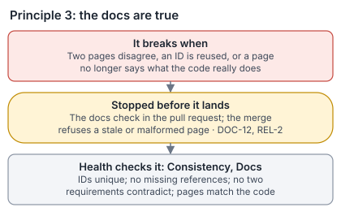
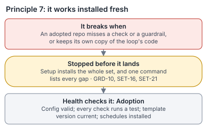
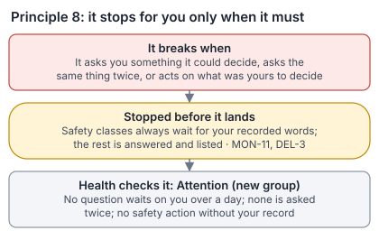

<!-- workflow-docs -->
<!-- workflow-docs guide -->
# Principles

Eight principles sit above the features. Health gives one verdict for each, red when any of its groups fails, and each is made true by the requirements it names. Each table lists every requirement that belongs to its principle, once: the requirement, its feature, the release that introduced it, its title and a link to the feature's flow diagram. A row marked v2.1 (planned) is a feature on the v2.1 roadmap that has no requirement ID yet; the last table lists requirements that fit no principle yet. The README shows the same eight in short; this page has each in full, with its diagram and requirements.

## 1. Documentation-driven

Nothing is built that a Reviewed requirement doesn't ask for, and the PRD changes only by your words.

| Requirement | Feature | Release | Summary | Flow |
|---|---|---|---|---|
| [DOC-2 The PRD is mine](Documentation) | Documentation | 🟧 v2.0 r2 reworded (since v0.1.2) | The PRD is mine | [DOC-2 flow](https://github.com/jcl2018/agent-workflow-template/blob/main/docs/wiki/flows/DOC-2.svg) |
| [DOC-20 Reviewed text is revised, never rewritten](Documentation) | Documentation | 🟧 v2.0 r2 reworded: the revision format (since v1.0.67) | Reviewed text is revised, never rewritten | [DOC-20 flow](https://github.com/jcl2018/agent-workflow-template/blob/main/docs/wiki/flows/DOC-20.svg) |
| [DOC-22 The PRD is read-only while a goal builds](Documentation) | Documentation | 🟧 v2.0 r2 reworded: your rule, 2026-11-17; replaces the standing un-review in… (since v1.0.67) | The PRD is read-only while a goal builds | [DOC-22 flow](https://github.com/jcl2018/agent-workflow-template/blob/main/docs/wiki/flows/DOC-22.svg) |
| [DEL-2 Done lines are frozen](Delivery) | Delivery | 🟧 v2.0 r2 reworded (since v0.1.2) | Done lines are frozen | [DEL-2 flow](https://github.com/jcl2018/agent-workflow-template/blob/main/docs/wiki/flows/DEL-2.svg) |
| [DEL-18 Everything goes through a goal](Delivery) | Delivery | 🟩 v1.0.70 | Everything goes through a goal | [DEL-18 flow](https://github.com/jcl2018/agent-workflow-template/blob/main/docs/wiki/flows/DEL-18.svg) |
| [DEL-19 Every goal serves a requirement](Delivery) | Delivery | 🟩 v1.0.70 | Every goal serves a requirement | [DEL-19 flow](https://github.com/jcl2018/agent-workflow-template/blob/main/docs/wiki/flows/DEL-19.svg) |
| [REG-1 Three kinds of tests](Regression) | Regression | 🟧 v2.0 r2 reworded (since v0.1.2) | Three kinds of tests | [REG-1 flow](https://github.com/jcl2018/agent-workflow-template/blob/main/docs/wiki/flows/REG-1.svg) |
| [INT-7 PRDs kept in an outside document](Integrations) | Integrations | 🟩 v1.0.74 | PRDs kept in an outside document | [INT-7 flow](https://github.com/jcl2018/agent-workflow-template/blob/main/docs/wiki/flows/INT-7.svg) |
| plan-red-team (planned) | Delivery | 🟪 v2.1 (planned) | Hourly and before any release ETA, a fresh-context reviewer lists unverified assumptions, idle-capacity work and the biggest risk. | [plan-red-team flow](https://github.com/jcl2018/agent-workflow-template/blob/main/docs/wiki/flows/v2.1-plan-red-team.svg) |

## 2. The loop and coverage

Every requirement is enforced and proven, and whatever falls short, conflicts or has no owner becomes work until it is fixed or the PRD is revised.

| Requirement | Feature | Release | Summary | Flow |
|---|---|---|---|---|
| [REG-1 Three kinds of tests](Regression) | Regression | 🟧 v2.0 r2 reworded (since v0.1.2) | Three kinds of tests | [REG-1 flow](https://github.com/jcl2018/agent-workflow-template/blob/main/docs/wiki/flows/REG-1.svg) |
| [REG-6 Every fixed issue leaves a test](Regression) | Regression | 🟧 v2.0 r2 reworded (since v0.1.2) | Every fixed issue leaves a test | [REG-6 flow](https://github.com/jcl2018/agent-workflow-template/blob/main/docs/wiki/flows/REG-6.svg) |
| [REG-9 Honest results](Regression) | Regression | 🟧 v2.0 r2 reworded (since v0.1.3) | Honest results | [REG-9 flow](https://github.com/jcl2018/agent-workflow-template/blob/main/docs/wiki/flows/REG-9.svg) |
| [REG-10 Tests a machine can't run](Regression) | Regression | 🟧 v2.0 r2 reworded (since v0.27.46) | Tests a machine can't run | [REG-10 flow](https://github.com/jcl2018/agent-workflow-template/blob/main/docs/wiki/flows/REG-10.svg) |
| [REG-15 Coverage is measured in one place](Regression) | Regression | 🟩 v1.0.74 | Coverage is measured in one place | [REG-15 flow](https://github.com/jcl2018/agent-workflow-template/blob/main/docs/wiki/flows/REG-15.svg) |
| [REG-16 Coverage never drops silently](Regression) | Regression | 🟩 v1.0.74 | Coverage never drops silently | [REG-16 flow](https://github.com/jcl2018/agent-workflow-template/blob/main/docs/wiki/flows/REG-16.svg) |
| [DOC-3 Tests follow on their own](Documentation) | Documentation | 🟧 v2.0 r2 reworded (since v0.1.2) | Tests follow on their own | [DOC-3 flow](https://github.com/jcl2018/agent-workflow-template/blob/main/docs/wiki/flows/DOC-3.svg) |
| [HLT-4 Findings become issues](Health) | Health | 🟧 v2.0 r2 reworded (since v0.1.2) | Findings become issues | [HLT-4 flow](https://github.com/jcl2018/agent-workflow-template/blob/main/docs/wiki/flows/HLT-4.svg) |
| [HLT-6 Every rule can fire](Health) | Health | 🟧 v2.0 r2 reworded (since v0.1.2) | Every rule can fire | [HLT-6 flow](https://github.com/jcl2018/agent-workflow-template/blob/main/docs/wiki/flows/HLT-6.svg) |
| [HLT-12 A filed finding becomes work](Health) | Health | 🟩 v1.0.75 | A filed finding becomes work | [HLT-12 flow](https://github.com/jcl2018/agent-workflow-template/blob/main/docs/wiki/flows/HLT-12.svg) |
| [GRD-9 Health proves every guardrail](Guardrails) | Guardrails | 🟧 v2.0 r2 reworded (since v0.27.1) | Health proves every guardrail | [GRD-9 flow](https://github.com/jcl2018/agent-workflow-template/blob/main/docs/wiki/flows/GRD-9.svg) |
| [DEL-14 Every goal feeds back what it found](Delivery) | Delivery | 🟧 v2.0 r2 reworded (since v0.28.14) | Every goal feeds back what it found | [DEL-14 flow](https://github.com/jcl2018/agent-workflow-template/blob/main/docs/wiki/flows/DEL-14.svg) |
| [DEL-1 The loop](Delivery) | Delivery | 🟧 v2.0 r2 reworded (since v0.1.2) | The loop | [DEL-1 flow](https://github.com/jcl2018/agent-workflow-template/blob/main/docs/wiki/flows/DEL-1.svg) |
| [DEL-4 The pull request is the record](Delivery) | Delivery | 🟧 v2.0 r2 reworded (since v0.1.2) | The pull request is the record | [DEL-4 flow](https://github.com/jcl2018/agent-workflow-template/blob/main/docs/wiki/flows/DEL-4.svg) |
| [GRD-1 One visible set of guardrails](Guardrails) | Guardrails | 🟧 v2.0 r2 reworded (since v0.27.1) | One visible set of guardrails | [GRD-1 flow](https://github.com/jcl2018/agent-workflow-template/blob/main/docs/wiki/flows/GRD-1.svg) |
| [HLT-1 Deterministic and read-only](Health) | Health | 🟧 v2.0 r2 reworded (since v0.1.2) | Deterministic and read-only | [HLT-1 flow](https://github.com/jcl2018/agent-workflow-template/blob/main/docs/wiki/flows/HLT-1.svg) |
| [HLT-2 The rules](Health) | Health | 🟧 v2.0 r2 The groups roll up to the eight principles the README shows… (since v0.1.2) | The rules | [HLT-2 flow](https://github.com/jcl2018/agent-workflow-template/blob/main/docs/wiki/flows/HLT-2.svg) |
| [HLT-3 Formal report with one findings table](Health) | Health | 🟧 v2.0 r2 reworded (since v0.1.2) | Formal report with one findings table | [HLT-3 flow](https://github.com/jcl2018/agent-workflow-template/blob/main/docs/wiki/flows/HLT-3.svg) |
| [HLT-9 Evidence or nothing](Health) | Health | 🟧 v2.0 r2 reworded (since v0.22.0) | Evidence or nothing | [HLT-9 flow](https://github.com/jcl2018/agent-workflow-template/blob/main/docs/wiki/flows/HLT-9.svg) |
| [HLT-10 Every feature has a Backlog milestone](Health) | Health | 🟩 v0.28.14 | Every feature has a Backlog milestone | [HLT-10 flow](https://github.com/jcl2018/agent-workflow-template/blob/main/docs/wiki/flows/HLT-10.svg) |
| [OPS-1 One command starts the operation session](Operation) | Operation | 🟧 v2.0 r2 three-layer operation reland (since v0.1.2) | One command starts the operation session | [OPS-1 flow](https://github.com/jcl2018/agent-workflow-template/blob/main/docs/wiki/flows/OPS-1.svg) |
| [OPS-10 Re-plan at every check-in](Operation) | Operation | 🟩 v0.1.2 | Re-plan at every check-in | [OPS-10 flow](https://github.com/jcl2018/agent-workflow-template/blob/main/docs/wiki/flows/OPS-10.svg) |
| [REG-2 Test format](Regression) | Regression | 🟧 v2.0 r2 reworded (since v0.1.2) | Test format | [REG-2 flow](https://github.com/jcl2018/agent-workflow-template/blob/main/docs/wiki/flows/REG-2.svg) |
| [REG-3 One command, three places](Regression) | Regression | 🟩 v0.1.2 | One command, three places | [REG-3 flow](https://github.com/jcl2018/agent-workflow-template/blob/main/docs/wiki/flows/REG-3.svg) |
| [REG-5 Failures go to GitHub](Regression) | Regression | 🟧 v2.0 r2 reworded (since v0.1.2) | Failures go to GitHub | [REG-5 flow](https://github.com/jcl2018/agent-workflow-template/blob/main/docs/wiki/flows/REG-5.svg) |
| [REG-8 Controllable](Regression) | Regression | 🟧 v2.0 r2 reworded (since v0.1.2) | Controllable | [REG-8 flow](https://github.com/jcl2018/agent-workflow-template/blob/main/docs/wiki/flows/REG-8.svg) |
| [REG-12 Lanes don't disturb each other](Regression) | Regression | 🟩 v1.0.74 | Lanes don't disturb each other | [REG-12 flow](https://github.com/jcl2018/agent-workflow-template/blob/main/docs/wiki/flows/REG-12.svg) |
| [REG-13 One machine's failure is not the goal's failure](Regression) | Regression | 🟩 v1.0.74 | One machine's failure is not the goal's failure | [REG-13 flow](https://github.com/jcl2018/agent-workflow-template/blob/main/docs/wiki/flows/REG-13.svg) |
| [REL-3 The full suite passes on the candidate](Release) | Release | 🟧 v2.0 r3 a CI run of the regression workflow is an accepted suite source… (since v0.1.2) | The full suite passes on the candidate | [REL-3 flow](https://github.com/jcl2018/agent-workflow-template/blob/main/docs/wiki/flows/REL-3.svg) |
| [REL-4 Health, review and pages pass on the candidate](Release) | Release | 🟧 v2.0 r2 reworded: on main since v1.0.61 (release-gate), Unreviewed; text… (since v0.1.2) | Health, review and pages pass on the candidate | [REL-4 flow](https://github.com/jcl2018/agent-workflow-template/blob/main/docs/wiki/flows/REL-4.svg) |
| ci-shards-unrun0 (in progress) | Regression | 🟧 v2.0 (in progress) | Every test runs in CI: the full nightly regression finishes every row inside its job budget (UNRUN 0), so a release gate can accept a main CI run. | [ci-shards-unrun0 flow](https://github.com/jcl2018/agent-workflow-template/blob/main/docs/wiki/flows/v2.0-ci-shards-unrun0.svg) |
| ci-trace-matrix (in progress) | Regression | 🟧 v2.0 (in progress) | Every land command is replayed under the read-trace in about 16 parallel CI jobs, so lanes-trace finishes inside the 900 s row limit. | [ci-trace-matrix flow](https://github.com/jcl2018/agent-workflow-template/blob/main/docs/wiki/flows/v2.0-ci-trace-matrix.svg) |
| ops-findings (planned) | Operation | 🟪 v2.1 (planned) | The operation layer files process findings as issues on the owning feature's Backlog, deduped against open issues. | [ops-findings flow](https://github.com/jcl2018/agent-workflow-template/blob/main/docs/wiki/flows/v2.1-ops-findings.svg) |

## 3. The docs are true

The pages agree with each other and with the code: one ID, one name for each command, and no two requirements that contradict.

| Requirement | Feature | Release | Summary | Flow |
|---|---|---|---|---|
| [DOC-1 PRD template](Documentation) | Documentation | 🟧 v2.0 r3 reworded (since v0.1.2) | PRD template | [DOC-1 flow](https://github.com/jcl2018/agent-workflow-template/blob/main/docs/wiki/flows/DOC-1.svg) |
| [DOC-6 Each skill's commands are documented](Documentation) | Documentation | 🟧 v2.0 r2 reworded (since v0.1.2) | Each skill's commands are documented | [DOC-6 flow](https://github.com/jcl2018/agent-workflow-template/blob/main/docs/wiki/flows/DOC-6.svg) |
| [DOC-12 Fast check](Documentation) | Documentation | 🟧 v2.0 r2 reworded (since v0.22.0) | Fast check | [DOC-12 flow](https://github.com/jcl2018/agent-workflow-template/blob/main/docs/wiki/flows/DOC-12.svg) |
| [DOC-13 Same answer every time](Documentation) | Documentation | 🟧 v2.0 r2 reworded (since v0.22.0) | Same answer every time | [DOC-13 flow](https://github.com/jcl2018/agent-workflow-template/blob/main/docs/wiki/flows/DOC-13.svg) |
| [DOC-20 Reviewed text is revised, never rewritten](Documentation) | Documentation | 🟧 v2.0 r2 reworded: the revision format (since v1.0.67) | Reviewed text is revised, never rewritten | [DOC-20 flow](https://github.com/jcl2018/agent-workflow-template/blob/main/docs/wiki/flows/DOC-20.svg) |
| [DOC-21 A code change alone never un-reviews a page](Documentation) | Documentation | 🟩 v1.0.74 | A code change alone never un-reviews a page | [DOC-21 flow](https://github.com/jcl2018/agent-workflow-template/blob/main/docs/wiki/flows/DOC-21.svg) |
| [HLT-5 Repo review](Health) | Health | 🟧 v2.0 r2 reworded (since v0.1.2) | Repo review | [HLT-5 flow](https://github.com/jcl2018/agent-workflow-template/blob/main/docs/wiki/flows/HLT-5.svg) |
| [HLT-13 Conflicts and orphans are findings](Health) | Health | 🟩 v1.0.75 | Conflicts and orphans are findings | [HLT-13 flow](https://github.com/jcl2018/agent-workflow-template/blob/main/docs/wiki/flows/HLT-13.svg) |
| [REL-10 Every goal ends with a release](Release) | Release | 🟩 v0.1.2 | Every goal ends with a release | [REL-10 flow](https://github.com/jcl2018/agent-workflow-template/blob/main/docs/wiki/flows/REL-10.svg) |
| [INT-2 The repo stays the source of truth](Integrations) | Integrations | 🟩 v1.0.74 | The repo stays the source of truth | [INT-2 flow](https://github.com/jcl2018/agent-workflow-template/blob/main/docs/wiki/flows/INT-2.svg) |
| [INT-3 A difference is a delta, never a silent overwrite](Integrations) | Integrations | 🟩 v0.28.53 | A difference is a delta, never a silent overwrite | [INT-3 flow](https://github.com/jcl2018/agent-workflow-template/blob/main/docs/wiki/flows/INT-3.svg) |
| [DOC-4 Home is one table](Documentation) | Documentation | 🟧 v2.0 r4 owner addition to the v2 rewrite: the milestone-optional rule… (since v0.1.2) | Home is one table | [DOC-4 flow](https://github.com/jcl2018/agent-workflow-template/blob/main/docs/wiki/flows/DOC-4.svg) |
| [DOC-10 One Tests page](Documentation) | Documentation | 🟧 v2.0 r2 reworded (since v0.22.0) | One Tests page | [DOC-10 flow](https://github.com/jcl2018/agent-workflow-template/blob/main/docs/wiki/flows/DOC-10.svg) |
| [DOC-14 A feature page lists what it ships](Documentation) | Documentation | 🟧 v2.0 r2 reworded (since v0.25.1) | A feature page lists what it ships | [DOC-14 flow](https://github.com/jcl2018/agent-workflow-template/blob/main/docs/wiki/flows/DOC-14.svg) |
| [DOC-15 Home shows the setup and what runs by itself](Documentation) | Documentation | 🟧 v2.0 r2 The README no longer carries the Settings and Automation… (since v0.27.17) | Home shows the setup and what runs by itself | [DOC-15 flow](https://github.com/jcl2018/agent-workflow-template/blob/main/docs/wiki/flows/DOC-15.svg) |
| [DOC-16 A runbook for each routine](Documentation) | Documentation | 🟧 v2.0 r2 reworded (since v0.27.22) | A runbook for each routine | [DOC-16 flow](https://github.com/jcl2018/agent-workflow-template/blob/main/docs/wiki/flows/DOC-16.svg) |
| [DOC-18 Every feature has a How-to-use page](Documentation) | Documentation | 🟧 v2.0 r2 The README no longer links the How-to-use pages (DOC-23); Home… (since v1.0.23) | Every feature has a How-to-use page | [DOC-18 flow](https://github.com/jcl2018/agent-workflow-template/blob/main/docs/wiki/flows/DOC-18.svg) |
| [DOC-19 One How-to item per functional requirement](Documentation) | Documentation | 🟧 v2.0 r3 carries the r1 rule that a repo's own published sites and… (since v1.0.28) | One How-to item per functional requirement | [DOC-19 flow](https://github.com/jcl2018/agent-workflow-template/blob/main/docs/wiki/flows/DOC-19.svg) |
| [DOC-23 The README is the principles](Documentation) | Documentation | 🟧 v2.0 r2 README holds the eight principles with enforcing-requirement… (since v1.0.69) | The README is the principles | [DOC-23 flow](https://github.com/jcl2018/agent-workflow-template/blob/main/docs/wiki/flows/DOC-23.svg) |
| [INT-8 Milestones kept in step with an outside page](Integrations) | Integrations | 🟩 v1.0.74 | Milestones kept in step with an outside page | [INT-8 flow](https://github.com/jcl2018/agent-workflow-template/blob/main/docs/wiki/flows/INT-8.svg) |

## 4. Nothing stale or left over

The tests ran today, merged work is released, and no stale branch, idle session, old finding or question to you is left behind.

| Requirement | Feature | Release | Summary | Flow |
|---|---|---|---|---|
| [AUT-2 Regression on a schedule](Automation) | Automation | 🟧 v2.0 r2 reworded (since v0.20.0) | Regression on a schedule | [AUT-2 flow](https://github.com/jcl2018/agent-workflow-template/blob/main/docs/wiki/flows/AUT-2.svg) |
| [AUT-3 Health on a schedule](Automation) | Automation | 🟧 v2.0 r2 reworded (since v0.20.0) | Health on a schedule | [AUT-3 flow](https://github.com/jcl2018/agent-workflow-template/blob/main/docs/wiki/flows/AUT-3.svg) |
| [REG-4 When tests run](Regression) | Regression | 🟧 v2.0 r2 reworded (since v0.1.2) | When tests run | [REG-4 flow](https://github.com/jcl2018/agent-workflow-template/blob/main/docs/wiki/flows/REG-4.svg) |
| [REL-9 The merge's wiki check refuses only for what the goal changed](Release) | Release | 🟧 v2.0 r2 merge.py re-renders other pages Tests tables on the goal… (since v0.1.2) | The merge's wiki check refuses only for what the goal changed | [REL-9 flow](https://github.com/jcl2018/agent-workflow-template/blob/main/docs/wiki/flows/REL-9.svg) |
| [REL-1 A version number says what changed](Release) | Release | 🟧 v2.0 r2 reworded: on main since v1.0.61 (release-gate), Unreviewed; text… (since v0.1.2) | A version number says what changed | [REL-1 flow](https://github.com/jcl2018/agent-workflow-template/blob/main/docs/wiki/flows/REL-1.svg) |
| [REL-5 A candidate admits only gate fixes](Release) | Release | 🟧 v2.0 r2 reworded: on main since v1.0.61 (release-gate), Unreviewed; text… (since v0.1.2) | A candidate admits only gate fixes | [REL-5 flow](https://github.com/jcl2018/agent-workflow-template/blob/main/docs/wiki/flows/REL-5.svg) |
| [REL-6 Promotion tags, snapshots and reports](Release) | Release | 🟧 v2.0 r2 reworded: on main since v1.0.61 (release-gate), Unreviewed; text… (since v0.1.2) | Promotion tags, snapshots and reports | [REL-6 flow](https://github.com/jcl2018/agent-workflow-template/blob/main/docs/wiki/flows/REL-6.svg) |
| [REL-7 A major can be reverted](Release) | Release | 🟧 v2.0 r2 reworded: on main since v1.0.61 (release-gate), Unreviewed; text… (since v0.1.2) | A major can be reverted | [REL-7 flow](https://github.com/jcl2018/agent-workflow-template/blob/main/docs/wiki/flows/REL-7.svg) |
| [OPS-6 Clean up after every goal](Operation) | Operation | 🟩 v0.1.2 | Clean up after every goal | [OPS-6 flow](https://github.com/jcl2018/agent-workflow-template/blob/main/docs/wiki/flows/OPS-6.svg) |
| [OPS-8 No silent worker](Operation) | Operation | 🟩 v0.1.2 | No silent worker | [OPS-8 flow](https://github.com/jcl2018/agent-workflow-template/blob/main/docs/wiki/flows/OPS-8.svg) |
| [HLT-8 Triage](Health) | Health | 🟧 v2.0 r2 reworded (since v0.22.0) | Triage | [HLT-8 flow](https://github.com/jcl2018/agent-workflow-template/blob/main/docs/wiki/flows/HLT-8.svg) |
| [HLT-12 A filed finding becomes work](Health) | Health | 🟩 v1.0.75 | A filed finding becomes work | [HLT-12 flow](https://github.com/jcl2018/agent-workflow-template/blob/main/docs/wiki/flows/HLT-12.svg) |
| [CHK-7 Blockers first](Check-in-and-board) | Check in and board | 🟩 v0.1.3 | Blockers first | [CHK-7 flow](https://github.com/jcl2018/agent-workflow-template/blob/main/docs/wiki/flows/CHK-7.svg) |
| [AUT-1 Routines run where they can run fully](Automation) | Automation | 🟧 v2.0 r2 reworded (since v0.20.0) | Routines run where they can run fully | [AUT-1 flow](https://github.com/jcl2018/agent-workflow-template/blob/main/docs/wiki/flows/AUT-1.svg) |
| [OPS-23 The operation session keeps itself running](Operation) | Operation | 🟧 v2.0 r2 three-layer operation reland (since v1.0.75) | The operation session keeps itself running | [OPS-23 flow](https://github.com/jcl2018/agent-workflow-template/blob/main/docs/wiki/flows/OPS-23.svg) |
| [REL-2 A major's milestone is closed out](Release) | Release | 🟧 v2.0 r2 reworded: on main since v1.0.61 (release-gate), Unreviewed; text… (since v0.1.2) | A major's milestone is closed out | [REL-2 flow](https://github.com/jcl2018/agent-workflow-template/blob/main/docs/wiki/flows/REL-2.svg) |
| [REL-14 Every release is noted](Release) | Release | 🟩 v1.0.70 | Every release is noted | [REL-14 flow](https://github.com/jcl2018/agent-workflow-template/blob/main/docs/wiki/flows/REL-14.svg) |
| [SET-20 A repo behind the template says so](Setup) | Setup | 🟩 v1.0.70 | A repo behind the template says so | [SET-20 flow](https://github.com/jcl2018/agent-workflow-template/blob/main/docs/wiki/flows/SET-20.svg) |
| release-readiness (planned) | Release | 🟪 v2.1 (planned) | Nightly full CI regression on main, every shard reported, UNRUN 0; a daily red-row count and trend in health and the check-in. | [release-readiness flow](https://github.com/jcl2018/agent-workflow-template/blob/main/docs/wiki/flows/v2.1-release-readiness.svg) |

## 5. Fast, cheap and small

Goals, tests and health stay inside their time and token limits, and scripts, pages and the package stay inside their size limits, including Agensi's.

| Requirement | Feature | Release | Summary | Flow |
|---|---|---|---|---|
| [GRD-2 Budgets and caps stop a runaway](Guardrails) | Guardrails | 🟧 v2.0 r2 reworded: index only (since v0.27.1) | Budgets and caps stop a runaway | [GRD-2 flow](https://github.com/jcl2018/agent-workflow-template/blob/main/docs/wiki/flows/GRD-2.svg) |
| [GRD-7 CI spends minutes only on runs that matter](Guardrails) | Guardrails | 🟧 v2.0 r2 reworded (since v0.27.1) | CI spends minutes only on runs that matter | [GRD-7 flow](https://github.com/jcl2018/agent-workflow-template/blob/main/docs/wiki/flows/GRD-7.svg) |
| [GRD-8 A step far past its usual is flagged while it runs](Guardrails) | Guardrails | 🟧 v2.0 r2 reworded (since v0.27.1) | A step far past its usual is flagged while it runs | [GRD-8 flow](https://github.com/jcl2018/agent-workflow-template/blob/main/docs/wiki/flows/GRD-8.svg) |
| [GRD-19 A page stays small enough to review](Guardrails) | Guardrails | 🟩 v1.0.75 | A page stays small enough to review | [GRD-19 flow](https://github.com/jcl2018/agent-workflow-template/blob/main/docs/wiki/flows/GRD-19.svg) |
| [GRD-20 The package always passes Agensi's rules](Guardrails) | Guardrails | 🟩 v1.0.75 | The package always passes Agensi's rules | [GRD-20 flow](https://github.com/jcl2018/agent-workflow-template/blob/main/docs/wiki/flows/GRD-20.svg) |
| [GRD-21 Our package limits are never looser than Agensi's](Guardrails) | Guardrails | 🟩 v1.0.75 | Our package limits are never looser than Agensi's | [GRD-21 flow](https://github.com/jcl2018/agent-workflow-template/blob/main/docs/wiki/flows/GRD-21.svg) |
| [GRD-22 A goal learns at qa that it doesn't fit](Guardrails) | Guardrails | 🟩 v1.0.75 | A goal learns at qa that it doesn't fit | [GRD-22 flow](https://github.com/jcl2018/agent-workflow-template/blob/main/docs/wiki/flows/GRD-22.svg) |
| [DEL-17 A goal's ETA is a hard limit](Delivery) | Delivery | 🟩 v1.0.28 | A goal's ETA is a hard limit | [DEL-17 flow](https://github.com/jcl2018/agent-workflow-template/blob/main/docs/wiki/flows/DEL-17.svg) |
| [REG-7 Fast in the loop](Regression) | Regression | 🟧 v2.0 r2 reworded: one lane limit (your decision, o39) (since v0.1.2) | Fast in the loop | [REG-7 flow](https://github.com/jcl2018/agent-workflow-template/blob/main/docs/wiki/flows/REG-7.svg) |
| [REG-11 Preparation is budgeted too](Regression) | Regression | 🟩 v1.0.74 | Preparation is budgeted too | [REG-11 flow](https://github.com/jcl2018/agent-workflow-template/blob/main/docs/wiki/flows/REG-11.svg) |
| [REG-14 Caps on tests and suite time](Regression) | Regression | 🟩 v1.0.11 | Caps on tests and suite time | [REG-14 flow](https://github.com/jcl2018/agent-workflow-template/blob/main/docs/wiki/flows/REG-14.svg) |
| [AUT-7 Bounded cost](Automation) | Automation | 🟧 v2.0 r2 reworded (since v0.22.0) | Bounded cost | [AUT-7 flow](https://github.com/jcl2018/agent-workflow-template/blob/main/docs/wiki/flows/AUT-7.svg) |
| [HLT-11 Health keeps the repo lean](Health) | Health | 🟩 v1.0.75 | Health keeps the repo lean | [HLT-11 flow](https://github.com/jcl2018/agent-workflow-template/blob/main/docs/wiki/flows/HLT-11.svg) |
| [SET-3 Shipped as a versioned package](Setup) | Setup | 🟧 v2.0 r2 reworded: the Agensi rules move to Guardrails (since v0.1.3) | Shipped as a versioned package | [SET-3 flow](https://github.com/jcl2018/agent-workflow-template/blob/main/docs/wiki/flows/SET-3.svg) |
| [CHK-4 A check-in with nothing new costs nothing](Check-in-and-board) | Check in and board | 🟩 v1.0.75 | A check-in with nothing new costs nothing | [CHK-4 flow](https://github.com/jcl2018/agent-workflow-template/blob/main/docs/wiki/flows/CHK-4.svg) |
| [CHK-8 Fast board](Check-in-and-board) | Check in and board | 🟩 v0.1.2 | Fast board | [CHK-8 flow](https://github.com/jcl2018/agent-workflow-template/blob/main/docs/wiki/flows/CHK-8.svg) |
| [GRD-12 Nothing starts under the memory floor](Guardrails) | Guardrails | 🟧 v2.0 r2 reworded: 3 GB default (your decision, o39) (since v0.28.49) | Nothing starts under the memory floor | [GRD-12 flow](https://github.com/jcl2018/agent-workflow-template/blob/main/docs/wiki/flows/GRD-12.svg) |
| [GRD-15 Token counts are real or say unread](Guardrails) | Guardrails | 🟩 v1.0.75 | Token counts are real or say unread | [GRD-15 flow](https://github.com/jcl2018/agent-workflow-template/blob/main/docs/wiki/flows/GRD-15.svg) |
| [GRD-17 Too many CI runs raise an alarm](Guardrails) | Guardrails | 🟩 v1.0.75 | Too many CI runs raise an alarm | [GRD-17 flow](https://github.com/jcl2018/agent-workflow-template/blob/main/docs/wiki/flows/GRD-17.svg) |
| [HLT-7 Fast check](Health) | Health | 🟧 v2.0 r2 reworded (since v0.1.2) | Fast check | [HLT-7 flow](https://github.com/jcl2018/agent-workflow-template/blob/main/docs/wiki/flows/HLT-7.svg) |
| [OPS-12 Session pool](Operation) | Operation | 🟩 v0.27.33 | Session pool | [OPS-12 flow](https://github.com/jcl2018/agent-workflow-template/blob/main/docs/wiki/flows/OPS-12.svg) |
| [OPS-16 Fill every free slot at once](Operation) | Operation | 🟧 v2.0 r2 three-layer operation reland (since v0.1.3) | Fill every free slot at once | [OPS-16 flow](https://github.com/jcl2018/agent-workflow-template/blob/main/docs/wiki/flows/OPS-16.svg) |
| [OPS-20 Every ready goal gets its own worker](Operation) | Operation | 🟩 v1.0.75 | Every ready goal gets its own worker | [OPS-20 flow](https://github.com/jcl2018/agent-workflow-template/blob/main/docs/wiki/flows/OPS-20.svg) |
| [REL-13 Fast merge queue](Release) | Release | 🟩 v0.28.47 | Fast merge queue | [REL-13 flow](https://github.com/jcl2018/agent-workflow-template/blob/main/docs/wiki/flows/REL-13.svg) |
| lanes-table-data (in progress) | Regression | 🟧 v2.0 (in progress) | A goal that edits a few lines of the known or regression table runs only the rows those lines change. | [lanes-table-data flow](https://github.com/jcl2018/agent-workflow-template/blob/main/docs/wiki/flows/v2.0-lanes-table-data.svg) |
| size-trims-19000 (in progress) | Guardrails | 🟧 v2.0 (in progress) | The 19,000-byte size rows pass again: every script they name is trimmed under 19,000 bytes with behaviour unchanged. | [size-trims-19000 flow](https://github.com/jcl2018/agent-workflow-template/blob/main/docs/wiki/flows/v2.0-size-trims-19000.svg) |
| release-eta (planned) | Release | 🟪 v2.1 (planned) | A release has a target time and a freeze point; every goal's STATUS carries an ETA and slips over 15 minutes are reported at once. | [release-eta flow](https://github.com/jcl2018/agent-workflow-template/blob/main/docs/wiki/flows/v2.1-release-eta.svg) |
| merge-queue (planned) | Release | 🟪 v2.1 (planned) | Batch merging in merge.py: one CI run on a draft batch branch, members merged when their tree equals the batch tree except stamp lines. | [merge-queue flow](https://github.com/jcl2018/agent-workflow-template/blob/main/docs/wiki/flows/v2.1-merge-queue.svg) |

## 6. Nothing private escapes

No private name, path, address or key leaves the machine, and automation gets only the access it needs.

| Requirement | Feature | Release | Summary | Flow |
|---|---|---|---|---|
| [GRD-3 Nothing private is committed](Guardrails) | Guardrails | 🟧 v2.0 r2 reworded (since v0.27.1) | Nothing private is committed | [GRD-3 flow](https://github.com/jcl2018/agent-workflow-template/blob/main/docs/wiki/flows/GRD-3.svg) |
| [GRD-4 A worker writes only its own goal's work](Guardrails) | Guardrails | 🟧 v2.0 r2 reworded (since v0.27.1) | A worker writes only its own goal's work | [GRD-4 flow](https://github.com/jcl2018/agent-workflow-template/blob/main/docs/wiki/flows/GRD-4.svg) |
| [GRD-5 Nothing is written to GitHub without --live](Guardrails) | Guardrails | 🟧 v2.0 r2 reworded (since v0.27.1) | Nothing is written to GitHub without --live | [GRD-5 flow](https://github.com/jcl2018/agent-workflow-template/blob/main/docs/wiki/flows/GRD-5.svg) |
| [GRD-16 No commit skips the hooks](Guardrails) | Guardrails | 🟩 v1.0.75 | No commit skips the hooks | [GRD-16 flow](https://github.com/jcl2018/agent-workflow-template/blob/main/docs/wiki/flows/GRD-16.svg) |
| [AUT-6 Private address](Automation) | Automation | 🟧 v2.0 r2 reworded: one file for both mailers (your decision, o39) (since v0.22.0) | Private address | [AUT-6 flow](https://github.com/jcl2018/agent-workflow-template/blob/main/docs/wiki/flows/AUT-6.svg) |
| [AUT-9 Every routine declares what it may do](Automation) | Automation | 🟧 v2.0 r2 reworded (since v0.28.59) | Every routine declares what it may do | [AUT-9 flow](https://github.com/jcl2018/agent-workflow-template/blob/main/docs/wiki/flows/AUT-9.svg) |
| [INT-4 Nothing leaves without my say](Integrations) | Integrations | 🟩 v1.0.74 | Nothing leaves without my say | [INT-4 flow](https://github.com/jcl2018/agent-workflow-template/blob/main/docs/wiki/flows/INT-4.svg) |
| [MCH-6 Phone-first: starting a worker never needs the desktop app](Machines) | Machines | 🟩 v1.0.65 | Phone-first: starting a worker never needs the desktop app | [MCH-6 flow](https://github.com/jcl2018/agent-workflow-template/blob/main/docs/wiki/flows/MCH-6.svg) |
| [DEL-9 Nothing private ships](Delivery) | Delivery | 🟩 v0.1.3 | Nothing private ships | [DEL-9 flow](https://github.com/jcl2018/agent-workflow-template/blob/main/docs/wiki/flows/DEL-9.svg) |
| [GRD-6 The base branch is protected](Guardrails) | Guardrails | 🟧 v2.0 r2 reworded (since v0.27.1) | The base branch is protected | [GRD-6 flow](https://github.com/jcl2018/agent-workflow-template/blob/main/docs/wiki/flows/GRD-6.svg) |
| [MCH-9 A machine keeps its private data to itself](Machines) | Machines | 🟩 v1.0.70 | A machine keeps its private data to itself | [MCH-9 flow](https://github.com/jcl2018/agent-workflow-template/blob/main/docs/wiki/flows/MCH-9.svg) |
| [OPS-7 Govern only](Operation) | Operation | 🟩 v0.1.2 | Govern only | [OPS-7 flow](https://github.com/jcl2018/agent-workflow-template/blob/main/docs/wiki/flows/OPS-7.svg) |

## 7. It works installed fresh

A repo that adopts the template gets the same loop, checks and guardrails, with nothing rebuilt there.

| Requirement | Feature | Release | Summary | Flow |
|---|---|---|---|---|
| [SET-1 One command adopts a repo](Setup) | Setup | 🟧 v2.0 r2 reworded (since v0.1.3) | One command adopts a repo | [SET-1 flow](https://github.com/jcl2018/agent-workflow-template/blob/main/docs/wiki/flows/SET-1.svg) |
| [SET-6 Adoption is proven](Setup) | Setup | 🟧 v2.0 r2 reworded (since v0.22.0) | Adoption is proven | [SET-6 flow](https://github.com/jcl2018/agent-workflow-template/blob/main/docs/wiki/flows/SET-6.svg) |
| [SET-16 One command judges a repo fully migrated](Setup) | Setup | 🟧 v2.0 r2 reworded (since v1.0.28) | One command judges a repo fully migrated | [SET-16 flow](https://github.com/jcl2018/agent-workflow-template/blob/main/docs/wiki/flows/SET-16.svg) |
| [SET-21 Adopted repos build on the template, not copies of it](Setup) | Setup | 🟩 v1.0.70 | Adopted repos build on the template, not copies of it | [SET-21 flow](https://github.com/jcl2018/agent-workflow-template/blob/main/docs/wiki/flows/SET-21.svg) |
| [GRD-10 Setup installs the whole set](Guardrails) | Guardrails | 🟧 v2.0 r2 reworded (since v0.27.1) | Setup installs the whole set | [GRD-10 flow](https://github.com/jcl2018/agent-workflow-template/blob/main/docs/wiki/flows/GRD-10.svg) |
| [MCH-1 One command sets a machine up](Machines) | Machines | 🟧 v2.0 r2 reworded (since v1.0.26) | One command sets a machine up | [MCH-1 flow](https://github.com/jcl2018/agent-workflow-template/blob/main/docs/wiki/flows/MCH-1.svg) |
| [MCH-7 Prerequisites first](Machines) | Machines | 🟩 v1.0.70 | Prerequisites first | [MCH-7 flow](https://github.com/jcl2018/agent-workflow-template/blob/main/docs/wiki/flows/MCH-7.svg) |
| [DEL-12 Windows-safe on merge](Delivery) | Delivery | 🟩 v0.27.55 | Windows-safe on merge | [DEL-12 flow](https://github.com/jcl2018/agent-workflow-template/blob/main/docs/wiki/flows/DEL-12.svg) |
| [GRD-18 Windows-safe](Guardrails) | Guardrails | 🟩 v1.0.75 | Windows-safe | [GRD-18 flow](https://github.com/jcl2018/agent-workflow-template/blob/main/docs/wiki/flows/GRD-18.svg) |
| [MCH-2 A new machine or account reaches a working operation session and its peer link from one command](Machines) | Machines | 🟩 v1.0.57 | A new machine or account reaches a working operation session and its peer link from one command | [MCH-2 flow](https://github.com/jcl2018/agent-workflow-template/blob/main/docs/wiki/flows/MCH-2.svg) |
| [MCH-3 Backup and restore are commands](Machines) | Machines | 🟩 v1.0.57 | Backup and restore are commands | [MCH-3 flow](https://github.com/jcl2018/agent-workflow-template/blob/main/docs/wiki/flows/MCH-3.svg) |
| [MCH-4 Goals move between machines, with one owner and one merge order](Machines) | Machines | 🟩 v1.0.65 | Goals move between machines, with one owner and one merge order | [MCH-4 flow](https://github.com/jcl2018/agent-workflow-template/blob/main/docs/wiki/flows/MCH-4.svg) |
| [MCH-10 A drifted machine says so](Machines) | Machines | 🟩 v1.0.70 | A drifted machine says so | [MCH-10 flow](https://github.com/jcl2018/agent-workflow-template/blob/main/docs/wiki/flows/MCH-10.svg) |
| [SET-2 Layered settings](Setup) | Setup | 🟧 v2.0 r2 reworded (since v0.1.3) | Layered settings | [SET-2 flow](https://github.com/jcl2018/agent-workflow-template/blob/main/docs/wiki/flows/SET-2.svg) |
| [SET-4 Updates reach every repo](Setup) | Setup | 🟧 v2.0 r2 reworded (since v0.1.3) | Updates reach every repo | [SET-4 flow](https://github.com/jcl2018/agent-workflow-template/blob/main/docs/wiki/flows/SET-4.svg) |
| [SET-5 A self-describing workspace](Setup) | Setup | 🟧 v2.0 r2 reworded: "committed settings only" is new (since v0.1.3) | A self-describing workspace | [SET-5 flow](https://github.com/jcl2018/agent-workflow-template/blob/main/docs/wiki/flows/SET-5.svg) |
| [SET-7 Safe and repeatable](Setup) | Setup | 🟩 v0.22.0 | Safe and repeatable | [SET-7 flow](https://github.com/jcl2018/agent-workflow-template/blob/main/docs/wiki/flows/SET-7.svg) |
| [SET-9 Learn from a repo already set up](Setup) | Setup | 🟧 v2.0 r2 reworded (since v0.22.0) | Learn from a repo already set up | [SET-9 flow](https://github.com/jcl2018/agent-workflow-template/blob/main/docs/wiki/flows/SET-9.svg) |
| [SET-10 The right format for every agent](Setup) | Setup | 🟧 v2.0 r2 reworded (since v0.22.0) | The right format for every agent | [SET-10 flow](https://github.com/jcl2018/agent-workflow-template/blob/main/docs/wiki/flows/SET-10.svg) |
| [SET-11 A strict replay of the first adoption](Setup) | Setup | 🟧 v2.0 r3 adoption-golden: SET-11 names its fixture file again, so the… (since v0.27.33) | A strict replay of the first adoption | [SET-11 flow](https://github.com/jcl2018/agent-workflow-template/blob/main/docs/wiki/flows/SET-11.svg) |
| [SET-12 Adopt all my repos in one pass](Setup) | Setup | 🟧 v2.0 r2 reworded (since v0.27.33) | Adopt all my repos in one pass | [SET-12 flow](https://github.com/jcl2018/agent-workflow-template/blob/main/docs/wiki/flows/SET-12.svg) |
| [SET-14 The connectors each repo needs are checked](Setup) | Setup | 🟧 v2.0 r2 reworded (since v0.27.33) | The connectors each repo needs are checked | [SET-14 flow](https://github.com/jcl2018/agent-workflow-template/blob/main/docs/wiki/flows/SET-14.svg) |
| [SET-18 Adoption never blocks, and health judges it](Setup) | Setup | 🟩 v1.0.26 | Adoption never blocks, and health judges it | [SET-18 flow](https://github.com/jcl2018/agent-workflow-template/blob/main/docs/wiki/flows/SET-18.svg) |
| [SET-19 Fixes flow back to the template](Setup) | Setup | 🟩 v1.0.70 | Fixes flow back to the template | [SET-19 flow](https://github.com/jcl2018/agent-workflow-template/blob/main/docs/wiki/flows/SET-19.svg) |
| develop-staging (planned) | Release | 🟪 v2.1 (planned) | develop and staging branches for the template; the branch-flow design goes to the owner before any protection or default-branch change. | [develop-staging flow](https://github.com/jcl2018/agent-workflow-template/blob/main/docs/wiki/flows/v2.1-develop-staging.svg) |

## 8. It stops for you only when it must

It asks you only for what is yours to decide: anything destructive, costly or private, and any change to the PRD. Everything else it decides, tells you, and lets you reverse.

| Requirement | Feature | Release | Summary | Flow |
|---|---|---|---|---|
| [DEL-3 It only stops for me when it must](Delivery) | Delivery | 🟧 v2.0 r2 reworded (since v0.1.2) | It only stops for me when it must | [DEL-3 flow](https://github.com/jcl2018/agent-workflow-template/blob/main/docs/wiki/flows/DEL-3.svg) |
| [DEL-17 A goal's ETA is a hard limit](Delivery) | Delivery | 🟩 v1.0.28 | A goal's ETA is a hard limit | [DEL-17 flow](https://github.com/jcl2018/agent-workflow-template/blob/main/docs/wiki/flows/DEL-17.svg) |
| [OPS-11 Full auto mode](Operation) | Operation | 🟧 v2.0 r2 three-layer operation reland (since v0.1.2) | Full auto mode | [OPS-11 flow](https://github.com/jcl2018/agent-workflow-template/blob/main/docs/wiki/flows/OPS-11.svg) |
| [OPS-18 I say it once](Operation) | Operation | 🟩 v0.1.3 | I say it once | [OPS-18 flow](https://github.com/jcl2018/agent-workflow-template/blob/main/docs/wiki/flows/OPS-18.svg) |
| [MCH-8 A goal started on another machine can be adopted](Machines) | Machines | 🟩 v0.1.3 | A goal started on another machine can be adopted | [MCH-8 flow](https://github.com/jcl2018/agent-workflow-template/blob/main/docs/wiki/flows/MCH-8.svg) |
| [REL-11 A merge is never refused late or left half done](Release) | Release | 🟩 v1.0.70 | A merge is never refused late or left half done | [REL-11 flow](https://github.com/jcl2018/agent-workflow-template/blob/main/docs/wiki/flows/REL-11.svg) |
| [REL-8 Promotion and waivers are my words](Release) | Release | 🟧 v2.0 r2 reworded: on main since v1.0.61 (release-gate), Unreviewed; text… (since v0.1.2) | Promotion and waivers are my words | [REL-8 flow](https://github.com/jcl2018/agent-workflow-template/blob/main/docs/wiki/flows/REL-8.svg) |
| [DOC-2 The PRD is mine](Documentation) | Documentation | 🟧 v2.0 r2 reworded (since v0.1.2) | The PRD is mine | [DOC-2 flow](https://github.com/jcl2018/agent-workflow-template/blob/main/docs/wiki/flows/DOC-2.svg) |
| [CHK-7 Blockers first](Check-in-and-board) | Check in and board | 🟩 v0.1.3 | Blockers first | [CHK-7 flow](https://github.com/jcl2018/agent-workflow-template/blob/main/docs/wiki/flows/CHK-7.svg) |
| [CHK-9 I can answer and steer from my phone or mail](Check-in-and-board) | Check in and board | 🟩 v1.0.75 | I can answer and steer from my phone or mail | [CHK-9 flow](https://github.com/jcl2018/agent-workflow-template/blob/main/docs/wiki/flows/CHK-9.svg) |
| [AUT-4 A digest by email](Automation) | Automation | 🟧 v2.0 r2 reworded (since v0.20.0) | A digest by email | [AUT-4 flow](https://github.com/jcl2018/agent-workflow-template/blob/main/docs/wiki/flows/AUT-4.svg) |
| [AUT-5 Under my control](Automation) | Automation | 🟧 v2.0 r2 reworded (since v0.20.0) | Under my control | [AUT-5 flow](https://github.com/jcl2018/agent-workflow-template/blob/main/docs/wiki/flows/AUT-5.svg) |
| [AUT-10 A private repo needs no Actions check to merge](Automation) | Automation | 🟩 v1.0.74 | A private repo needs no Actions check to merge | [AUT-10 flow](https://github.com/jcl2018/agent-workflow-template/blob/main/docs/wiki/flows/AUT-10.svg) |
| [CHK-1 Live board](Check-in-and-board) | Check in and board | 🟧 v2.0 r2 three-layer operation reland (since v0.1.2) | Live board | [CHK-1 flow](https://github.com/jcl2018/agent-workflow-template/blob/main/docs/wiki/flows/CHK-1.svg) |
| [CHK-2 A check-in on a cadence, in one layout](Check-in-and-board) | Check in and board | 🟧 v2.0 r2 three-layer operation reland (since v0.1.2) | A check-in on a cadence, in one layout | [CHK-2 flow](https://github.com/jcl2018/agent-workflow-template/blob/main/docs/wiki/flows/CHK-2.svg) |
| [CHK-3 Notify me by mail](Check-in-and-board) | Check in and board | 🟩 v1.0.75 | Notify me by mail | [CHK-3 flow](https://github.com/jcl2018/agent-workflow-template/blob/main/docs/wiki/flows/CHK-3.svg) |
| [CHK-6 What a check-in shows of other machines](Check-in-and-board) | Check in and board | 🟩 v0.1.3 | What a check-in shows of other machines | [CHK-6 flow](https://github.com/jcl2018/agent-workflow-template/blob/main/docs/wiki/flows/CHK-6.svg) |
| [DOC-11 Safe publish](Documentation) | Documentation | 🟧 v2.0 r2 reworded (since v0.22.0) | Safe publish | [DOC-11 flow](https://github.com/jcl2018/agent-workflow-template/blob/main/docs/wiki/flows/DOC-11.svg) |
| [MCH-5 One email stream: every update and question by mail, answered by reply](Machines) | Machines | 🟩 v1.0.65 | One email stream: every update and question by mail, answered by reply | [MCH-5 flow](https://github.com/jcl2018/agent-workflow-template/blob/main/docs/wiki/flows/MCH-5.svg) |
| [MCH-11 No routine stops to ask](Machines) | Machines | 🟩 v1.0.70 | No routine stops to ask | [MCH-11 flow](https://github.com/jcl2018/agent-workflow-template/blob/main/docs/wiki/flows/MCH-11.svg) |
| [OPS-2 Live communication](Operation) | Operation | 🟧 v2.0 r2 three-layer operation reland (since v0.1.2) | Live communication | [OPS-2 flow](https://github.com/jcl2018/agent-workflow-template/blob/main/docs/wiki/flows/OPS-2.svg) |
| [REL-12 A review hold before auto merge](Release) | Release | 🟩 v1.0.70 | A review hold before auto merge | [REL-12 flow](https://github.com/jcl2018/agent-workflow-template/blob/main/docs/wiki/flows/REL-12.svg) |

## Not yet covered

Requirements that fit none of the eight principles; the owner places them.

| Requirement | Feature | Reason |
|---|---|---|
| [CHK-5 Dependency map](Check-in-and-board) | Check in and board | The dependency map shows what waits on what; it is a view, and no principle names a view. |
| [DEL-7 It survives failure](Delivery) | Delivery | It survives failure: retries, resume and a stop after three tries. No principle's sentence is about a goal's own robustness. |
| [DEL-16 Each step runs on the agent I pick](Delivery) | Delivery | Each step runs on the agent the owner picks: a choice of tool, not a limit, a doc rule or a stop for the owner. |
| [INT-1 One contract for every integration](Integrations) | Integrations | One contract for every integration: how outside systems plug in, which no principle's sentence covers. |
| [INT-5 Every integration is visible](Integrations) | Integrations | Every integration is visible: a listing of outside systems; no principle's sentence covers it. |
| [INT-6 A new system is an adapter, not a rewrite](Integrations) | Integrations | A new system is an adapter, not a rewrite: an extension rule, no principle's sentence covers it. |
| [OPS-13 Two layers per pod](Operation) | Operation | Two layers per pod: the shape of the operation's own structure; no principle's sentence covers it. |
| [OPS-15 Pods coordinate through shared state](Operation) | Operation | Pods coordinate through shared state: how pods stay consistent; no principle's sentence covers it. |
