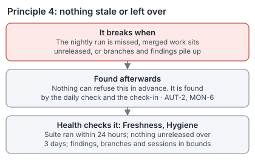

<!-- workflow-docs -->
<!-- workflow-docs guide -->
# Principles

Eight principles sit above the features. Health gives one verdict for each, red when any of its groups fails, and each is made true by the requirements it names. A requirement marked planned is added by the named regroup goal of the v2.0 roadmap (regroup-delivery, regroup-regression or regroup-guardrails); an ID never takes a new meaning, so a drafted requirement whose ID a live one holds is cited under its next free number.

## 1. Documentation-driven

Nothing is built that a Reviewed requirement doesn't ask for, and the PRD changes only by your words.

Enforced by: DOC-2, DOC-20, DOC-22, DEL-2, DEL-18 (planned: regroup-delivery), DEL-19 (planned: regroup-delivery), REG-1

## 2. The loop and coverage

Every requirement is enforced and proven, and whatever falls short, conflicts or has no owner becomes work until it is fixed or the PRD is revised.

Enforced by: REG-1, REG-6, REG-9, REG-10, REG-15 (planned: regroup-regression), REG-16 (planned: regroup-regression), DOC-3, HLT-4, HLT-6, HLT-12 (planned: regroup-guardrails), GRD-9, DEL-14

## 3. The docs are true

The pages agree with each other and with the code: one ID, one name for each command, and no two requirements that contradict.

Enforced by: DOC-1, DOC-6, DOC-12, DOC-13, DOC-20, DOC-21 (planned: regroup-regression), HLT-5, HLT-13 (planned: regroup-guardrails), REL-10 (planned: regroup-delivery), INT-2 (planned: regroup-regression), INT-3 (planned: regroup-regression)

## 4. Nothing stale or left over

The tests ran today, merged work is released, and no stale branch, idle session, old finding or question to you is left behind.

Enforced by: AUT-2, AUT-3, REG-4, REL-9 (planned: regroup-delivery), REL-1, REL-5, REL-6, REL-7, MON-6, MON-8, HLT-8, HLT-12 (planned: regroup-guardrails), CHK-7 (planned: regroup-guardrails)

## 5. Fast, cheap and small

Goals, tests and health stay inside their time and token limits, and scripts, pages and the package stay inside their size limits, including Agensi's.

Enforced by: GRD-2, GRD-7, GRD-8, GRD-19 (planned: regroup-guardrails), GRD-20 (planned: regroup-guardrails), GRD-21 (planned: regroup-guardrails), GRD-22 (planned: regroup-guardrails), DEL-17 (planned: regroup-delivery), REG-7, REG-11 (planned: regroup-regression), REG-14 (planned: regroup-regression), AUT-7, HLT-11 (planned: regroup-guardrails), SET-3

## 6. Nothing private escapes

No private name, path, address or key leaves the machine, and automation gets only the access it needs.

Enforced by: GRD-3, GRD-4, GRD-5, GRD-16 (planned: regroup-guardrails), AUT-6, AUT-9, INT-4 (planned: regroup-regression), MCH-6 (planned: regroup-delivery)

## 7. It works installed fresh

A repo that adopts the template gets the same loop, checks and guardrails, with nothing rebuilt there.

Enforced by: SET-1, SET-6, SET-16, SET-21 (planned: regroup-delivery), GRD-10, MCH-1, MCH-7 (planned: regroup-delivery)

## 8. It stops for you only when it must

It asks you only for what is yours to decide: anything destructive, costly or private, and any change to the PRD. Everything else it decides, tells you, and lets you reverse.

Enforced by: DEL-3, DEL-17 (planned: regroup-delivery), MON-11, MON-18, MCH-8 (planned: regroup-delivery), REL-11 (planned: regroup-delivery), REL-8, DOC-2, CHK-7 (planned: regroup-guardrails), CHK-9 (planned: regroup-guardrails)
