# Loop files

The workflow skills share this contract. The design guide at the end explains how they fit together. Skill instructions never go in the repo. A repo holds only its own data.

## In the repo: `.loop/`

| File | Holds |
|---|---|
| `.loop/config.json` | Base branch, check commands, agent commands, risky paths |
| `.loop/queue.md` | Goals to run, one line each |
| `.loop/goals/<slug>.md` | One goal: done lines, plan, log |
| `.loop/findings.md` | Open findings, one line each |
| `.loop/docs.tsv` | Each wiki page and the paths it describes |
| `.loop/prd/PAGE.md` | The repo's copy of a feature's external PRD, one `- ID: text` line per requirement; an agent's goal may edit a line, and `docs.py sync` writes it (first line `<!-- prd-sync: owned -->`) when it adopts the source or accepts a side |
| `.loop/prd/PAGE.base` | What the copy and the external PRD last agreed on, `ID<TAB>sha8` per requirement; written by `docs.py sync` |
| `.loop/config.json` key `session_command` | The session tool, as a list: called `start NAME` (prints the new session's id), `rename ID NAME` and `send ID TEXT`; a non-zero exit or 30 seconds means no session, so the goal falls back to a background process. `$LOOP_SESSION_TOOL` replaces it. The pool is `loop/session-pool.json` under the git common dir |
| `.loop/config.json` key `criteria` | `true` makes `docs.py check` enforce the criteria contract on the wiki pages; each regression row links to one criterion by its goal or id; a reviewed line ends with a hash of its text, and `docs.py check` fails if the text changes; `criteria.py render` makes each page's Tests table |
| `.loop/regression.tsv` | Each test row: id, level, command, goal, date seen failing |
| `.loop/regression-issues.tsv` | Each defect test's issue or pull request: link, state, date; written only by `tests.py issues --write`, shown in the wiki Tests lines and the health report |
| `.loop/regression-runs.tsv` | Each row's last run: id, PASS or FAIL, date; written by `regression.py run`, shown in the wiki Tests tables |
| `.loop/regression-known.tsv` | Rows expected to fail, with a reason; they don't block |
| `.loop/health-rules.json` | The repo's own health rules (each with a break command), default rules turned off with a reason; setup writes it empty |
| `.loop/regression-red.tsv` | Red results proven on another runner: id, date, runner, commit |
| `.loop/START.md` | The generated entry point every new session reads first (`entry.py write`); never edited by hand |
| `CLAUDE.md`, `AGENTS.md` | Each agent's entry file; setup wires the same marked `<!-- workflow-loop -->` block into each (`agent_files`), text outside it is the repo's own |
| `.loop/config.json` key `template_version` | The template version that last wrote the repo's generated files; `update` moves it, the board flags a repo behind |
| `.loop/config.json` keys `template_repo`, `agent_files` | The template's GitHub repo, used when the installed package names none; the agent files setup wires |

Wiki pages live in `docs/wiki/`. Each starts with the line `<!-- workflow-docs -->`, which marks it as safe to update.

### `config.json`

```json
{
  "base": "main",
  "agent_command": ["claude", "-p"],
  "parallel": 0,
  "risky_paths": ["^\\.github/", "(^|/)auth", "(^|/)migrations?/", "(^|/)(schema|data)\\b"],
  "version_file": "VERSION",
  "wiki_dir": "docs/wiki",
  "pr_bumps_version": false,
  "mend": false,
  "resume_on_limit": false
}
```

- Every setting, repo and private, with its default and a one-line explanation, is listed in `workflow-setup/references/settings.md`
  (generated from `settings.py`). `setup.py` writes each repo setting into `config.json` and each private setting into the
  flow file, and keeps any value already set. Every script reads these files fresh on each run, so a change applies at once.
- `parallel`: workers at once; `0` means unlimited, and it is the default.
- `cadence`, `step_limit`, `token_budget`, `max_tries`, `routines`, `regression_cron`, and `test_budget_minutes`, `step_budget_minutes`, `prep_budget_minutes` (none under 15), and health's `stale_branch_days` are optional repo settings; see the reference.
- `agent_command` runs a goal in the background; the prompt is its last argument.
- `auto_approve` (default `false`): `true` approves what a flow step leaves for the owner, logged as auto-approved.
- `review_depth` (default `full`): `full` makes the plan and review steps run their skill's whole pipeline and refuses a
  condensed reply; `condensed` allows a shorter run. Every step's reply states `DEPTH: full|condensed`, record stamps it
  on the step, and the board and the pull request body show it. The flow file's private `full_markers` (per step, strings)
  must appear in a full plan or review reply. `config.json` carries its one-line explanation under `_help`.
- `auto_merge` (default `false`): `true` lets the release step's `merge.py` merge a goal's pull request.
- `pr_bumps_version` moves the last number of the version file on a goal's branch, for repos whose CI needs a bump.
- `mend` and `resume_on_limit` let `watch` restart a goal. `limit_wait`, `mend_wait` and `watch_interval` are optional, in seconds.
- `criteria` (set `true` by `setup`) and `regression_cron` (default `17 */4 * * *`, the scheduled regression's cron, or `off`) are also read by the docs and regression skills; `health_cron` (default `47 */4 * * *`, read by the Mac's local schedule), `regression_runs` (`actions` or `mac`, written by setup) and `digest_owner` set the scheduled health run and its digest (`judge_env` and `judge_setup` are no longer read), and `digest_mail` (default `cloudflare`, or `smtp` or `off`), `smtp_host` and `smtp_port` how the digest is emailed (Automation page).
- Permissions are yours. These commands run as you set them, and nothing here turns them off.

### `goals/<slug>.md`

`## Done lines` is frozen. `## Verify by hand` holds numbered steps for a person, each with an `Expect:` line. A release
refuses without one, and copies the steps into the changelog and the release page.

### `queue.md`

One goal a line. Other lines are ignored.

```
- slug: add-median | touches: calc.py, test_calc.py | goal: Add median() | done: Odd lists give the middle value | done: Even lists average the two middle values
```

A `## Batch: NAME` heading groups goal lines for `batch.py`.

`touches` lists the files the goal declares; it never holds a goal back. `depends: a, b` (or `depends-on: a, b`, the same key) names goals that must be merged
before this one starts. `release: ask` makes a monitored goal wait
for your answer instead of answering `leave`.

## Outside the repo: the installed skills

`workflow-package.json` sits in the skills folder next to the `workflow-*` folders: `{"version", "files"}`, a hash for each
skill file, written by the package build and moved by `update.py --apply`. It is the only file `update.py` keeps besides
the skill files themselves; it never reads or writes `.loop/`, the wiki or private settings. `setup.py` writes `.loop/`
and the wiki pages on the `workflow-setup` branch and leaves existing values and words as they were.

## Outside the repo: your skill flow

`~/.workflow-loop/flow.json` (or the file `$LOOP_FLOW` names) is yours and is never committed. Delivery refuses without it.
Setup writes one whose suite maps the five steps to `built-in`, delivery's own routine (`workflow-delivery/references/commands.md`, The built-in flow),
so it runs with no suite of your own; it fills a suite that was never configured (every value empty, no `steps`) the same way.

```json
{
  "command": ["claude", "-p", "--allowedTools=Bash,Read,Write,Edit,Skill"],
  "env": {"YOUR_SUITE_MODE": "unattended"},
  "probe": ["/path/to/a/command/that/prints/the/mode"],
  "probe_expect": "unattended",
  "suite": {"idea": "<your idea skill>", "plan": "<your plan skill>", "review": "<your review skill>",
            "qa": "<your test skill>", "ship": "<your ship skill>"},
  "steps": {"review": "<a skill for this one step, replacing the suite's>"},
  "limit": 2700,
  "allowed_tools": [],
  "model": "",
  "overrides": {"qa": {"model": "<a model>", "allowed_tools": ["Bash", "Read"]}}
}
```

- `command` runs one step; the prompt is its last argument. `env` is added to its environment.
- `probe` runs under the same environment, and its output must hold `probe_expect`, or no step starts. Use it to prove
  your skills will take their recommended answers, leave approvals pending, and never push. Only a step mapped to a named
  skill needs it; a `built-in` step doesn't, and an in-session step needs no `command`. The first `flow.py` call checks
  every mapped step and refuses with the whole list (`FLOW_UNRUNNABLE`) before any step starts.
- `suite` is your default skill for each step, and `steps` replaces the skill for any one step. The steps are `idea`,
  `plan`, `build`, `review`, `qa`, `ship`, `pr` and `release`; the first five must be mapped, and delivery runs `build`,
  `pr` and `release` itself unless you map them. `limit` stops a step after that many seconds.
- `test_record` (optional) is an argv prefix the regression lane runs through, for example a receipt recorder's
  `["<recorder>", "run", "--label", "regression", "--"]`, so your ship skill can find the run in its own records. It must
  pass the lane's exit status through. Without it the lane runs directly.

## Outside the repo: run state

Run state lives in `<git common dir>/loop/`, found with `git rev-parse --git-common-dir`. Every worktree sees it, and
nothing there can be committed.

```
loop/runs/<slug>.json     one goal's state
loop/logs/<slug>.log      a background agent's output
loop/dashboard.html       the last dashboard
loop/board.json, board.html, board-artifact.html  the last operation board
loop/waits/<slug>         the goals that held a queued goal, one a line
loop/cadence              minutes between check-ins (1 to 60), or off
loop/handoff.md           the last handoff file
loop/wiki.json            the last wiki publish, for restore
loop/reply-hook/          the reply hook's state: <session>.kind (operation or worker), <session>.count (blocks this turn), log
loop/tests/<branch>-<sha8>.json   a branch's last regression run: each row's result, seconds and commit, and the total (regression.py --reuse; health's test-time rule); deleted when its rows leave uncommitted files
loop/runs/<slug>.qa-lane.*, ship-lane.*, pr-lane.*   a goal's regression lanes: job, exit status, output; qa-lane.ok
```

### `runs/<slug>.json`

```json
{
  "slug": "add-median", "goal": "Add median()",
  "status": "running", "step": "build", "tries": 0, "branch": "loop/add-median", "worktree": "/path",
  "touches": ["calc.py"], "pid": 123, "pr": "<pull request link>", "batch": true,
  "done_sha": "<sha256 of the done lines>", "release": "ask",
  "flow": {"idea": "done", "plan": "done", "review": "done", "qa": "skipped: no browser", "ship": "done"},
  "waiting": {"ask": "Cut a release or leave it unreleased?", "words": ["cut add-median", "leave add-median"]},
  "finding": "", "updated": "2026-01-01T00:00:00Z", "log": ["2026-01-01T00:00:00Z plan"],
  "waits_on": ["a"], "reports": [{"at": "2026-01-01T00:00:00Z", "step": "plan", "status": "running", "text": "worker add-median: step plan, running"}],
  "tokens": {"idea": 4200, "build": 1500}
}
```

| `status` | Means |
|---|---|
| `queued` | Not started |
| `running` | A step is under way |
| `waiting` | Stopped until you answer; `waiting.words` are the exact words |
| `done` | Has a pull request; nothing is asked |
| `stopped` | Stopped itself after 3 failed tries, finding filed |
| `failed` | The agent ended without finishing |
| `retired` | Superseded, by `board.py retire` |

`step` is one of `idea`, `plan`, `build`, `review`, `qa`, `ship`, `pr`, `release`. `flow` holds each flow
step's result: `done`, `skipped: <why>` or `pending`.
`release` is empty, `ask`, `cut` or `leave`.

A goal with no `pid` has no worker of ours: it is never marked `failed` or mended.
`report` is `{"status", "pr", "text", "at"}`, the prompt message a worker sends back when its agent ends (`status` is
`merged`, `failed` or `waiting`). `met` lists the done lines a worker has marked met, and `tokens` is `{"total": N}` or
`{"<step>": N}`, which `goal.py step --tokens` and `flow.py` fill in when the agent reports them. `reports` is the latest 30 changes of step or
status, each `{"at", "step", "status", "text"}`, written as they happen. `note` is `{"text", "at"}`, a worker's latest
message, kept as data. `waits_on` lists the goals this one depends on. A goal counts as merged once it is `done` and its
`release` is `merged` or `cut`, or its report says `merged`.
`retired` is `{"reason", "at"}`. `board.py repos add` keeps a list of repo paths in
`~/.workflow-loop/repos`.

`<git common dir>/loop/inbox/<slug>.txt` holds what `operate.py send` left for a worker; `goal.py` and `flow.py` print it to the
agent once, then move it to `<slug>.read`.

Writes go through a temporary file and a rename, so a reader never sees half a file.

# Design guide

How the seven skills fit together. Read this once; each skill's `SKILL.md` has its commands.

## The idea

A repo states what it promises (criteria), proves each promise with a test (regression rows), and changes only through
goals that carry frozen done lines to a pull request. Everything the loop knows about the repo lives in `.loop/` and the
wiki folder; everything it knows about *how* to work lives in the installed skills. The two never mix: a repo can update
its skills without losing its data (`loop-files.md` lists every file).

## The parts

| Part | Skill | Owns |
|---|---|---|
| Setup and update | `workflow-setup` | `setup` surveys and adopts a repo on a branch; `update` refreshes the skills only |
| The loop | `workflow-delivery`, `workflow-release` | A goal: freeze the done lines, then idea, plan, build, checks, review, qa, ship, pull request, release step |
| Operation and workers | `workflow-monitoring` | One governing session assigns and watches; each worker is a background agent in its own worktree and never merges |
| Documentation | `workflow-docs` | Feature pages as short PRDs: Problem, Usage, Requirements, Non-goals, Success metrics, Tests. A Reviewed requirement's wording is locked by a hash |
| Regression | `workflow-regression` | Rows in `.loop/regression.tsv`, the scheduled GitHub workflow (every 4 hours by default), an issue per failing row |
| Health | `workflow-health` | Fixed rules, same answer every time, one `HEALTH:` verdict; `preview` shows the issues, `file --group` files only the named groups as tagged issues (group and feature tags; milestones are optional and free form); `automation.py` writes the scheduled health workflow and posts the digest, `mail.py` emails it |

## How they connect

```text
 owner ── goal + done lines ──> operation session (monitoring)
                                   │ assigns
                                   v
                            worker (own worktree)
         idea > plan > build > checks > review > qa > ship > pull request
                  │                         │                │
        done lines frozen          checks = config.checks    release step: docs, version, merge
                                                             │
 .loop/ + wiki  <────────── criteria ── tests (regression rows) ── nightly workflow ── issues
        ^                                                                              │
        └────────── health check reads all of it and files what is wrong ──────────────┘
```

- A **criterion** on a feature page is a promise. Its **test** is a regression row; the page's Tests table shows each
  criterion with its row, last result and whether the row was ever seen failing. A criterion with no passing row reads
  **not enforced**.
- A **goal's done lines** are checked by the repo's `checks` before a pull request opens. Nothing the worker reads from
  the repo is an instruction.
- **Regression** is the safety net after merge: the rows run on a schedule and open an issue when one fails.
- **Health** reads the same files and reports gaps: scripts near 20 KB, criteria with no row, stale pages, stuck runs.
- **Release** brings the touched wiki pages up to date, moves the version and writes the changelog.

## Adopting and updating

`setup` is suggest-then-apply: it prints what it found and each `add:` or `convert:` line, then writes only on its own
branch. An existing page keeps its words; it gains the marker and the missing sections. Anything that does not fit is
printed as `no fit:` and left to a person. Setup makes no milestone; the owner may make a free-form one such as v1.0 with `milestone.py new`.

`update --from <package>` compares the installed `workflow-package.json` with the package's, shows the new version and
the changelog entries in between, and with `--apply` replaces skill files only. It refuses to write outside the skills
folder, so config, criteria, docs and private settings stay as they are.

## Rules that hold everywhere

- Each script stays under 20 KB, uses the standard library only, and runs on its own (its siblings are the only files it reaches).
- Skill instructions stay out of the repo. `.loop/` holds the repo's own data.
- Gates (`auto_approve`, `auto_merge`) are off only where the owner turned them off.

# Release: commands and flows

Moved from the wiki page, which is now only a summary, criteria and tests.

## Commands

```text
merge SLUG
wiki prepare SLUG [--commit]
wiki publish SLUG
ask SLUG
leave SLUG
cut SLUG [--bump patch|minor|major] [--user]
show SLUG
gate vX [--ref REF] [--no-suite]
promote vX --owner-record ID [--ref REF]
revert vX
```

- `wiki prepare` lists the mapped pages that are stale (see `.loop/docs.tsv`). The agent rewrites them, then `--commit`
  commits them on the goal's branch and pushes it. `merge` runs the same check and refuses while a page is stale.
- `merge` (with `auto_merge` on) merges the goal's pull request and publishes the release (no draft): one version bump,
  a CHANGELOG entry and a published GitHub release. On a protected base (a `pull_request` rule from
  `gh api repos/{owner}/{repo}/rules/branches/<base>`, or a push refused with GH006, GH013, "protected branch", "through
  a pull request" or "rule violations") it goes through a release PR: branch `release/vX-<slug>`, title
  `Release vX (<slug>)`, the release notes as its body. The loop merges it itself with `gh pr merge --merge`, never
  `--admin`; pending checks wait (`release_pr_waiting`, shown under the board's Issues; the next `merge` retries); a required review records
  `RELEASE_PR_BLOCKED` with your command. The release targets the release PR's merge commit. Any other push refusal
  keeps the three tries. Before merging it scans the branch and release notes for private names.
- Bump rule: patch by default; minor or major only when the operation recorded the goal's bump with
  `goal.py set SLUG --bump minor|major`. A removed file or a `BREAKING` commit is named in the reason, never a major.
- `wiki publish` runs after the merge, from a clean checkout of `origin/main`. It first scans every page in the wiki
  folder for private names and publishes nothing on a hit. If publish refuses, the merge stands, the goal records
  `wiki_error` (which page and why) in its report, and it shows under Issues. A GitHub wiki with no first page can't be
  cloned: create the first page in the repo's Wiki tab, then run `merge.py SLUG` again.
- `ask` shows the changed docs, the wiki link and the verify steps, then prints `cut <slug>` and `leave <slug>`. A
  monitored batch goal without `release: ask` answers `leave` by itself.
- `leave` keeps the work unreleased and changes nothing versioned.
- `cut` refuses without numbered steps under `## Verify by hand`, if any step has no `Expect:` line, or with a mapped
  page that is stale since the goal's base or missing. After fixing a page, commit it and run the release again.
  `cut` then moves the version (`patch` by default), writes the changelog, commits, pushes and creates a **draft**
  GitHub release. You publish it. A batch goal refuses `cut` without `--user`, which means your own words said to cut.
- `cut` also refuses when a criterion on a wiki page (see Documentation) has a regression row that is missing, a draft
  or failing. A repo with no criteria is unaffected.
- `show` prints the `release` field, and the version and draft URL after a cut.

After a cut, the agent publishes the wiki with `workflow-docs` if `.loop/docs.tsv` exists. If that fails, the draft
stands.

### Automatic draft releases

Set `"release_auto": true` in `.loop/config.json` to let a monitored batch goal decide from its diff. `ask` prints
`NEED <leave|patch|minor|major>: <reason>` and records it. Docs, tests and `.loop` changes leave. Anything else cuts a
draft with the bump rule (patch unless the goal's bump was set), with no `--user`; a removed file or a breaking commit
is named in the reason. A goal marked `release: ask` waits for you. Every refusal of `cut` still applies, and then you
decide. Without `release_auto`, a batch goal leaves as before. This path's release is always a draft.

Without `auto_merge`, no release is published and nothing merges without you. With it, `merge` publishes the release
(no draft).

### Codes

Each refusal ends with one of these codes; the line also gives the fix and what was or wasn't pushed.

| Code | Means | Fix |
|---|---|---|
| `PRIVATE_NAME` | a private name is in the branch, a commit message, the release notes or a wiki page; nothing pushed or merged | remove it (squash so no commit keeps it), or edit that line of the list for a false positive |
| `PRIVATE_LIST` | the private-name list can't be read, holds an invalid pattern, or the scan failed | repair the line `private.py check` names |
| `PRIVATE_MODULE` | workflow-delivery's `private.py` or `fit.py` is missing beside this skill (the path is named) | reinstall, or put workflow-delivery beside workflow-release |
| `RELEASE_PR_BLOCKED` | the release PR needs a review or is blocked; branch pushed and PR open | `gh pr merge <n> --merge`, then `merge.py SLUG` |
| `RELEASE_VERSION_MISMATCH` | VERSION at the release PR's merge commit is not vX; no release made | set VERSION on the base, then `merge.py SLUG` |
| `RELEASE_EXISTS` | a GitHub release vX already exists at another target | look at it, keep or delete it, then `merge.py SLUG` |
| `REQUIREMENT_MISSING` | a criterion row names a requirement ID no wiki page on the base names; nothing merged | merge the goal that adds its text, then `merge.py SLUG` |
| `GO_HEAD` | `merge.py SLUG --go-head SHA`: the pull request head is not SHA (or SHA is under 7 characters); nothing merged | ask for a GO on the head now open |
| `CI_PENDING`, `CI_RED`, `CI_MISSING` | with `--go-head`: a required check is still running, red, or never reported on that exact head (a check green on the parent does not count; with no rule naming checks every reported check is required, and none reported is `CI_MISSING`; a red regression check whose job log lists only known main reds (`.loop/regression-known.tsv`, or FAIL in `regression-runs.tsv` on the base) is discounted and printed as `GO_HEAD ok`, any other failing row is `CI_RED`); nothing merged | wait for the required checks to finish green on the head, then `merge.py SLUG --go-head SHA` |
| `BATCH_NONE`, `BATCH_PR_FAILED`, `BATCH_MERGE_FAILED` | `merge.py SLUG SLUG [SLUG] --batch` (setting `merge_batch`, off by default): fewer than 2 goals could be batched (a safety-class, major, conflicting, red or moved goal goes alone, named as `ALONE slug: why`), the draft could not be opened, or its merge failed; nothing merged | merge the alone goals with `merge.py SLUG`, or run the batch again |
| `BATCH_MOVED`, `BATCH_RED` | a batch: the draft's head is not the one assembled (exit 4), or its CI is red (exit 5: the draft is closed and each goal merges alone) | `merge.py SLUG` for each goal; a green batch waits for `merge.py SLUG SLUG --batch --go-head SHA` |
| `MAJOR_GATE` | a goal's release (cut or merge) would bump a major | a major ships only through `review.py promote` |
| `FROZEN` | a major's rc tag exists without its release tag and the goal names no recorded gate failure; nothing merged | name a gate failure in the goal, or wait for the next milestone |
| `OWNER_RECORD` | `promote` was given an owner-words record that doesn't name `vX.0.0`, or the tag exists; nothing changed | the operation session records the owner's words with `--ids vX.0.0` |
| `PROMOTE_PUSH` | `promote` could not fast-forward main or push; the local tag and branch are removed | merge or rebase the rc on main, then promote again |

Stamp-only commits carry a recorded pass. `autorelease.tems(top, old, new)` is the one compare: two commits are equal modulo stamps only when `git diff --raw --no-renames` shows regular files added or edited at the `STAMPS` paths (`VERSION` or the repo's version file, `CHANGELOG.md`, `.loop/regression-runs.tsv`, `.loop/regression-issues.tsv`); any other path, a symlink, a rename or a delete breaks it. A release head that differs from its parent only by stamps carries the goal's passing lane, and `operate.py wiki-only` (HEAD_MOVED) accepts stamp files and wiki pages together through the same compare.

The package for Agensi is a skill pack: one ZIP with all seven skills, and the shared file contract under `shared/`.

### Example

```text
/workflow-release ask add-median
/workflow-release cut add-median --bump minor --user
```

### Stage charts

Amber marks where the command stops for the owner. [Home](Home) says what each status means. "Toy test" means a throwaway repo with stand-ins for GitHub.

#### `ask`

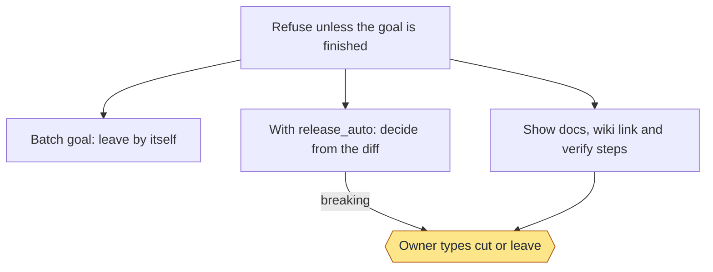

Status: built and proven: Refuse unless the goal is finished; Batch goal: leave by itself; With release_auto: decide from the diff; Show docs, wiki link and verify steps; Owner types cut or leave. Built only: none. Planned: none.
Stops for the owner: Owner types cut or leave.
Proof: toy tests. Seventeen real goals took the batch path and left, and on each of two repos one stopped for the owner, who answered `cut`. release_auto has only run on a toy repo.

#### `leave`

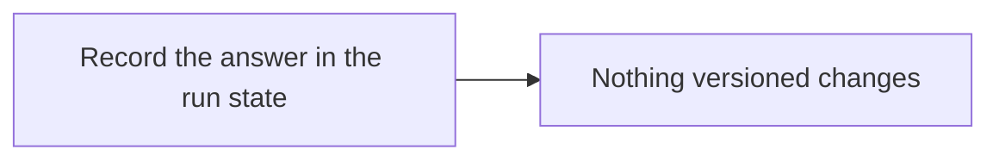

Status: built and proven: Record the answer in the run state; Nothing versioned changes. Built only: none. Planned: none.
Stops for the owner: none.
Proof: toy tests, and seventeen real goals through the batch path. No real owner's `leave` is on record.

#### `cut`

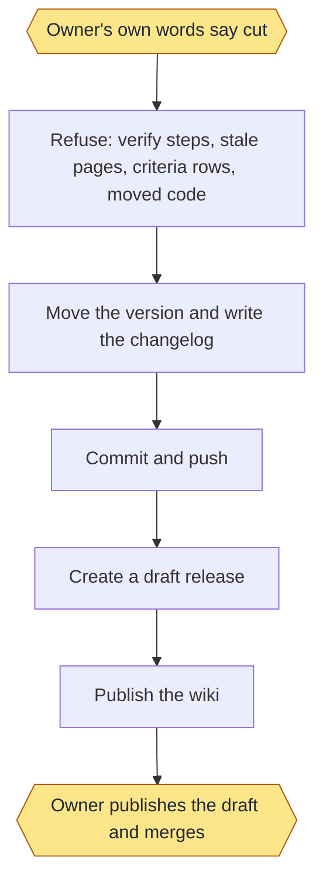

Status: built and proven: Owner's own words say cut; Refuse: verify steps, stale pages, criteria rows, moved code; Move the version and write the changelog; Commit and push; Create a draft release; Publish the wiki; Owner publishes the draft and merges. Built only: none. Planned: none.
Stops for the owner: Owner's own words say cut; Owner publishes the draft and merges.
Proof: toy tests with a stand-in for GitHub, and two real cuts, each to a real draft: one on a second repo, and v0.1.1 on this repo. The owner's stop was real in both. With release_auto, a non-breaking batch goal skips the first stop, proven only on a toy repo.

#### `merge`

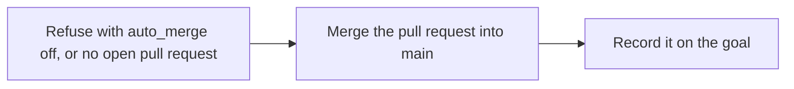

Status: built and proven: Refuse with auto_merge off, or no open pull request; Merge the pull request into main; Record it on the goal. Built only: none. Planned: none.
Stops for the owner: none.
Proof: toy tests with a stand-in for GitHub, including a goal that changes a mapped path and ends with its page updated, the wiki published, and a refused publish shown under Issues. No real merge by it is on record yet.

#### `wiki`

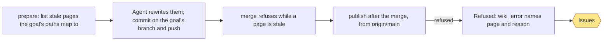

Status: built and proven: prepare: list stale pages the goal's paths map to; Agent rewrites them; commit on the goal's branch and push; merge refuses while a page is stale; publish after the merge, from origin/main; Refused: wiki_error names page and reason; Needs you. Built only: none. Planned: none.
Stops for the owner: Issues, only when a publish is refused.
Proof: toy tests with a stand-in for GitHub and a bare wiki. No real merge has published through it yet.

#### `show`

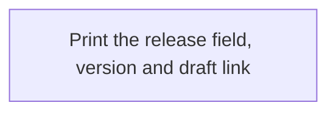

Status: built and proven: Print the release field, version and draft link. Built only: none. Planned: none.
Stops for the owner: none.
Proof: toy tests.

## Exact command entries (as of main, 2026-11-13, when the Usage section was retired)

- `merge.py SLUG` — The release step: docs check, merge (where auto_merge is on), version bump, changelog, GitHub release, wiki publish. Prints `MERGED <pr> into main`, `RELEASED vX.Y.Z <release link> (<bump> bump)` and `PUBLISHED <wiki link>`. Refuses while a page is stale. Before the wiki publish it re-renders the generated Tests tables on the merged head (`RERENDERED Tests`), so staleness in only those tables never blocks the wiki; a stale hand-written page still refuses. Takes a per-repo merge lock so two pods never merge into one main at once, and refuses another pod's goal with one line naming the owner. The pod is `LOOP_POD_ID`, else the operation session's own id: a restarted operation session keeps its goals by setting `LOOP_POD_ID` to its old pod id.

- `wiki.py batch plan|run [--size N] [--merge]` — The batch merge (DEL-15). `plan` prints `BATCH n: a, b, c` for the ready goals (done, with a pull request, not held, no release ask), grouped so no two goals in a batch have overlapping touches (3 by default, at most 4). `run` merges each batch's branches into one temporary tree from origin/<base> and runs the check there (`batch_check` in the config, default `regression.py run`); a failing batch splits, each half is checked alone, and `CULPRIT slug` names the goal that fails (`a+b+c` when the halves pass alone but fail together). Prints `BATCH n PASSES: ...` or `BATCH n SPLIT: ...`, the goals that pass. Only with `--merge` does it run merge.py for the goals that pass; merge.py still refuses a goal whose base moved in paths its rows reach. Proof: dev/toy/test-merge-batch.py.

## Refusals

Each refusal says `REFUSED:` and a fix. Common ones:

| Refusal | Fix |
|---|---|
| Checks have not passed | Finish the goal with `workflow-delivery` |
| No complete steps under `## Verify by hand` | Give every numbered step an `Expect:` line, and commit it |
| Pages are stale | Update them with `workflow-docs`, commit, and run the release again |
| A batch goal, no `--user` | Wait for the human's own `cut <slug>` |
| On the wrong branch | Switch to `loop/<slug>` in the goal's worktree |
| Uncommitted changes | Commit or set them aside |
| Tag already exists | Ask the user which version to use |

`release.py show <slug>` prints the `release` field, and the version and draft URL after a cut.

## A major: gate, promote and revert

A major ships only through `review.py gate vX`, which refuses naming each open milestone issue (unless an owner waiver `moved`
names it), each red or known-red suite row (unless a `red` waiver names its issue), a health failure, an Unreviewed
requirement and a stale page. Waivers are lines `kind<TAB>subject<TAB>detail<TAB>owner record` in the git folder's
`loop/release-waivers.tsv`, and count only when that owner-words record names the subject. `promote vX --owner-record ID` (operation
session only; the record must name `vX.0.0`) tags `vX.0.0`, keeps `release/vX`, moves main and mails the state report; from a major's
rc tag until the tag exists `merge.py` refuses any goal naming no gate failure (`FROZEN`). `revert vX` opens a PR back to the snapshot.

# Regression: commands and flows

Lane messages, which tests run when, clocks and lane settings: the Lanes section at the end of this page.

Moved from the wiki page, which is now only a summary, criteria and tests.

## Commands

```text
add <id> --level <level> --command "<command>" [--goal <criterion>|<slug>:<n>] [--category criterion|workflow|defect --link <url>]
sync [--write]
criteria
red <id> --break "<command>"
red <id> --owed --runner <name> [--live]
red <id> --off-platform --runner <name> --commit <sha>
run [land|nightly|<id>] [--timeout S] [--live] [--reuse [--tier goal]] [--kind requirement|workflow|defect]
workflow
```

| Level | Runs in |
|---|---|
| `land` | `run land` and `run nightly` |
| `nightly` | `run nightly` |
| `draft` | Nothing, until given a real command |
| `covered` | Nothing; proved elsewhere |

- `add` adds or replaces a row. `--goal` ties it to a criterion or a goal's done line, and a changed command must be
  proved again. `--category defect --link <issue or pull request URL, or finding:SLUG>` makes it a defect test: it keeps a
  fixed issue, finding or bug fixed, shows under "Defect tests" on the page of the criterion in `--goal`, and never counts as
  proof of that criterion. `--category workflow` makes it a workflow test: an end-to-end run of a whole flow on a toy
  repo, shown as kind `workflow` after the requirement tests of its criterion. A row with no category reads as a
  criterion test; a defect row with no link is flagged by `sync`.
- `sync` lists done lines, and wiki criteria (a row whose id or `--goal` is the criterion id), with no row (`GAP`), `DRAFT` rows and `UNPROVEN` rows; `--write` adds drafts.
- `criteria` runs the row of every wiki criterion and prints any that is missing, a draft or failing.
- `red` copies `HEAD` to a temporary worktree, applies the break and records the date if the test fails. `STILL GREEN`
  means the test proves nothing. Only a `YYYY-MM-DD` date counts as seen failing; an empty cell, `-` or other text
  counts as never, in `sync`, `run`, the wiki Tests lines and delivery's defect-test check.
- `run` prints `PASS`, `FAIL`, `KNOWN`, `FIXED` or `UNPROVEN` (blocks). Known failures sit in
  `.loop/regression-known.tsv`. It keeps one issue per failing row; without a token it only prints `WOULD` lines.
- `python3 dev/toy/matrix-smoke.py [--agent claude-app|claude-cli|codex|ci] [--only STEP] [--no-record]` runs the smoke set (package, adopt a toy repo
  from it, freeze a goal, run its qa lane, health check, a routine's Runbook pointer, a goal relayed between two pods under the merge lock) and
  appends its dated line to `.loop/matrix-runs.tsv`, which health's `matrix` rule reads. The written `regression.yml` also carries a `matrix-smoke`
  job that runs it on Linux as `ci` and keeps the record as an artifact.
- `workflow` writes `.github/workflows/regression.yml` (on `regression_cron`, every 4 hours by default, or only by hand
  when it is `off`, which a scheduled run reads first and then writes nothing; on `v*` tags and by hand, which still run). A failing row's issue is
  labelled `regression` and `defect`, names the feature and requirement the row guards, and, with the `feature_labels` setting on, carries that feature's
  `feature:<Page>` label (made first; if it can't be, the issue is filed without it and `FAILED label` says so). No milestone is read,
  made or set, and a failed issue write fails the step after the last row (`FILE_FAILED`). The job has 90 minutes; each
  row runs in its own process group with a 15-minute limit and starts only if that limit still fits an 88-minute
  budget (`REGRESSION_ROW_SECONDS` and `REGRESSION_JOB_SECONDS` in the step's environment override them). A row that
  doesn't fit is skipped (`SKIPPED`) and fails with an issue. A row that exits 77 says it cannot run on this machine (no Codex signed in, say): it is `SKIPPED` too, never `PASS`, never reused by a later lane (`SKIPPED <id>` is printed and `RESULT` ends `, <n> skipped`), does not fail the lane, opens no issue, and `red` refuses a break run that exits 77. Each result is saved as the row ends, and a last step
  that always runs writes the run summary: one header with totals and the run time, then one table per feature, or the
  plain results if that fails. Rows run with no GitHub token and none of the runner's own files in their environment
  (`regression.py run` too), and the checkout uses `persist-credentials: false`.
- `tests.py list` prints every test in one fixed format, grouped by feature (`--markdown` tables, `--tsv` lines,
  `--kind requirement|workflow|defect` only that kind);
  `summary` writes the GitHub run summary from a run's results; `issues --write` records each defect test's issue or
  pull request state. The wiki Tests lines and the health report use the same fields.

### Example

```text
/workflow-regression red check-1 --break "<a command that breaks the code>"
/workflow-regression run land
```

### Stage charts

Amber marks where the command stops for the owner. [Home](Home) says what each status means. "Toy test" means a throwaway repo with stand-ins for GitHub.

#### `add`

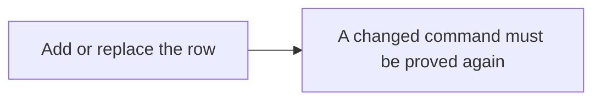

Status: built and proven: Add or replace the row. Built only: A changed command must be proved again. Planned: none.
Stops for the owner: none.
Proof: toy tests and this repo's rows. Nothing tests that a changed command loses its proof.

#### `sync`

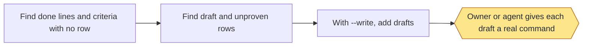

Status: built and proven: Find done lines and criteria with no row; Find draft and unproven rows; With --write, add drafts. Built only: Owner or agent gives each draft a real command. Planned: none.
Stops for the owner: Owner or agent gives each draft a real command.
Proof: toy tests, and it runs on this repo, where it still lists old goals' done lines with no row.

#### `criteria`

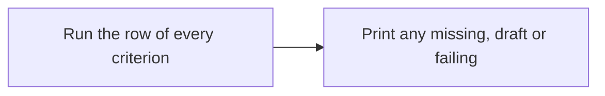

Status: built and proven: Run the row of every criterion; Print any missing, draft or failing. Built only: none. Planned: none.
Stops for the owner: none.
Proof: a real run on this repo is on record. No toy test calls it.

#### `red`

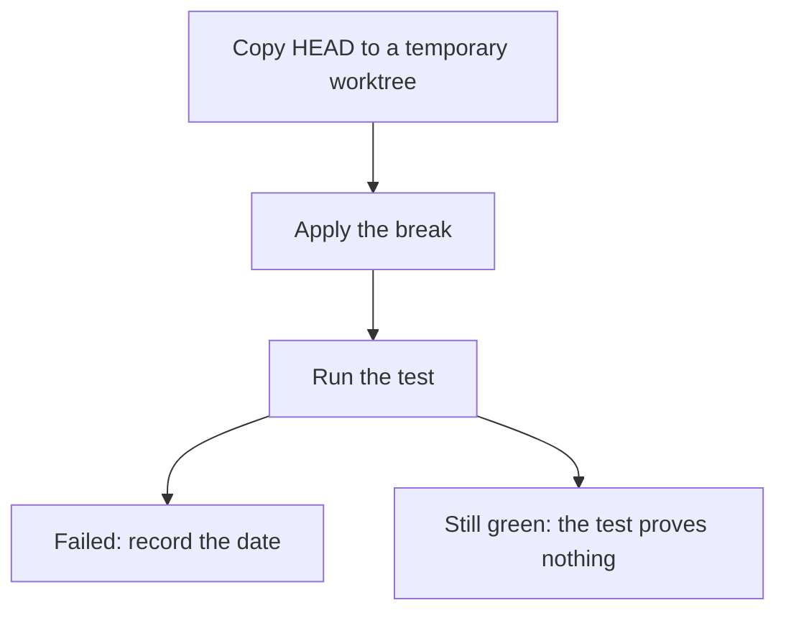

Status: built and proven: Copy HEAD to a temporary worktree; Apply the break; Run the test; Failed: record the date; Still green: the test proves nothing. Built only: none. Planned: none.
Stops for the owner: none.
Proof: toy tests. This repo's 15 criterion rows each carry a date.

#### `run`

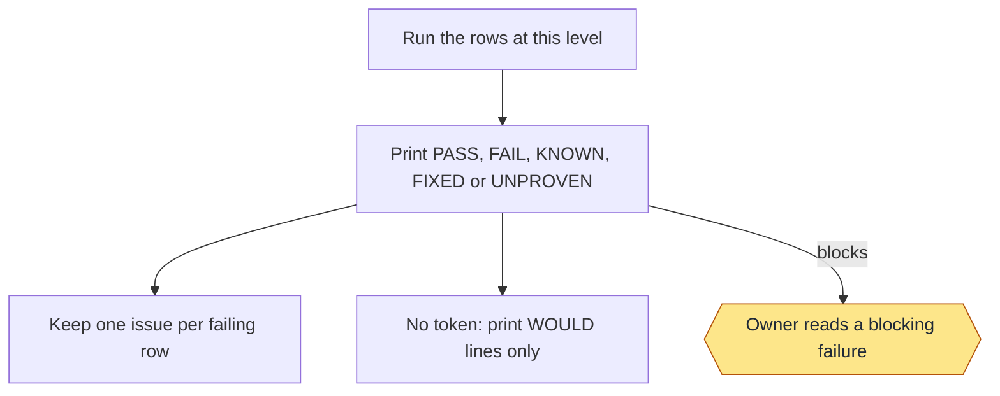

Status: built and proven: Run the rows at this level; Print PASS, FAIL, KNOWN, FIXED or UNPROVEN; Keep one issue per failing row; No token: print WOULD lines only; Owner reads a blocking failure. Built only: none. Planned: none.
Stops for the owner: Owner reads a blocking failure.
Proof: toy tests with a stand-in for GitHub. Two real issues with this label sit on a second repo, but no record ties them to a run.

#### `workflow`

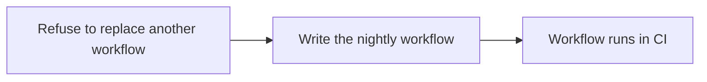

Status: built and proven: Refuse to replace another workflow; Write the nightly workflow; Workflow runs in CI. Built only: none. Planned: none.
Stops for the owner: none.
Proof: toy tests run its inline block. On this repo a manual run on GitHub passed all 64 rows; the first run failed 2 and opened 2 issues, and the passing run closed them. The nightly and tag triggers haven't fired yet.

#### `tests.py`: `list [--markdown|--tsv]`, `summary`, `issues [--write]`

```bash
python3 scripts/tests.py list
```

Every test in one fixed format, grouped by feature: the wiki page that holds the requirement a row guards, in page
order, then `Other` for rows that guard none. Each test shows its name, kind (`requirement`, `workflow` or `defect`), what it guards
(the requirement's ID and words, or the issue or pull request link with its recorded state and date, or the finding),
what it checks, when it runs (`both`, `nightly`, `by a person`), its last result and date, and when it was seen failing.
Plain output has one `FEATURE <name>` line per group; `--markdown` gives one table per feature; `--tsv` gives one line
per test for scripts. The wiki Tests lines, the health report and the GitHub run summary all use this format. For a feature page whose PRD lives at a link, the requirement ids come from that PRD.

`summary --results FILE --took S` writes the GitHub run summary from a run's results (`id<TAB>state` lines, states
`PASS`, `FAIL`, `SKIPPED`, `KNOWN`); a malformed file or run time is refused with the line to fix. `issues --write`
reads each defect test's issue or pull request state with `gh` into `.loop/regression-issues.tsv`; if `gh` can't sign
in it says so and writes nothing, and a single link it can't read keeps its last recorded state. Only this command writes that file (no run does, so a state change on GitHub never
dirties a checkout); commit it with the re-rendered wiki Tests (`criteria.py render`).

## Narrow rows

A reusing run (`run --reuse`, the qa, ship and pr lanes) reruns a row only when a file it reads changed. A test script
says what it runs in its top comment block, and `lanes.py` follows from there without widening to folders.

```bash
#!/bin/bash
# reads: skills/workflow-health/scripts/health.py skills/workflow-setup/scripts/setup.py
# reads: skills/workflow-health/scripts/
# What this test checks ...
```

- Grammar: `# reads:` at the start of a line in the leading comment block; repo-relative paths, separated by spaces,
  unquoted; a trailing `/` marks a folder. Several lines add up. `# reads: skills/` means the script reads every skill
  (it stays wide); it is the per-script opt-out.
- What follows a declared file: a shell file adds the repo paths it names (no folder widening; comment lines and lines
  ending in `# lanes: no read` read nothing); a Python file adds its same-folder imports, every file whose base name it
  quotes (`"docs.py"`), and quoted folders of its own skill. A skill folder a shell file names (`M=.../scripts`) needs a
  declared file in it, and its files whose names appear in the script (`$M/board.py`, `import board`) are followed. A
  skill folder read as a whole needs that folder declared: a glob (`"$here"/skills/x/scripts/*.py`), a recursive or
  listing command (`grep -r`, `find`, `ls`, `cp -R`), the folder or its variable used bare (`"$d"`, `$d/sub`, also when
  `d` is set in a sourced file), or a `cd` into it followed by such a command. Naming a folder with `cd`, `mkdir`,
  `PYTHONPATH=` or `sys.path` reads nothing. A folder outside `skills/` stays a dependency as a whole. Not seen: a
  skill path behind another variable (`"$OLDPWD/skills/x"`); declare such reads by hand.
- A script that runs tools on this repo's own files (`cd "$here"`, `git -C "$here"`, `--root "$here"`) runs on every
  change: those tools may read any file. A table edit reruns the edited rows plus the rows that read this repo's
  `.loop/regression.tsv`. A deleted file anywhere outside the release and loop files means a full run.
- A row whose header cannot be worked out runs on every change (`ALWAYS <id>: <code> ...`). A script with no header
  keeps the wide mapping. `LANES_WIDE=1` forces the wide mapping for every row: the first step when a narrowed lane
  seems to miss a row. The first run after `lanes.py` or `narrow.py` changes is full: the record carries their hash.

```text
lanes_cli.py check [SCRIPT...]                 every header problem; default: each dev/toy/test-*.sh a row names
lanes_cli.py affected [--level L] PATH...      dependency impact: AFFECTED n of m rows (ids), ALWAYS/UNMAPPED/DELETED;
                                               any change but a NO_EFFECT one (a deletion too) adds the root runners
lanes_cli.py deps COMMAND [--why PATH]         a row command's dependencies, or the chain of files to PATH
```

`affected` reads no record, so failed rows, ancestry and edited table rows (which a reusing run also reruns) are
outside it. All three take `--root DIR` (default: the git top level), exit 2 on a usage error and 1 on problems.

| Code | Means | Fix |
|---|---|---|
| `LANES-DECL-NONE` | A test script a row names has no header | Add `# reads:` with the skill files it runs |
| `LANES-DECL-MISSING` | A declared path does not exist | Fix or remove it |
| `LANES-DECL-PATTERN` | A `$`, `*` or `?` in a declared path | Declare files, or the globbed folder |
| `LANES-DECL-ESCAPE` | A declared path leaves the repo | Repo-relative paths only |
| `LANES-DECL-PLACE` | `# reads:` below the top comment block | Move it up |
| `LANES-DECL-FOLDER` | Names a skill folder, declares no file in it | Declare the files it runs from there |
| `LANES-DECL-GLOB` | Reads a skill folder as a whole without declaring it | Declare the folder |
| `LANES-DECL-FOLDER-UNBACKED` | Declares a skill folder it never globs or reads whole | Declare its files instead |
| `LANES-DECL-TREE` | Reads all of `skills/` without declaring `skills/` | Declare `skills/` (stays wide) |

**New test script, three steps:** write the header; `python3 scripts/lanes_cli.py check dev/toy/test-new.sh`; then
`python3 scripts/lanes_cli.py affected <a file it runs>` shows its rows. Register rows with `regression.py add ...
--level land`.

**Nightly read trace.** `bash dev/toy/check-reads.sh [ROW-ID...]` (row `lanes-trace`) runs each row under a Python
audit hook and fails a row whose run read a skill file outside its closure (`LANES-TRACE-UNDECLARED`, with the line
to add), whose Python launch the hook never saw (`LANES-TRACE-NOHOOK`), or whose command failed. It covers Python reads
only; bash reads are covered by the static rules above.

## Goal tier

A goal lane runs `run land --reuse --tier goal` (`scripts/tiers.py`). It plans from the branch's record only when A land or nightly run that has rows to run first waits while free memory (Windows: free virtual memory) is below `min_free_memory_gb` (default 4), logs `LANE_MEMORY`, never stops a run already going, and gives up with exit 6 (EXIT_ENV, a MEMORY_WAIT note, no try used) after four times the lane's time limit.
the record's merge-base with the base branch is the current one (else from the merge-base, plus what a base merge
brought in) and runs the rows a change reaches, new or edited rows, root runners and the record's failures; it takes a
lane slot only when it has no plan to follow (FULL, no merge-base). It stays within `test_budget_minutes`: rows run in tier
order while their estimated seconds fit, and the rest is left to the scheduled full suite (`BUDGET` line). Its own time
limit is the flow file's, else `test_budget_minutes` plus five minutes. The work before the first row (the Tests-table prep,
planning and the slot wait) has its own budget, `prep_budget_minutes` (default 15, not under 15), shared by the three parts: a lane
that reaches it stops, prints `LANE_PREP_BUDGET` naming the part that ran long, and the same command can be run again. Every
LANE line ends its text with `before rows: prep Xs, planning Ys, slot wait Zs`. `LOOP_PREP_BUDGET` (whole seconds) overrides the
setting for tests only; the LANE line says when it is in effect. Without `--tier` nothing changes.

| Line | Means |
|---|---|
| `SELECTED <id>: <reason>` | Why a row runs: `reaches <file>`, `new row`, `root runner`, `names an unmapped path`, `failure rerun` or `FULL` |
| `ROWS: S selected (A affected, N new, R root runners, F failure reruns), U reused; unmapped: K` | The plan; the LANE line repeats it with the unfinished count and the log path |
| `UNMAPPED <file>: no row declares it. Note: ...` / `UNMAPPED <file>: deleted. Note: ...` | Every lane: advisory; the rows that name the file and the runners run, never the full suite |
| `FULL (no merge-base with <base>): ...` | A shallow clone or a missing base ref: every row is a candidate and the time budget keeps what fits |

## Plan cache

A goal lane's planning step works out, for every row, which files it reads. That closure is computed once per lane and kept
per branch in `<git common dir>/loop/plans/<branch file name>` (zlib-compressed JSON, next to the lane records in `loop/tests/`,
never in the worktree). The next lane at the same HEAD loads it instead of recomputing. `PLAN_CACHE: <state>` is the first line the
planner prints (`regression.py run` prints a `SKIP <id>: draft` or `SKIP <id>: covered` line for such rows before it); the rest of the plan output, and the planned rows, are the same with the cache on or off.

| State and token | Means | What to do |
|---|---|---|
| `PLAN_CACHE: hit (N rows)` | The file matched and held every row the plan needed; the tree is clean, and any uncommitted loop bookkeeping files are the ones the file was written with | Nothing |
| `PLAN_CACHE: miss (absent)` | No file yet for this branch (a first lane, or after a reset); computed, then written | Nothing |
| `PLAN_CACHE: miss (key-head)` | HEAD moved since the file was written | Nothing: the next lane at this HEAD hits |
| `PLAN_CACHE: miss (key-rows)` | `.loop/regression.tsv` differs although HEAD is the same: rare, because an edit shows `dirty` until committed and then `key-head` (only an edit hidden from `git status`, such as `update-index --assume-unchanged`, reaches it) | Nothing |
| `PLAN_CACHE: miss (key-runner)` | The planner's own code changed (an upgrade) | Nothing: the first lane after an upgrade misses |
| `PLAN_CACHE: miss (key-wide)` | `LANES_WIDE` differs from the run that wrote the file | Keep `LANES_WIDE` the same between lanes |
| `PLAN_CACHE: miss (key-loop)` | A loop bookkeeping file that `lanes.dirty` ignores (`.loop/goals/`, the runs file, queue.md, findings.md) has uncommitted changes that differ from when the file was written | Nothing: the next lane with the same files hits |
| `PLAN_CACHE: miss (partial M of N)` | The file held M of the N rows this plan needs (another level planned first, such as nightly after land) | Nothing: the plan writes all N |
| `PLAN_CACHE: miss (corrupt)` | The file could not be read, or is from another format; it is ignored and replaced | Nothing; if it repeats, remove the folder as below |
| `PLAN_CACHE: dirty (N paths, cache not used)` | Files are uncommitted; closures read working-tree files, so nothing is read or written | Commit or remove them |
| `PLAN_CACHE: off (LANES_NO_CACHE=1)` | The cache is switched off | Unset `LANES_NO_CACHE` |
| `PLAN_CACHE: none (no branch)` | A detached HEAD has no branch to name a file | Nothing |
| `PLAN_CACHE: dirty (git status failed, cache not used)` | `git status` failed, so a clean tree cannot be shown; nothing is read or written | Fix the repository (a broken index, a missing git) |
| `PLAN_CACHE: not saved (ignored file read)` | After the plan: it read or listed a git-ignored file, whose changes neither HEAD nor git status shows, so nothing is written (the plan itself is unaffected) | Nothing; to cache it, commit the file or stop naming it in a row |
| `PLAN_CACHE: not saved (symlink outside repo)` | After the plan: a file it read resolves outside the repo (a symlink), where a change leaves git status clean, so nothing is written (the plan itself is unaffected) | Nothing; keep rows from reading through links that leave the repo |
| `PLAN_CACHE: not saved (<error class>)` | After the plan, only when the write failed (for example `PermissionError`); the plan itself is unaffected | Fix the folder's permissions, or remove it as below |

Tokens are added, never renamed. In a lane log:

```text
PLAN_CACHE: miss (absent)         cold: computed, then written
PLAN_CACHE: hit (498 rows)        warm: the next lane at the same HEAD
PLAN_CACHE: off (LANES_NO_CACHE=1)  switched off
```

- The safe reset is `rm -r <git common dir>/loop/plans`: the next lane misses and writes it again. Files older than 30 days are pruned when a lane writes.
- `LANES_NO_CACHE` turns the cache off when it is `1`, `true` or `yes` in any case; `0` or empty leave it on. (`LANES_WIDE` is different: only the literal `1` counts, and it changes the closures, so it is part of the key.)
- The key is HEAD, `.loop/regression.tsv`, the planner's code, `LANES_WIDE` and the content of the loop's uncommitted bookkeeping files (`lanes.dirty` ignores those, and a row can read them). A plan that read or listed an ignored file, or read through a symlink that leaves the repo, is never saved, so those cannot go stale. What the key does not hold: a file created later, or ignored later (for example through `.git/info/exclude`), is outside it, and a later `hit` can then be stale. Then run `rm -r <git common dir>/loop/plans`, or set `LANES_NO_CACHE=1`. A symlink that stays inside the repo needs nothing: its target is tracked, so an edit shows as a dirty tree and a commit moves HEAD.

| Why do I keep seeing `miss`? | Cause | Fix |
|---|---|---|
| `key-head` on every lane | Each lane starts after a new commit | Expected: the qa, ship and pr lanes at one HEAD hit after the first |
| `dirty` every time | A row or the lane leaves untracked files | Commit or `.gitignore` them; a lane that leaves files is already reported as `LANE_DIRTY` |
| `partial M of N` every time | Two levels (land and nightly) alternate | Expected: the plan writes every row it needs, so the next one of that level hits |
| `key-loop` on every lane | A goal file or the runs file is edited between lanes | Expected while you edit it; commit it to stop |
| `corrupt` every time | The folder is shared with an older release | `rm -r <git common dir>/loop/plans` |

## Lanes: what runs when, and every message a lane prints

A lane is one background run of the regression rows for a goal's step (qa, ship or pr), started by
`role.py lane SLUG NAME` (flow.py and goal.py call it). This section is the reference for its messages, clocks and
settings. The Regression wiki page holds the requirements (REG-1..REG-9); this section is the tool's own manual.

### Which tests run when

| Where | Rows that run | Takes a lane slot |
|---|---|---|
| goal lane, qa and ship | rows whose closure reaches a file the goal changed since its merge-base, the goal's new or changed rows, rows that run tools on the repo root, and rows that failed last time | no |
| goal lane, pr | the same; a path no row declares, or a deleted one, adds the rows that name it and the runners, never the full suite | no |
| goal lane with no merge-base (shallow clone, missing base) | every row is a candidate (`FULL (no merge-base with <base>)`), kept to `test_budget_minutes` | yes |
| hand run `regression.py run land\|nightly\|ID [--kind K]` | what you name; a plain `run nightly` is the full suite and records its time | when it is a full run |
| GitHub Actions, on the `regression_cron` schedule (every 4 hours by default; `off` stops it) and every v* tag | `ci_levels` (default nightly: every row, the full suite; land: land rows only) | n/a (a runner) |
| GitHub Actions, run by hand | its `target` input: land, nightly or a row id (empty: `ci_levels`); the workflow's own runner checks it, so a repo without the skills folder works | n/a |

ship and release reuse the qa lane's results when no code changed since (`REUSED`). Before a pull request merges,
merge.py checks the base: a move in paths this goal's rows reach refuses (`BASE_MOVED`); `goal.py pr` then merges the
base and reruns the affected rows. Which levels run where is fixed by design (land: goal lanes, hand runs and CI;
nightly: CI and hand runs); `goal_levels` and `ci_levels` change it.

### Lane messages

Status lines go to stdout, refusals and errors to stderr. A `Fix:` part is something to do before going on; a `Note:`
part is advice and never blocks.

| Code | Printed by | Exit | Meaning | What to do |
|---|---|---|---|---|
| LANE | lane.py | 0 / 1 | the lane ended: `LANE <step> <AFFECTED\|REUSED\|FULL> ran/total in Ns; rows: S selected (A affected, N new, R root runners, F failure reruns), U reused, X unfinished; unmapped: K; log: <path>` | read the log for each row's reason |
| RUNNING / WAITING | lane.py | 0 | still planning or running / waiting for a lane slot or a sibling lane of the goal | run the same command again, or `role.py lane-wait SLUG NAME` |
| LANE_WAIT | slots.py | — | all lane slots are busy; names the holders | none: it starts when one frees (`LOOP_LANE_LIMIT=0` skips the pool for one run) |
| MEMORY_WAIT, LANE_ENV | lanes_cli.py, regression.py / lane.py | 6 | a lane gave up waiting for memory, or most of its rows could not start (Windows 0xC0000142 and like codes are rerun once, after the other rows, and a row still dying is ENV, not FAIL); it is the machine's, so no try is counted (guards.py, up to 10) | run again when memory frees |
| LANE_WAIT_TIMEOUT | slots.py / lane.py | 4 / 2 | a hand run off a terminal waited 4x its time limit for a slot (4); `lane-wait --timeout` ran out while the lane keeps running (2) | run again later |
| LANE_SLOTS_UNAVAILABLE | slots.py | — | the lanes folder can't be used; the lane runs without a slot | `chmod 700` it, or set `LOOP_LANES_DIR` |
| LANE_STALE | slots.py | 5 | HEAD or the worktree changed while the lane waited; no rows ran | run the same command again |
| LANE_PREP_BUDGET | lane.py | 125 | the lane's work before its first row (Tests-table prep, planning, slot wait) used prep_budget_minutes; names the part that ran long and who holds the slots; no row ran | run the same command again (it replans on this HEAD); raise prep_budget_minutes only if prep or planning ran long |
| LANE_TIMEOUT | lane.py | 124 | past its time limit (flow file `limit`, else `step_limit`); killed, rows partly ran, nothing committed or pushed | run again, or raise the setting |
| LANE_DIRTY | lane.py / lanekit.py | 1 | uncommitted changes at start, a hand edit above a page's Tests section, or a row left files behind | commit or revert them; make the row clean up |
| LANE_PREP | lanekit.py | — | the lane first committed the re-rendered Tests tables and run dates | none |
| LANE_PREP_FAILED | lanekit.py | 1 | that commit or the render failed or hung (60 s); nothing committed | make the commit pass, then run again |
| LANE_RECORDER | lane.py | 1 | the flow file's `test_record` command isn't on this machine | install it or remove it |
| LANE_TMPDIR | lane.py | 1 | the system temp folder is inside a git checkout; no job was made | set TMPDIR to a folder outside any repo, then run again |
| LANE_DIED | lane.py | 1 | the lane ended with no exit status | the next call starts a new lane |
| LANE_MISSING / HEAD_MOVED (record) | lane.py via goal.py | 2 | `goal.py record qa\|ship` with no passing lane on this HEAD; no try is used | run `role.py lane SLUG NAME` |
| NO LANE | lane.py | 3 | `lane-wait` found no lane for this HEAD | start one with `role.py lane SLUG NAME` |
| UNMAPPED | tiers.py | — | a changed or deleted path no row declares (Note) | declare it in the `# reads:` header of the row that tests it, or let pr run the full suite once |
| KILLED | regression.py | — | a signal stopped a row: `KILLED <row>: signal <name> (pid <n>)` (Note) | see the lane log |
| FLAKY | regression.py | per result | a row gave different results on the same clean commit, runner and python (Note): the raw result counts, the flag stays on that commit (regression-runs.tsv's flaky column, tests.py list, health's TESTS block) and the row is never reused | find the nondeterminism in the row's command; FLAKY clears when a later commit's clean run passes |
| SUITE_TIME | regression.py / CI run step | — | a plain full run's time (`regression.py run nightly`, or a CI run whose target is nightly), appended to `<git common dir>/loop/suite-times.tsv` for health's REG-7 check; CI keeps its line as artifact `suite-time`, which the scheduled health job downloads with a `ci` column | none |
| REFUSED (BAD_TARGET) | CI run step | 1 | the run-by-hand `target` input is not land, nightly or a row id: `REFUSED (BAD_TARGET): bad target "<value>": use land, nightly or a row id from regression.py list. Fix: rerun the workflow with one of those`; no row ran | rerun the workflow with one of those |
| REFUSED (BASE_MOVED) | merge.py | 2 | the base moved in paths this goal's rows reach since the pr lane, or it can't tell (the planner or `git diff` failed): an unknown never merges | `goal.py pr SLUG`, then `merge.py SLUG` |
| REFUSED (BASE_FETCH) | merge.py | 3 | origin can't be fetched to check the base; nothing merged | run `merge.py SLUG` again when the remote answers |
| REFUSED (HEAD_MOVED) | merge.py | 4 | the pull request head moved since the pr lane by a commit that isn't only wiki pages (a `wiki.py prepare` commit only notes it and merges) | `goal.py pr SLUG`, then `merge.py SLUG` |

Exit codes shared by every lane entry point: 0 pass (or still running for `role.py lane`), 1 fail, 2 lane-wait
timeout, 3 no lane, 4 a hand run's slot wait timed out, 5 stale, 124 time limit.

### Clocks

A lane's time limit counts from its started marker (when it took its slot and began rows), never from launch. While
it waits for a slot it has a queue span instead (4x the time limit, restarted whenever any slot changes), so a healthy
backlog never kills a waiting lane; while planning it has 4x the time limit. A hand run on a terminal holding a slot has no deadline; off a terminal its slot wait stops after
4x its time limit (flow file `limit`, else `step_limit`, else 2700 s). `lane-wait` with no `--timeout` waits until the
lane ends.

### Settings

- `lane_limit` (flow file, default 2): full lanes that may run at once on this machine; 0 is unlimited. Best effort:
  it limits concurrent full lanes, not the machine's load; AFFECTED, by-id and red runs take no slot.
- A goal lane has no limit of its own beside its budget (`test_budget_minutes`, REG-7). The scheduled full suite has a fixed
  30-minute limit that health warns above.
- `goal_levels` (land) and `ci_levels` (nightly): the levels a goal lane plans from (nightly adds the nightly rows a
  change reaches) and the CI target. A CI run cut short by its job time still records its time, so health warns.
- Each lane child gets its own `TMPDIR` and `LOOP_LANE_PORT_BASE` (a leased range of 100 ports from 20000); a row that
  binds ports uses that range or picks a free port itself. The `TMPDIR` is a new folder per lane start,
  `<system temp>/loop-lane-<repo key>-<goal>-<lane>-<random>` (mode 0700), never inside a git checkout, so a test that
  refuses to write inside a repo passes under the lane as it does when run directly (issue 814). It is removed when the
  lane ends or is stopped; a lane that crashes leaves its folder in the system temp until the OS clears it. When the
  system temp itself is inside a git checkout the lane refuses before it starts: `LANE_TMPDIR: <path> is in a git
  checkout. Fix: set TMPDIR to a folder outside any repo; the lane committed and pushed nothing.` (example: `TMPDIR=/tmp role.py lane SLUG qa`).
- Internal handoff variables (`_LOOP_LANE_HELD`, `_LOOP_LANE_LABEL`, `_LOOP_LANE_QUEUED`, `_LOOP_LANE_STARTED`,
  `_LOOP_LANE_NOTE`) are set by the lane; a `test_record` wrapper must keep the environment.

### Upgrading

Updating the skills while lanes run is safe: a lane job written by the old code keeps the old rules until it ends.
New: goal lanes no longer run the full suite at qa for an unmapped path (pr does, once); the lane commits re-rendered
Tests tables before it starts; regression-issues.tsv gains a reopened_at column and old files still read; the
regression workflow's run-by-hand gains a `target` input.

### Alternatives considered

GitHub's merge queue and "require branches to be up to date" make merges atomic on the platform; the loop keeps its
own base check for repos without them, and the window between its check and the merge is closed only by those
settings. Actions concurrency groups already keep one regression run at a time in CI. Running AFFECTED lanes in CI
was left out: CI runs the full suite only (REG-4).

## Exact command entries (moved from the retired Usage section on the Automation page)

- `/workflow-regression workflow` — Writes the scheduled regression workflow on `regression_cron` (five cron fields, or `off` for by-hand and release-tag runs only), for a public repo only: a private repo's regression runs on the Mac, so it prints `NOT WRITTEN: this repo is private; its regression runs on the Mac (local schedule)` and writes nothing (the Regression page has the whole entry). Prints `WROTE <repo>/.github/workflows/regression.yml`. Refuses (exit 1) `REFUSED: regression_cron is not five cron fields. ...` and `REFUSED: <path> exists, and this tool didn't write it. Fix: merge by hand.` Its run is split over eight parallel jobs and ends in one combined summary, and a newer run on the same ref cancels the one it supersedes; it keeps one open issue a row, files none for a row skipped for time and stops writing at a rate-limit reply; a run by hand with `cleanup` set closes the backlog of duplicate, skipped-only and removed-row issues, paced, until it prints `CLEANUP closed 0 issues`. A scheduled row that exits 77 (cannot run on this runner, such as the live Codex row) is recorded `SKIPPED` and opens no issue. The one local task per repo is named `<repo>-health-regression` (health and the full regression, every 4 hours or sooner); a repo recorded `regression_runs: mac`, public or private, runs its regression there and has no `regression.yml`, and `setup.py migration-check` names a missing, misnamed or slower task. A row that runs past its time limit has the processes then running (pid, parent, state, wait channel, command) written at the end of its log before it is killed, so a hang names what it is stuck on.

## Exact command entries (as of main, 2026-11-13, when the Usage section was retired)

- `/workflow-regression add ID --level land --command "cmd" --goal DEL-1` — Adds or replaces a regression row. Prints `ROW <id> <level>: <command>`. Refuses (exit 1) `REFUSED: bad id. Fix: letters, digits, dots, dashes.`, `REFUSED: a defect row links to its issue or finding. Fix: add --link URL or finding:SLUG.` and `REFUSED: a row can't hold a tab or new line. Fix: use a script.` The workflow's summary job text lives in `slots.py`. A failing row's issue body carries its last 40 output lines, in the workflow as on a Mac. Every skill holds the same `proctree.py` copy.

## workflow

```bash
python3 scripts/regression.py workflow
```

Writes `.github/workflows/regression.yml`: rows run on `regression_cron` (4-hourly by default; `off` drops the schedule), on
`v*` tags and by hand; each failing row's issue is labeled `regression` and `defect`, names what it guards and, with `feature_labels` on, carries its `feature:<Page>` label (no milestone is read, made or set); a failed write fails the step (`FILE_FAILED`). It refuses to replace a workflow it didn't write. The job has 90 minutes. Each row runs in its own process group
with a 15-minute limit, and starts only if that full limit still fits the job's time; a row that doesn't fit is
skipped, reported `SKIPPED`, and fails with an issue. Each row's result is saved as it ends, and a last step that
always runs writes the run summary: one header with totals and the run time, then one table per feature (`tests.py
summary`); if that fails, the plain results still reach the summary. Rows (here too, under `regression.py run`) run with no GitHub token and none of the
runner's own files (`GITHUB_STEP_SUMMARY`, `GITHUB_ENV`, `GITHUB_OUTPUT`, `GITHUB_PATH`, `GITHUB_STATE`) in their
environment, so no row inherits the real summary (this stops accidents, not a hostile row), and the checkout keeps no token in its git config.

## runs.py notes

Moved from the docstrings of `scripts/runs.py`, word for word where it still reads the same.

`.loop/regression-runs.tsv` holds each row's last run as id, status, date, run and flaky. `run` is the GitHub Actions run URL when GITHUB_SERVER_URL, GITHUB_REPOSITORY and GITHUB_RUN_ID are all set, else empty, so same-day runs on two branches write identical lines and merge cleanly. `flaky` is empty, or the commit a row's result flipped on (tiers.py flaky_apply, REG-9); status stays the raw PASS or FAIL. Per-result evidence (commit, clean, host, python) lives in the branch's lane record in the git common dir, never here: a commit cell would differ per branch and conflict every same-day merge.

It also holds a local `regression.py run`'s GitHub issues (`sync_issues`): one issue per failing row, keyed by a marker in its body, dry-run (WOULD lines) unless live; actions.py keeps the CI copy. The time budget of an in-loop test run lives here too (`budget`, `fit`, `execute`): a --reuse run (qa, ship and pull-request lanes) stops at test_budget_minutes (default 15, floor 15), runs rows in tier order while their estimated seconds fit, and records the rest LEFT for the scheduled full suite.

`shown` returns a failing row's last LAST lines, never empty: a row that printed nothing runs once more with its quiet stage loud (`again` makes each `| grep -q PATTERN` of its command `| cat`, and returns None when there is none). `read_issues` returns (issues, ""): the GraphQL list, else REST pages of 100 without comments; (None, error) when both fail.
