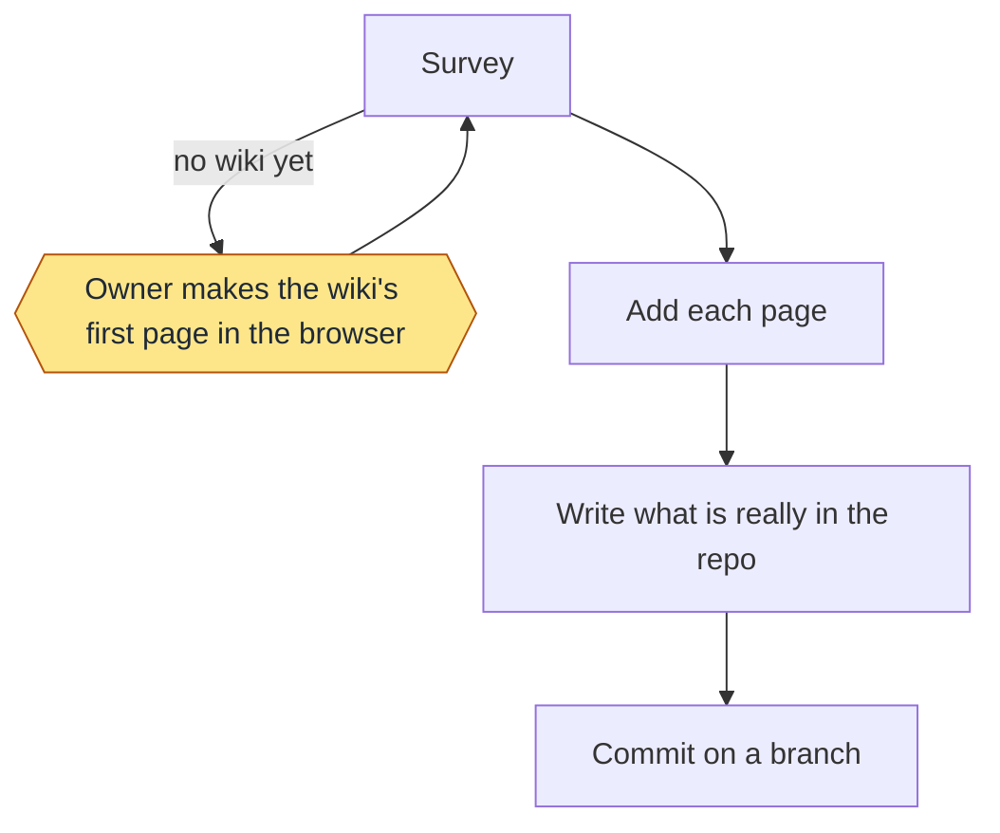
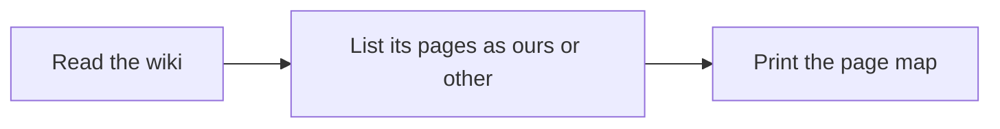
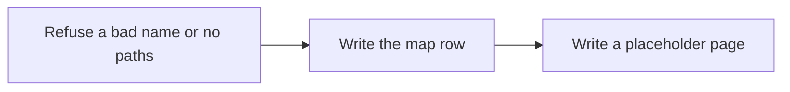
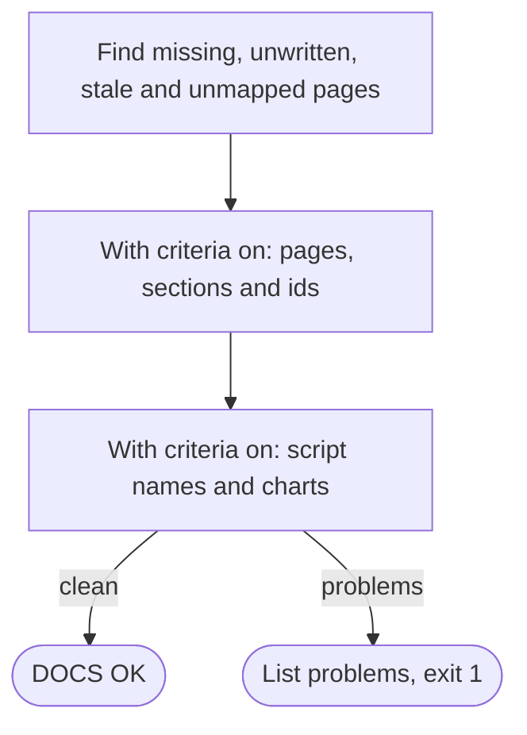
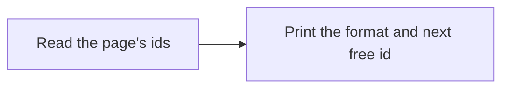
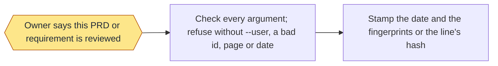
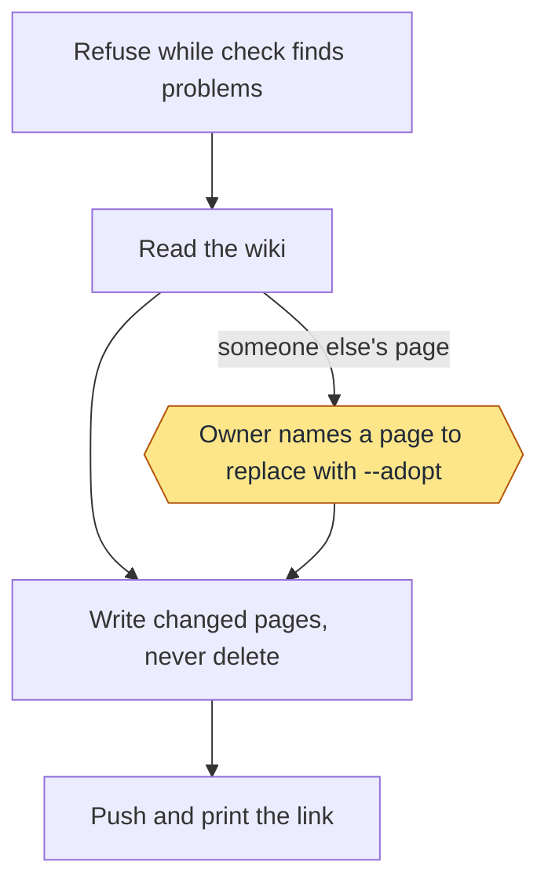
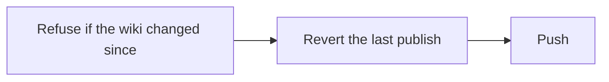

# Documentation: commands and flows

Moved from the wiki page, which is now only a short PRD and its tests.

### Init

`init` is a step list in `skills/workflow-docs/SKILL.md`, built from `survey` and `add`.

1. Survey: `survey` shows what exists.
2. Add: choose pages (three is a good start: how to use the repo, how it's run, how it's released), name the paths each
   describes, and use a name the survey doesn't list, so the wiki's other pages stay as they are:
   `add Using-the-workflow --paths ".loop/config.json,README.md"`.
3. Write each page: replace its placeholder text with what is really in the repo (real commands, real paths, real
   outputs). Keep the first line. If you didn't see it in the repo, don't write it.
4. Commit the pages and `.loop/docs.tsv` on a branch.

First-page rule: if the wiki has no pages yet, the user must create its first page in the browser, because GitHub only
makes the wiki's repo then. Tell them, then stop.

On Agensi, the file contract `loop-files.md` is under `shared/` in the pack.


## Commands

Pages are added and checked with these:

```text
init                            the step list above; an agent follows it
survey                          show the wiki's pages and this repo's page map
add PAGE --paths A,B            add a page and the paths it describes
check [--base REF]              list page problems, and PRD contract problems when criteria is on; exit 1 if any
                                a page whose PRD is at a link or MCP source (`PRD: <source>`, or the third column of .loop/docs.tsv)
                                is read from there and prints UNREAD, never a pass, when it cannot be; `topics` adds Home's Topic column
audit [--base REF] [--dry-run]  check all required docs against the template, fix the mechanical, list wording to rewrite
criteria PAGE                   print the requirement format and the next free id for a page
review PAGE|ID [...] --user [--date D]   the owner marks a PRD, or a requirement, Reviewed
unreview PAGE|ID [...] --user   the owner lifts that review
render [--check]                rewrite each page's Tests from the regression rows
prd NAME "<idea>" --paths A,B   draft a new feature's PRD, Unreviewed, and map it
convert                         turn old Summary/Criteria pages into PRD pages (prd.py convert previews, --write writes)
relock                         re-stamp a reviewed page whose lock moved only because of owner-reviewed requirement lines (docs.py audit --relock; logs auto-relock in reviews.tsv)
restamp-own SLUG               audit.py restamp-own: the lane prep re-stamps the pages docs.py check --own calls stale only because the goal's mapped code changed (a Reviewed page whose text still matches its stamp, or an Unreviewed page with a kept marker); a page whose wording changed stays stale
publish [--dry-run] [--adopt PAGE]   copy the pages to the GitHub wiki, commit and push
restore                         revert the last publish, if nothing came after it
```

`entry.py write|check|render|block` builds `.loop/START.md`, the entry point every new session reads first, and the
workflow-loop block for the agent files, from the PRD pages, `.loop/config.json` and `## Entry point templates` in this file. `check`
(also run by `docs.py check`) prints `STALE` when either differs from a fresh render and `MISSING` when a stamped repo
(it holds `template_version`, or is the template's own checkout) has none; both fail. While the installed skills are
newer than the repo's `template_version`, a difference only in the parts built from the skills prints `LAG` and does
not fail. `docs.py audit` rewrites a stale entry point and stale blocks itself.

| Code | Means | Fix |
|---|---|---|
| `ENTRY_STALE` | START.md or an agent block differs from its sources | `docs.py audit`, or `entry.py write` |
| `ENTRY_MISSING` | a stamped repo has no START.md, or an agent file has no block | `entry.py write`; ask for workflow-setup agents |
| `ENTRY_LAG` | the installed skills are newer than the repo's template_version | run the migrate goal (workflow-setup update) |

`.loop/docs.tsv` maps each page to the paths it describes. `check` prints `STALE`, `MISSING`, `UNWRITTEN` or
`UNMAPPED`, `NO PAGES` if the map is empty, and `DOCS OK` when clean. `STALE` means a commit touched a mapped path and
no later commit to the page has it in its history. Merge commits don't count, so a page gives the same answer before and
after a merge. Only a commit that changes the page clears `STALE`.

With `"criteria": true` in the config, every feature page is a short PRD (`references/commands.md` holds the rules and
an example page): the Review line, then Problem, Requirements, Non-goals, Success metrics, an
optional Deployments (DOC-14: a Page table and/or a Delivery table for what the feature ships) and Tests, in that order
and nothing else. Requirements are the owner's lines (`- DEL-1: **Unreviewed** text`, up to
`criteria_max`, default 10); tests are for the machine: a regression row linked to one requirement by its goal column,
described as one `Given ..., when ..., then ...` scenario, rendered under its requirement with its last result.

### Page states

| State | Cause | `check` exit | `audit` | Release | `publish` | Who acts |
|---|---|---|---|---|---|---|
| Unreviewed | `Review: **Unreviewed**` | 0 | clean | goes ahead | publishes | the owner reviews the PRD when ready |
| Reviewed | the owner ran `review PAGE --user` | 0 | lists requirements with no passing test as `UNTESTED` (not a failure) | goes ahead | publishes | the loop writes the tests |
| `LOCKED` | Problem, Requirements, Non-goals or Success metrics changed after the review | 1 | fails | blocked | refused | an agent restores the text (`git log -p`), or the owner un-reviews |
| `USAGE` | a page still has a `## Usage` section (dropped 2026-11-13) | 1 | fails | fails | fails | remove the section; the commands are in the skill's Command map and `references/commands.md` |
| `UNWRITTEN` | a placeholder line is still on the page | 1 | fails | blocked | refused | an agent writes the drafts |
| `SCENARIO` | a row on the page is not Given/When/Then | 0 | fails | blocked | publishes | an agent rewrites the row's description |

### Examples

```text
/workflow-docs prd Billing "charge cards once a month" --paths src/billing
/workflow-docs review Billing                 # only on the owner's own words
/workflow-docs review BIL-1 --date 2026-11-08 # one requirement, on the owner's words
/workflow-docs unreview Billing               # the owner lifts the PRD lock
/workflow-docs convert                        # after an upgrade: old pages to PRD pages
/workflow-docs render
```

`--base REF` counts only changes since `REF`. `publish` has no `--base`, so it counts every commit, and it refuses while
`check` finds problems other than `CHANGED`. It never deletes a page. It refuses a page in the repo that lost the marker
`<!-- workflow-docs -->`, and won't replace a wiki page without that marker unless you name it with `--adopt`. `restore`
refuses if the wiki changed since.

### Stage charts

Amber marks where the command stops for the owner. [Home](Home) says what each status means. "Toy test" means a throwaway repo with stand-ins for GitHub.

#### `init`



Status: built and proven: Survey; Owner makes the wiki's first page in the browser; Add each page; Write what is really in the repo; Commit on a branch. Built only: none. Planned: none.
Stops for the owner: Owner makes the wiki's first page in the browser.
Proof: this repo's own wiki was built this way, and the toy tests cover survey and add. `init` itself is steps for an agent, so no test runs it whole.

#### `survey`



Status: built and proven: Read the wiki; List its pages as ours or other; Print the page map. Built only: none. Planned: none.
Stops for the owner: none.
Proof: toy tests.

#### `add`



Status: built and proven: Write the map row; Write a placeholder page. Built only: Refuse a bad name or no paths. Planned: none.
Stops for the owner: none.
Proof: toy tests and this repo. The refusals have no test.

#### `check`



Status: built and proven: Find missing, unwritten, stale and unmapped pages; With criteria on: pages, sections and ids; With criteria on: script names and charts. Built only: none. Planned: none.
Stops for the owner: none.
Proof: toy tests, and it runs on this repo. It checks that each chart and status line exists, not that a chart is true: that stays a matter of review.

#### `criteria`



Status: built and proven: Read the page's ids; Print the format and next free id. Built only: none. Planned: none.
Stops for the owner: none.
Proof: toy tests.

#### `review`



Status: built and proven: Check every argument; refuse without --user, a bad id, page or date; Stamp the date and the fingerprints or the line's hash. Built only: Owner says this PRD or requirement is reviewed. Planned: none.
Stops for the owner: Owner says this PRD or requirement is reviewed.
Proof: toy tests. With no terminal, `--user` also needs `LOOP_OWNER_WORDS`, the owner's quoted words, logged in
`.git/loop/reviews.tsv`; that the words are really the owner's is an instruction to the agent.

#### `publish`



Status: built and proven: Refuse while check finds problems; Read the wiki; Owner names a page to replace with --adopt; Write changed pages, never delete; Push and print the link. Built only: none. Planned: none.
Stops for the owner: Owner names a page to replace with --adopt.
Proof: toy tests, three real publishes to this repo's wiki, and a real publish on a second repo. No record shows a real --adopt.

#### `restore`



Status: built and proven: Revert the last publish; Push. Built only: Refuse if the wiki changed since. Planned: none.
Stops for the owner: none.
Proof: toy tests only: it has never run on a real wiki, and the refusal has no test.

## Moved from SKILL.md

Detail the skill's SKILL.md points to, kept word for word so no instruction is lost.

### The PRD page

1. the title, an optional free-form `Milestone:` line, then `Review: **Unreviewed**` (or the owner's Reviewed line);
2. `## Problem`: who it's for and what it solves, at most `problem_lines` lines;
3. (no Usage section: the commands are in the skill's Command map and `references/commands.md`);
4. `## Requirements`: up to `criteria_max` (default 10) lines `- DEL-3: **Unreviewed** what must hold`, short and plain,
   no script names; ids are stable: take the next free id (`criteria PAGE` prints it), never reuse or renumber one;
5. `## Non-goals`: at least one line; `## Success metrics`: one to `metrics_lines` measurable lines;
6. `## Tests`: written by `criteria.py render`, never by hand: under each requirement, one Given/When/Then scenario per
   regression row with its test, its kind, what it guards, when it runs, its last result and date and when it was seen failing; **not enforced**
   when no row passes; then the workflow tests, then the defect tests, in the same table.

Lines: `SECTIONS` (wrong, extra or out-of-order sections, or text before the first one), `REVIEW`, `PROBLEM`,
`NONGOALS`, `METRICS`, `CRITERION`, `CAP`, `SCRIPT`, `USAGE`, `TESTS` (run `render`), `LOCKED`, `CHANGED`.

Since the docs format (DOC-4..DOC-10), the shapes in `references/commands.md` win over items 2, 3, 4 and 6 above: Problem
is 1 to `problem_lines` first-person bullets,
Requirements sit under `### Functional` and `### Non-functional` with `  - ` sub-bullets, and Tests is one table
linking the generated Tests page. Their refusals are `FORMAT <Page>:<line>: <Section>: DOC-n ...` lines, and a
generated Tests page behind a fresh render is `STALE Tests`.

### Review locks

`review PAGE` stamps the Review line with a fingerprint each of Problem, Requirements, Non-goals, Success metrics (and
the retired Usage print, still written and never reported). After it, a change to any of them is `LOCKED` (check, audit and release fail). A reviewed requirement line is locked on its own as well. To edit a reviewed requirement the
owner un-reviews that requirement and the PRD, then reviews both again.

### Tests follow on their own

**Tests follow on their own.** Write each new regression row's description as one scenario,
`Given <context>, when <action>, then <outcome>.`; `audit` lists any other as `SCENARIO` and the release step blocks on
it. Once a PRD is Reviewed, `audit` lists every requirement with no passing test as `UNTESTED` for the loop to queue.
`regression.py sync` reports an id with no row, and `release.py cut` refuses while any of its rows is missing, a draft
or failing.

### New and old pages

**New and old pages.** `python3 scripts/prd.py new NAME "<idea>" --paths A,B` drafts a new feature's PRD, Unreviewed,
maps it in `.loop/docs.tsv` and prints what is left: replace the Non-goals and Success metrics placeholders (the page
is `UNWRITTEN` until then) and add its requirement's regression row in the same pull request (it needs one before the
next release). `python3 scripts/prd.py convert` previews turning old Summary/Criteria pages into PRD pages, and
`convert --write` does it (Summary becomes Problem, Criteria Requirements, every stamp kept, placeholder Non-goals and
Success metrics added); then write the drafts, rewrite row descriptions as scenarios and run `render`.

### The automation registry

The Automation block lists health and regression (built in, cadence from `health_cron` and `regression_cron`) and each entry
of `automation` in `.loop/config.json`: `{"name", "does", "cadence", "runs", "enabled", "last_run"}`, where `runs` is
`github:FILE` (a workflow file), `mac:LABEL` (a launch agent) or `claude:TASK` (a Claude scheduled task) and `cadence` is a
cron string, words, or `off`. Health and its digest email are built in as `local:schedule`: they run on the Mac's local
schedule, never in Actions, so the block owes no health workflow and `docs.py automation` says so. Adding a routine is adding one entry. `python3 scripts/docs.py automation` prints each one's
live state here; the committed block holds only what files and config show.

A routine of your own adds `"page": "<Page>"` (the feature page that carries its Runbook) and optionally `"routine": "<heading>"`
(the `### ` heading, default its name) to its entry. The docs check then requires that Runbook exactly as it does for a
`.loop/routines.tsv` routine (DOC-16), and `python3 scripts/docs.py prompts` prints one line per routine, built-in or yours:
`PROMPT <routine>: In <repo>, fast-forward to origin/main, then read <wiki_dir>/<Page>.md's Runbook section <routine> and follow
it exactly.` That line is the whole prompt a scheduler holds (a Claude scheduled task, a launch agent or an Actions job); the
steps live only in the Runbook, so any agent on any machine runs the same round. Health's `prompt-pointer` rule warns on an
installed scheduled-task prompt that holds anything else.

### `restore`

This reverts the last publish. It refuses if the wiki has changed since.

### audit

The one command. It checks every page against `references/commands.md` (the page rules live in its `rules` block, so
nothing else holds a number), the code (stale pages), the tests (Tests tables) and the required docs (a release note per tag; a milestone is
optional and free form, never required). It fixes the mechanical (`FIXED`: Tests tables), lists wording for a person to write as `REWRITE`, and lists each Reviewed criterion with no
test, or whose tests no longer match, as `UNTESTED` (also saved to `untested.tsv` under `.git/loop`, for the loop to
queue goals from). Exit 0 only when nothing is left; `UNTESTED` and a `SKIP` for no `gh` answer don't fail it. The
release step runs it on every goal. It never deletes a page or edits a criterion.

## Entry point templates

`entry.py` builds `.loop/START.md` from these paragraphs, filling each `{name}` from `.loop/config.json` only (a
missing setting reads as its default). Nothing private, no count, date or machine path goes in.

## Loop
A goal is one sentence with frozen done lines. A worker takes it through idea, plan, build, review, qa, ship, pull
request and release, on branch `loop/<slug>` cut from `{base}`. Each step's skill is chosen in the private flow file,
`~/.workflow-loop/flow.json` (`built-in` runs delivery's own routine). Review is the only gate. Plan and review run at
`{review_depth}` depth; auto-approval is `{auto_approve}`; a goal stops after {max_tries} failed tries; its token
budget is {token_budget} (0 means none).

## Release
Release is a goal's last step: it brings the docs up to date, bumps `{version_file}` and writes the release note.
Auto-merge is `{auto_merge}`; a pull request bumps the version itself: `{pr_bumps_version}`. Your own routines after a
release: {routines}.

## Operation and workers
One session governs and the others build: the operation session assigns goals, watches them and answers what waits on
you, and never builds. Up to {parallel} workers run at once (0 means no limit). It checks in every {cadence} minutes;
mending a failed goal is `{mend}`, resuming after a usage limit is `{resume_on_limit}`, and watch looks again every
{watch_interval} seconds.

## Docs
Feature pages live in `{wiki_dir}`, one PRD page per feature with numbered requirements, at most {criteria_max} each.
The criteria contract is `{criteria}`. The docs command finds stale pages, and the release step rewrites them.

## Regression
Every requirement and every fixed defect has a regression row in `.loop/regression.tsv`, seen failing before its fix.
The land lane runs once per goal, in qa, within {test_budget_minutes} minutes (the budget; rows past it are left to the scheduled run), after at most {prep_budget_minutes} minutes of preparing, planning and waiting for a slot before its first row; the scheduled run is `{regression_cron}`.

## Health
Health checks the repo with fixed rules that give the same answer every time, on the schedule `{health_cron}`; a
branch or worktree older than {stale_branch_days} days is stale. The judge runs on the Mac with your own claude login.

## Settings
Every repo setting, its value and its one-line explanation is in the Settings table below; add any missing one with
`/workflow-setup fill-repo`. Private settings live in `~/.workflow-loop/` and never appear here.
The wiki Home page also carries a Settings section (each setting's meaning, how to set it, its default and this repo's value, marked overridden) and an Automation section (each routine on or off, its cadence, where it runs, its last run and any step you still owe); the README repeats both and names the template repo it came from. `/workflow-docs render` refreshes them.

## Exact command entries (as of main, 2026-11-13, when the Usage section was retired)

- `/workflow-docs audit [--base REF] [--dry-run]` — Checks every page against the template, fixes the mechanical (the Tests tables) and lists wording to rewrite; on a Reviewed page it lists each requirement with no passing test as `UNTESTED ID: <why>`. Ends with `DOCS OK: N pages`, or `DOCS: N to do` and exit 1 while any is left. The full text of `audit` and of the `automation` registry is in `references/commands.md`. The README's settings reference is regenerated from the settings table, so a changed setting description reaches it on the next render.  The audit code is `audit.py`; the entry point's narrative stays in `references/commands.md`.

- `/workflow-docs entry` — Writes the entry point, `.loop/START.md`, from the PRD pages (each feature's first Problem bullet and its Usage entries) and the loop config, and refreshes the workflow-loop block in each agent file that holds one. Prints `FIXED .loop/START.md` and `FIXED <file>` per file it rewrote, or `NO CHANGE .loop/START.md` (exit 0). `entry check` prints `STALE <path>: ... (ENTRY_STALE)` or `MISSING <path>: ... (ENTRY_MISSING)` (exit 1), `LAG <path>: this repo is at v<v>, the template is at v<v>, run the migrate goal (ENTRY_LAG)` (exit 0), or `ENTRY OK` (exit 0). `entry lag [--new SLUG]` prints that one line (with the slug `migrate-<repo>`) for a repo behind the installed template and nothing when current (exit 0); with `--new SLUG` it exits 3 and prints `REFUSED: this repo is at v<v> and the template at v<v> (different major). Fix: start it as a migrate-<repo> goal` when both majors are known and differ, except for a `migrate-` slug. The entry point's narrative paragraphs are in `references/commands.md`, under Entry point templates.

- `/workflow-docs milestone new TITLE | move ISSUE TITLE` — Optional, for planning by version: `new` makes a free-form milestone such as v1.0 and `move` puts an issue on an existing one (or `none` clears it; a title that doesn't exist is refused). Prints `CREATED <title>`, `EXISTS <title>` or `WOULD create milestone <title> (dry run; add --live)`; running it again creates nothing. Refuses (exit 1) `REFUSED: no milestone <title> (issue <n> unchanged). Fix: milestone.py new <title> --live` and `REFUSED: no GitHub token, nothing created. ...`. `milestone backlog` makes every missing `Backlog: <Feature>` milestone (one per feature page) and `Backlog: Other`, renaming an old `Backlog` milestone to `Backlog: Other` first. Setup runs it on adoption, and `milestone leftovers FILE` files the `FILE` lines of a ship reply. No check ever runs `new` or `move`.

- `/workflow-docs sync [--dry-run] [--accept PAGE:ID=repo|source] [--open]` — For each feature whose PRD source in `.loop/docs.tsv` is `url:<link>` or `mcp:<server>:<resource>`, reads the PRD (`LOOP_PRD_READER` or the fetched link) and compares it with the repo's copy, `.loop/prd/PAGE.md`, against what both last agreed on (`.loop/prd/PAGE.base`: `ID<TAB>sha8`). The first sync adopts the source (`SYNCED`): its layout is brought to the repo's first (`NL-1 Functional: (Reviewed 2026-11-10) text`, or Notion's `**NL-1** Functional: (Reviewed 2026-11-10)` over a `Functional: text` sub-bullet, becomes `- NL-1: **Reviewed 2026-11-10** Functional: text`; html tags become markdown; a heading starting `New requirements` adds to Requirements; Source, Runbook and Deployments are left out) and the whole PRD, Problem, Requirements, Non-goals and Success metrics, is kept as the copy. Every check, the audit, health and the rows read that copy and never the source, so a page with a copy needs no reader to pass; `render` shows the four sections on the page as a block between `<!-- prd:begin -->` and `<!-- prd:end -->`, and the check says `STALE` when the block differs from the copy. A page with no source is never visited and gets no block. After the first sync each difference is `DELTA PAGE: ID the repo|the source changed (repo: ... | source: ...)`, or `CONFLICT PAGE: ID both sides changed (...)` when both sides changed it, and neither side is overwritten; a requirement added on one side is a delta too, and the source's review mark follows when the text agrees (`MARKED`); the loop ends with `SYNC: N in step, N with a delta, N not connected` and exits 0 (`--dry-run` posts and writes nothing and exits 1 with a delta). Each new delta is posted once as a GitHub issue on the page's milestone and once as a comment on the external page: `gh` is `LOOP_GH` (default `gh`) and the comment goes through `LOOP_PRD_WRITER`, a command run as `WRITER SOURCE comment|replace ID|remove ID` (`replace` sets the requirement, or adds it) with the text on stdin, which an agent's Notion connector sets; the posted deltas are kept in `<git common dir>/loop/deltas.tsv`. `--accept PAGE:ID=source` writes the source's text into the repo copy, `=repo` writes the repo's text into the document through the writer, for that id only, and closes the issue (`ACCEPTED`). `--open` lists the open deltas from the ledger with no network call; health reports each as a FAIL docs row and the check-in's board as waiting on the owner. A source, gh or writer that can't be reached prints `not connected` and changes nothing; a source with no ids prints `EMPTY` and keeps the copy; a file at the copy's path that sync did not write (it opens with `<!-- prd-sync: owned -->`) prints `SKIPPED`. Pages whose source is `page` are not visited.

- `/workflow-docs sync --accept milestones:TITLE=repo|source` — The same command also keeps a repo's GitHub milestones in step with an external Milestones page (DOC-17), opt-in: only a repo whose `.loop/config.json` sets `milestones_source` to a `url:<link>` or `mcp:<server>:<resource>` source is visited (read like a PRD source, `LOOP_PRD_READER`); with none, nothing is read, printed or called. A milestone is its title and `state | due` (`open | due 2026-12-01`, `closed | no due`): on the page a line `- TITLE: state | due` each (split on the last `: `), on GitHub from `gh api repos/{owner}/{repo}/milestones` (`LOOP_GH`). Both sides are compared with what they last agreed on, `.loop/milestones.md` (and its `.base`): a change on one side is `DELTA milestones: TITLE the repo|the source changed (repo: ... | source: ...)`, a milestone that differs on both is `CONFLICT milestones: TITLE both sides changed (...)`, and neither side is overwritten; a closed milestone missing from the page is the same as absent. Each delta is posted once as a GitHub issue and once as a comment on the page (`LOOP_PRD_WRITER`), kept in the same ledger as the PRD deltas under `milestones:TITLE`, so `--open`, health and the check-in show it. `--accept milestones:TITLE=source` creates, edits or closes the GitHub milestone (one only on the repo is closed), `=repo` has the writer `replace TITLE` (adding the line when absent) or `remove TITLE` on the page, with the text `state | due` on stdin; the title is split from the side on the last `=`. A side that can't be reached prints `not connected`, changes nothing and exits 0.

## criteria: the PRD page

With `"criteria": true` in `.loop/config.json`, every feature page (each page in `.loop/docs.tsv` but Home, which is
free-form, and a guide: a how-to page with the line `<!-- workflow-docs guide -->` under the marker, kept fresh but
with no PRD, Home row or README section, and not stale on a `.loop/config.json` change) is a short PRD and `check` enforces it, from the rules block of `references/commands.md`:

the title, `Milestone:` and `Review:` lines, then `## Problem`, `## Requirements` (up to
`criteria_max` lines like `- DEL-3: **Unreviewed** what must hold`; take the next free id from `criteria PAGE`, never
reuse or renumber one), `## Non-goals`, `## Success metrics` and `## Tests`, which only `criteria.py render` writes.
The full list, and the lines `check` prints: `references/commands.md` (The PRD page).

**The PRD is the owner's.** Only the owner reviews it, and only when their own words say so (`--user`):

```bash
python3 scripts/criteria.py review <PAGE|ID> [...] --user [--date YYYY-MM-DD]
python3 scripts/criteria.py unreview <PAGE|ID> [...] --user
python3 scripts/criteria.py render [--check] [--tables]
```

Run from a session with no terminal, `review` and `unreview` refuse `--user` unless `LOOP_OWNER_WORDS` holds the
owner's own message that said to, quoted exactly; each change is logged with those words in `.git/loop/reviews.tsv`.

A record in `.git/loop/owner-words.tsv` is the owner's own words too: only the operation session writes it
(`sessions.py owner-words "TEXT" --ids A,B`), and a worker never does. Pass `--owner-record ID` with `--user` and the
record's words are used, so don't ask the owner for them again. A record covers only the IDs and pages it lists, once for
`review` and once for `unreview`; any other ID, or a second use, is refused with nothing changed.

An argument like `DEL-3` is a requirement; any other is a page. Every argument is checked before anything is written.
`review PAGE` locks the PRD: after it, an edit shows as `LOCKED` or `CHANGED`; `references/commands.md` (Review
locks) has the rules and how the owner edits a reviewed requirement. Never review or unreview on a goal's own initiative.

**Tests follow on their own.** Write each new regression row's description as one scenario,
`Given <context>, when <action>, then <outcome>.`; what `audit`, `sync` and `cut` do with them: `references/commands.md`.

**New and old pages.** `python3 scripts/prd.py new NAME "<idea>" --paths A,B` drafts a new feature's PRD and
`prd.py convert --write` turns old Summary/Criteria pages into PRD pages; what each leaves to do: `references/commands.md`.

**Where a PRD lives, and topics.** A feature's PRD source is `page` (the default), `url:<link>` or `mcp:<server>:<resource>`,
set in the optional third column of `.loop/docs.tsv`; that page holds `PRD: <source>` and its generated sections only. Agents
read the PRD from the source and never copy it into the repo; its ids drive the Tests tables and health. The check reads it
fresh (`LOOP_PRD_READER`, given the source, reaches an MCP connector such as Notion's) and reports `UNREAD`, never a pass,
when it cannot. The `topics` setting adds a Topic column to Home and `render` groups the rows by it. `sync` (DOC-17) keeps
the repo's copy of an external PRD, `.loop/prd/PAGE.md`, and the document the same: either side may change a requirement, each
difference is a `DELTA` (never a silent overwrite) posted as an issue and a comment, and `--accept` writes the accepted side to the other.
It is opt-in per PRD: a page takes part only once its `.loop/docs.tsv` row has a `url:` or `mcp:` source in the third column, and every other page is never visited.

## Feature page template

The one definition of a feature page: a short PRD. `criteria.py`, `prd.py` and `docs.py audit` read the `rules` block
below, so changing a rule here changes the check; nothing else holds these numbers. A missing or broken block makes
them refuse.

```rules
sections: Problem, Requirements, Non-goals, Success metrics, Tests
problem_lines: 3
metrics_lines: 3
runbook_section: Runbook
runbook_fields: Serves, Schedule, Steps, Full run, Output, Never, Check
deployments_section: Deployments
deployments_page: Page, Link, Access, Shows, Live build
deployments_delivery: Delivery, Channel, Recipients, What's sent, Status
deployments_access: public, sign-in
review_line: Review
scenario: Given ..., when ..., then ...
milestone_line: Milestone
problem_banned: script, function, regex, json, tsv, stdout
requirement_groups: Functional, Non-functional
format: home, frontdoor, usage, bullets, problem, tests, deployments, runbook
```

### Layout

The first line is `<!-- workflow-docs -->`, then `# <Feature>`, then an optional free-form `Milestone: <url>` line (a
milestone is never required), then the PRD review line, then the sections in the order of `sections`, and nothing else. The
optional `runbook_section` goes between Problem and Requirements, and the optional `deployments_section` between Success
metrics and Tests. `format` lists which shape checks (DOC-4..DOC-9 and DOC-14) run,
default all; each refusal reads `FORMAT <Page>:<line>: <Section>: DOC-n <what> (got <value>). Fix: <how>`.

- **Review line**: `Review: **Unreviewed**`, or `Review: **Reviewed YYYY-MM-DD** <!-- prd P=… R=… N=… M=… U=… -->`
  written by `criteria.py review PAGE --user`: one 8-hex fingerprint each for Problem, Requirements, Non-goals, Success
  metrics (Usage was dropped on 2026-11-13; a trailing `U=` is still read, never reported). Only the owner reviews a PRD. While it is Reviewed, a change to Problem, Requirements, Non-goals
  or Success metrics fails the check (`LOCKED`). Requirement stamps are not part of the fingerprints; sub-bullets are.
- **Problem** (`problem`, DOC-8): 1 to `problem_lines` bullets (`- `), the user's problem in their words, at least one
  in the first person (I, my, me). No backticks, no path (`/x/`), no file extension (`.py`, `.sh`, `.json`, `.tsv`,
  `.md`) and no word from `problem_banned` (whole word, any case).
- **Usage** is gone (the owner, 2026-11-13): a page with a `## Usage` section fails with `USAGE`. A feature has no API, so the commands are in each skill's `## Command map` and `references/commands.md`, and the README's "How to use" table is the front door.
- **Runbook** (optional, `runbook`, DOC-16): for a feature that owns a scheduled or on-demand routine, what an agent
  given only "run routine X" must read first. One `### <routine>` subsection per routine (lowercase letters, digits and
  hyphens), each holding every field of `runbook_fields` as ``- **Field:** text`` (indented lines continue it), each
  5 characters or more, nothing else: **Serves** (the PRD requirement ids it serves, each an id some page defines), **Schedule**, **Steps** (the
  exact command or steps), **Full run** (what a full run is: live sources and real output, never a dry run or a fixture
  on a scheduled run), **Output** (the one output and where it goes; it may end with `Deployments row: NAME`, and the check verifies that row exists in the page's Deployments tables), **Never** (the forbidden shortcuts) and **Check**
  (how to tell the run was real). A routine listed in `.loop/routines.tsv` (`routine<TAB>page`, optional) must have its
  `### routine` runbook on its page. Not part of the PRD fingerprints: an agent corrects a runbook as it learns.
- **Requirements** (`bullets`, DOC-7): grouped under exactly the `requirement_groups` headings, in order:
  `### Functional` (what it does), then `### Non-functional` (qualities and limits: privacy, safety, reliability,
  performance, size and time limits), with nothing before the first. A group with no requirement holds the single line
  `None`. Up to the repo's limit (`criteria_max` in `.loop/config.json`, default 10) counted over both groups, one
  line each, `- ID: **Unreviewed** text` or `- ID: **Reviewed DATE** text`, and under each at least one sub-bullet:
  exactly two spaces, `  - `, each one checkable behavior. An Unreviewed line
  is a title of at most 20 words; a Reviewed line's wording is locked (DOC-2), and its stamp covers the line only, never
  its sub-bullets. Words are whitespace tokens after `[text](url)` becomes text and backticks are stripped. An orphan
  or deeper-nested sub-bullet is always refused. No script names.
- **Non-goals**: at least one line: what the feature deliberately won't do.
- **Success metrics**: one to `metrics_lines` lines: how we know it works, each measurable.
- **Deployments** (optional, `deployments`, DOC-14): for a feature that ships something people open or receive. Only
  tables and blank lines: at most one Page table `| Page | Link | Access | Shows | Live build |` (`deployments_page`) and
  at most one Delivery table `| Delivery | Channel | Recipients | What's sent | Status |` (`deployments_delivery`), each
  with its separator row and at least one row, headers exact after trimming spaces. Page rows: Page and Shows filled,
  Link a full `https://` URL, Access one of `deployments_access` (public, sign-in), Live build the 7 to 40 hex sha in
  the page's build.txt, in backticks. Delivery rows: every cell filled, and Recipients a group name, never an email
  address. A `|` inside a cell is written `\|`. Not part of the PRD fingerprints: it changes with each deploy. The
  live-link and promoted-build check runs in the deploying repo for now.
- **Tests** (`tests`, DOC-9): made by `criteria.py render`, never by hand: one table
  `| Test | Kind | Guards | Checks | Last result |`. Test links the row's entry on the full Tests page,
  `[row](Tests#t-<slug>)` (the row id lower-cased, anything but `a-z0-9-` turned into `-`; two rows sharing a slug are
  refused). Kind is requirement, workflow or defect; Guards is the requirement's ID, or the defect's issue link and state; Checks
  is the row's `scenario`; Last result is its last result and date. A requirement with no passing row gets a row whose
  Last result is `not enforced`. Workflow rows, then defect rows, follow in the same table.

### Home, the README front door and the full Tests page

- **Home** (`home`, DOC-4): the marker, `# <repo>`, `## Features` and one table
  `| Feature | What it does | How to use | Milestone |`, nothing else, with one row per feature page. Feature is
  `[Page](Page)`; How to use is `[README](https://github.com/OWNER/REPO#how-to-use-<feature>)`, an anchor of the README's
  `### How to use <Feature>` heading; Milestone is optional: empty, a link such as `…/milestone/N`, or free text, never checked.
  Home may also hold the generated `## Settings` and `## Automation` blocks, each between `<!-- settings:begin -->`/`end` (or `automation`) markers; the check skips them and holds them to a fresh render instead.
- **README** (`frontdoor`, DOC-5): `## How to use`, then one `### How to use <Feature>` per feature page, each with at most
  one intro line and a table `| You say | What happens |`. A You-say cell is a quoted phrase the owner says: no
  backticks, and no `/`, `python` or `bash` at its start.
- **Tests page** (DOC-10): `docs/wiki/Tests.md`, generated by `criteria.py render` and never mapped in `.loop/docs.tsv`:
  the marker, `# Tests`, then per feature `## <Feature>` and a table
  `| Test | Kind | Guards | Result | Date | Run | Seen failing |` whose first cell holds `<a id="t-<slug>"></a>` and the
  row id. Run links the run that recorded the result (the runs file's fourth column: a URL, or a commit), else `local`.
  The check reports `STALE Tests` when it differs from a fresh render.

### Scenario lines

A regression row's description is one scenario: `Given <context>, when <action>, then <outcome>.` A description in
another form still renders, marked `(not yet Given/When/Then)`, and `docs.py audit` lists it as `SCENARIO` until it is
rewritten.

### Example

```markdown
<!-- workflow-docs -->
# Billing

Milestone: https://github.com/owner/repo/milestone/9

Review: **Unreviewed**

## Problem

- I run paid repos, and I can't charge every card once a month without doing it by hand.

## Requirements

### Functional

- BIL-1: **Unreviewed** A due card is charged once.
  - A card due today is charged once, however often billing runs.
  - A failed charge is retried the next day.

### Non-functional

None

## Non-goals

- No refunds; a person handles those.

## Success metrics

- No card is charged twice in a month.

## Tests

| Test | Kind | Guards | Checks | Last result |
|---|---|---|---|---|
| [bil-once](Tests#t-bil-once) | requirement | BIL-1 | Given a card due today, when billing runs twice, then it is charged once. | PASS 2026-11-08 |
```

### Required docs

- A milestone is optional and free form; no page needs a `Milestone:` line and no `Backlog` milestone is needed.
- Every released version has a release note: a GitHub release for its tag, or its section in `CHANGELOG.md`.
